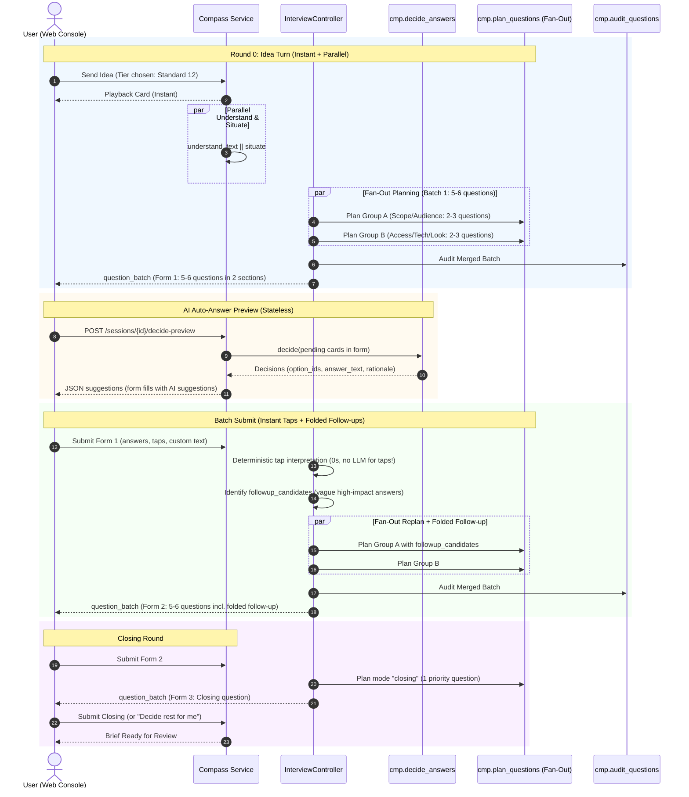
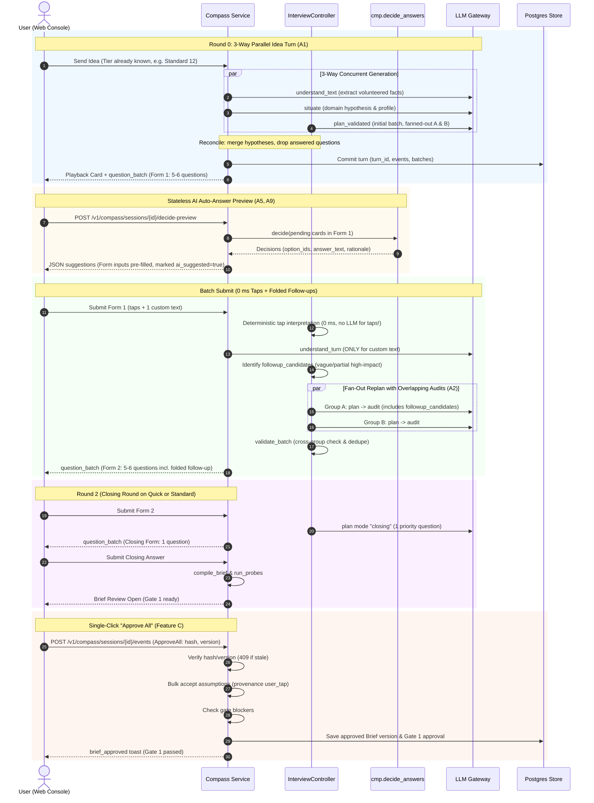
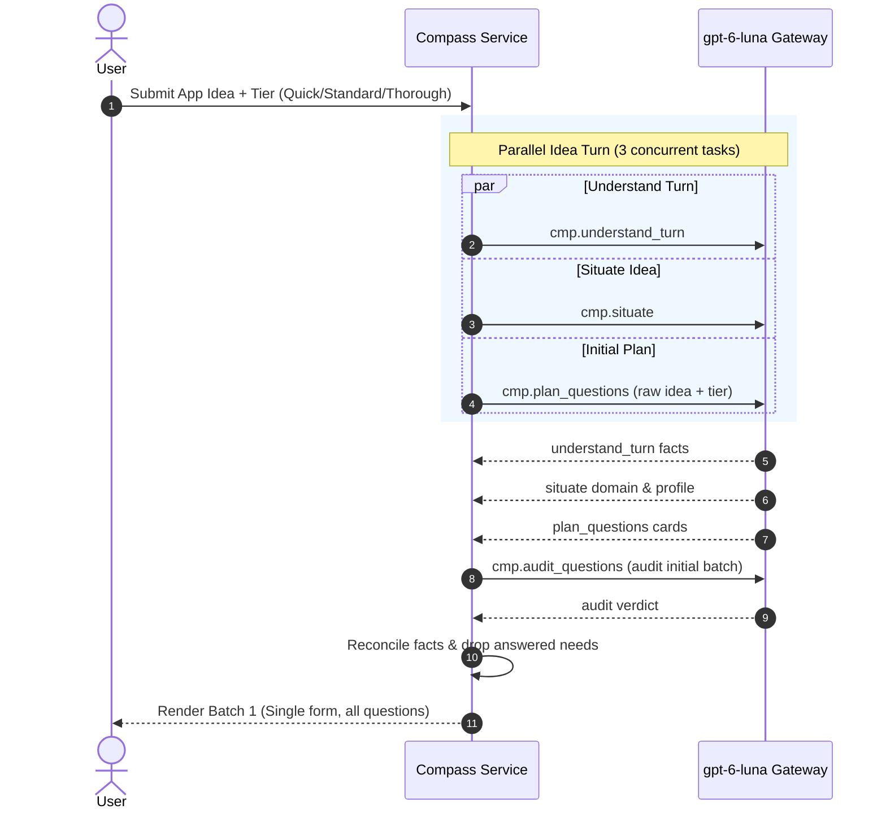

# Session b1c70918

### USER

'~/Desktop/project/men-gen/docs/implementation/COMPASS-STATUS-2026-11-09.md' This is the context for you. You do not need to do anything, just prepare everything. We'll be working on our compass agent.


### CLAUDE

I'll read the status doc and run the resume protocol from CLAUDE.md (git state, PROGRESS, DECISIONS, BRIEF) in parallel.

- `Read: ~/Desktop/project/men-gen/docs/implementation/COMPASS-STATUS-2026-11-09.md`
- `Bash: git log --oneline -20 && echo '--- STATUS ---' && git status --short && echo '--- BRANCH ---' && git branch --show-current && git worktree l`
- `Bash: wc -l docs/implementation/BRIEF.md docs/product/context-engine-spec.md docs/implementation/PROGRESS.md docs/implementation/DECISIONS.md docs`
- `Read: ~/Desktop/project/men-gen/docs/implementation/HANDOFF-compass-ai-interview.md`
- `Read: ~/Desktop/project/men-gen/docs/implementation/PROGRESS.md`
- `Read: ~/Desktop/project/men-gen/docs/implementation/GLOBAL_RULES.md`
- `Bash: git diff --stat && echo '--- wt-fix-facts ---' && git -C ../wt-fix-facts status --short | head -20 && git -C ../wt-fix-facts log --oneline m`
- `Bash: git diff`
- `Bash: echo '=== fix-facts committed (95d1a45) ===' && git show --stat --format='%h %s%n%n%b' 95d1a45 | head -40 && echo && echo '=== fix-facts unc`
- `Read: ~/Desktop/project/men-gen/docs/implementation/DECISIONS.md`
- `Bash: export PATH="$HOME/Library/Python/3.9/bin:$HOME/.local/bin:$PATH" && which uv just 2>&1; uv --version 2>&1; (uv run --offline mde doctor 2>&`
- `Bash: grep -rIl "compass-ai-interview-followup" --include='*' . 2>/dev/null | grep -v '^./.git/' | grep -v node_modules | grep -v '.venv' | head;`
- `Bash: grep -n 'D-09[0-9]\|D-10[0-9]' docs/implementation/DECISIONS.md | cut -c1-160`
- `Bash: ls docs/compass docs/compass/build-prompts docs/compass/evidence 2>&1; echo '---'; ls docs/adr | tail -5; echo '--- web console agents ---';`
- `Bash: git tag -n20 pre/compass-ai-interview-followup-20261109-2019; echo '--- commit dates ---'; git log -8 --format='%h %ad %s' --date=format:'%m`
- `ListAgents:`
- `Read: ~/Desktop/project/men-gen/docs/implementation/DECISIONS.md`
- `Bash: git -C ../wt-fix-facts diff`
- `Bash: cd ~/Desktop/project/men-gen/agents/compass/src/mde_compass && echo '--- symbols the uncommitted diff relies on ---' && grep -n '`
- `Bash: cd ~/Desktop/project/men-gen && export PATH="$HOME/Library/Python/3.9/bin:$HOME/.local/bin:$PATH" && echo '--- wt-fix-facts: does`

### CLAUDE

The suite stopped at the first failure because I passed `-x`: `SB-DC-02-planner`. I'll rerun without `-x` and filter the log noise to get the full failure list, then look at that scenario's error.

- `Bash: export PATH="$HOME/Library/Python/3.9/bin:$HOME/.local/bin:$PATH" && uv run --offline pytest agents/compass apps/web/tests -q -p no:logging`
- `Bash: sed -n '1,40p' agents/compass/tests/scenarios/data/SB-DC-02.yaml | cut -c1-220`
- `Bash: export PATH="$HOME/Library/Python/3.9/bin:$HOME/.local/bin:$PATH" && uv run --offline pytest "agents/compass/tests/scenarios/test_scenarios.`
- `Bash: echo '=== BRIEF.md headings ===' && grep -n '^## ' docs/implementation/BRIEF.md | cut -c1-100 && echo && echo '=== context-engine-spec.md he`
- `Bash: echo '=== strict xfails in python tests (id: reason head) ===' && grep -rn 'xfail' agents/compass/tests --include='*.py' | grep -o '\(BUG\|G`
- `Bash: git status --short && echo '--- (same 5 files as at session start if unchanged) ---' && git -C ../wt-fix-facts status --short && git -C ../w`

### CLAUDE

I've read the Compass status doc, the handoff, PROGRESS, GLOBAL_RULES, D-090 to D-105 and ADR 0015, and checked git and the environment. I changed nothing; the working trees are as I found them. For BRIEF.md and the product spec I only skimmed the headings, because the Compass work is governed by doc 11 §17 and ADR 0015. I'll read the relevant sections when a task needs them.

## What the status doc doesn't say

A follow-up session ran after it was written. It started at 20:19 (tag `pre/compass-ai-interview-followup-20261109-2019`) and stopped at about 20:29; it's now 21:07. It left three streams with **uncommitted or unmerged work**, and nothing is merged into `feat/compass-ai-interview`. The follow-up prompt isn't in the repo, so I inferred what each stream is for from its diff.

| Stream | State | What it does |
|---|---|---|
| Main checkout (5 files, uncommitted) | Edits only | Fixes BUG-27 (an open question is shown again after a side message). Also assumes visible defaults when the interview stops, which probably targets the failing design probe. Adds a notice for an assumption already settled by another answer. Converts tapped option labels to codes. |
| `../wt-fix-facts` | 1 commit, plus uncommitted edits | `95d1a45` fixes BUG-28 (an app that merely contains games is no longer declined). The uncommitted part is BUG-22 (a second contributor's conflicting value should mark the slot disputed). It's half done: `with_contributor` is defined but nothing calls it. |
| `../wt-fix-pipeline` | 1 commit, plus uncommitted edits | `4883872` fixes GAP-5 (the planner's priority now survives onto the card, so batches are cut by importance). The uncommitted mock-planner change targets GAP-1 (the mock re-proposing needs it already asked). |

- **Possible conflict:** both fix-branch commits touch `question_validators.py`, so merging them may conflict.
- **Branch state:** `feat/compass-ai-interview` is 102 commits ahead of `main`, unpushed, as the owner chose.

## Test state

I ran the offline suite on the main checkout with its uncommitted edits: **2602 passed, 1 failed, 3 skipped, 13 xfailed, in 56 s.** I did not run the two worktrees.

The one failure is `SB-DC-02-planner`, a strict XPASS, not a regression. The uncommitted work incidentally fixes that scenario, so its BUG-19 pin is stale; deleting the two `planner_known_issue*` lines in `SB-DC-02.yaml` clears it. BUG-19 is still open, since the persona budget test still xfails.

## Environment

- **Mode:** mock. `[live-mode rule phrase]` is unset, so no live call is possible, and I'll ask before any live call. I did not read `.env`; `mde doctor` only reports that the key is present.
- **Postgres:** down on port 54329. Offline tests don't need it; integration and e2e do (`just db-up`).
- **PATH:** `uv` and `just` need `export PATH="$HOME/Library/Python/3.9/bin:$HOME/.local/bin:$PATH"`.
- **Live spend:** about USD 0.55 of the USD 3.00 Compass ceiling.
- **Other session:** the peer session, `mobile-design-engine-e3`, is idle, and I assume it's a different project.

## What's still open

- **Pinned, with the fix unmerged or unfinished:** BUG-19 (`SB-DC-02`), BUG-21 (`SB-IN-12`), BUG-22 (`SB-IV-07`, in progress), BUG-23 (`SB-IV-09`), BUG-28 (`SB-QP-21`, fixed on the unmerged `fix-facts` branch), GAP-2 (`SB-QP-06`, stale scenario), GAP-3 (`SB-QP-07-b`) and GAP-7 (`SB-QP-17-b`).
- **Open items from the status doc with no work yet:**
  - the degraded design probe
  - Locked slots after a pivot
  - repeated questions
  - contradiction detection
  - the first batch taking about 35 s against the 10 s target
  - re-running live batch F
  - Phase 8 (delete the legacy path, `just ci-fast`, final report, merge)

I'm ready to continue. The natural order is to drop the stale pin and commit the main-checkout work, finish `fix-facts` and `fix-pipeline`, then merge them in and check the `question_validators.py` overlap. Tell me what you want to work on first, and whether you'll enable the live key if you want live batches.


### USER

<pasted_content id="8041">
Your task is to work on the Compass. That is our discovery agent, the Compass agent.
The issue I'm pointing out is that when I tested it I found issues:
1. The final brief is not detailed. Make sure it is focused. It should be detailed and correct, logically correct, because what it gives will be a source of truth for the downstream agents. The downstream agent will take it as input so we have to make it correct and as detailed as possible so nothing we get from the user gets missed. Even if the user is polluting it and not giving us correct input, we can do stuff. With the user's approval we can go for the stuff so go ahead.
2. The questions are not asked too much but not in a user-friendly way. For example when I enter my idea, it generates a question and takes too much time to generate the question plus its options. When I enter the app idea for XYZ app, it generates a batch of 3 questions. When I enter my idea, one batch is generated and that batch has 3 questions. When I ask an answer to the first question, it generates 3 different questions. It should wait for that. I should answer the 3 questions and submit and then it should process and generate the new question based on the input I have, the question I've answered, and the input I've provided. That is the thing.
3. We will have 3 categories as you already have. We'll be asking 7, 12, and above 25 questions. The 3 categories will be like that for the user. First the user has to choose how many questions he wants to ask. After the user enters his idea we can ask him directly and then we can take the user's idea. Based on that we can generate the question. For the 7-category questions the maximum we can ask is 10 questions. In any way even with follow-up and even if the user is hallucinating, we need to wind up and such things like that.
4. The last question will be a priority. Suppose 7 is the normal one. If the user is giving a hallucinated question, not giving the correct answer, not hallucinating us, or complicating things, suppose we can go for 7, 8, and 9. The 10th question should be the detailed one so it can give us the idea of what the user finally wants. It should be detailed, it should be the last question, and the question should be correct. With the options that will help us
5. The question was not asked in a user-friendly way. For example the user can select multiple options for one question, for example, 3 options, 1 input. The user can select multiple options. Plus for example, if we are asking for a feature, let me tell a scenario where it was failing. Do not hardcode it. For example when it was asking for the feature, it gave me the option in the MCQ to select only one feature but what if I want to get all the features? That is the thing and also the custom input. We need to work on that issue. You need to observe the edge cases, issues, and all those factors.
6. A major issue I find is that it takes too much time to generate the question plus options in a beautiful manner. You need to optimize that. It should have faster generation, be logically correct, and have a reasonable realistic question. Have a depthful understanding but be as fast as possible. Go ahead and optimize it.
7. Otherwise all the behavior, character, and detail in the final brief it creates should be detailed because it should have a logical realistic character and be logically correct. It will be the source of truth for the downstream engine.
8. We cannot ask many questions to the user. You need to think of all this as major. As far as auto answer is concerned, you have already added it but there will be one section where the user doesn't want to answer it and wants us to answer it for him. It will give an auto answer for all questions or a specific question. Think on all the edge cases. I've just pointed out some of the issues and edge cases. You need to optimize in all manners. Go ahead and do it.
</pasted_content id="8041">

 

<pasted_content id="8041">
Remember to also optimize for a company enterprise use case. When the enterprise (for example Accenture, TCS, or a service-based company, etc.) comes onto the application, it will be like there also for a normal user. That is the thing.

How it will be scraping the data is if they provide us with such a detailed PDF, a detailed file, and every kind of thing. You need to optimize it. How are we going to generate that question then? How are we going to optimize it? Remember that.

Also the user changes. You need to optimize that part also but it was working correctly so go ahead and optimize it. The frontend you need to be optimizing again. It is correct but you need to optimize and make it work correctly so go ahead. 
</pasted_content id="8041">


### CLAUDE

Plan mode is on, so I'll explore read-only and write only the plan file. I'm splitting the exploration into three parallel areas: the interview flow and budgets, question types, the UI and latency, and the Brief compile plus enterprise and documents.

- `Agent: Trace interview flow and budgets`
- `Agent: Map question types, UI, latency`
- `Agent: Map Brief compile and enterprise docs`

### CLAUDE

The three exploration agents are running in the background: interview flow and budgets, question types plus the UI and latency, and Brief compile plus enterprise and documents. I'll wait for their reports before designing anything. I can't predict what they'll find.


### USER

One thing I want to add is do not much worry about the cost and all. We will optimize it later, but let me put a cap is max is $3. But do not much worry about the cost and do not put any kind of limit related to it. Fast. Responses.


### CLAUDE

Understood. I'll plan with these constraints:

- **Cost is not a design constraint.** Speculative planning, parallel calls and a faster model route are all allowed. I'll drop cost-saving tricks like skipping the repair round, and I won't trade quality for tokens.
- **The $3 hard cap stays.** It's the Compass ceiling from D-093, which stops at 2.85 as a safety margin. About USD 0.55 is already spent, so roughly 2.4 remains for live testing. I won't add any other cost limits.
- **Speed comes first.** That covers the first batch, every follow-up turn and the UI. Where cost and speed conflict, speed wins.

The three exploration agents are still running, so I'll fold these constraints in when I rank the latency levers. I'll also save them to memory once plan mode ends, since I can't write memory files while it's on.


### USER

<task-notification>
<task-id>a0addf6e77644aa4a</task-id>
<tool-use-id>toolu_01VRTkXV8TNJ2kA2hRTdReWC</tool-use-id>
<output-file>/private/tmp/claude-502/-Users-coder-Desktop-project-men-gen/b1c70918-007b-426a-a4d3-6fd76d81c6be/tasks/a0addf6e77644aa4a.output</output-file>
<status>completed</status>
<summary>Agent "Trace interview flow and budgets" finished</summary>
<note>A task-notification fires each time this agent stops with no live background children of its own. The user can send it another message and resume it, so the same task-id may notify more than once.</note>
<result>Report on the Compass interview flow. I read the working tree and ran no code, so the "what fires in practice" points come from reading. Paths are under `agents/compass/src/mde_compass/` (`pkg`) unless noted. The apps/web UI is `apps/web/console/agents/compass/` (compass.js, interview.js, compass.html).

## Flow, first message to Brief review
1. `Service.create_session` (pkg/engine/service.py:351-407) opens in WELCOME with welcome card Q-001. The UI adds optional Quick/Standard/Thorough chips under the welcome buttons (compass.js:1923-1931) and again on the playback card while no batch exists (compass.js:915). A chip sends `budget_*` → `_on_command` (service.py:1866) → `set_budget` (interview.py:1232), which stores `DiscoveryPlan.interview_budget` (domain/situation.py:54). The tier is never forced. It comes before the idea only if clicked.
2. Idea message: `_on_user_message` (service.py:757) → `_first_understanding` (924-983). It keeps a pre-chosen budget (943-949) and emits the playback card.
3. `_advance` (993) → `next_question` (interview.py:476) finds no batches and schedules the internal `prepare_questions` turn (487-494). `handle_event` chains it (service.py:429-467).
4. `prepare` (interview.py:444) calls `plan("initial")` → `plan_validated` (engine/question_pipeline.py: plan, audit, repair only if too few survive). It then emits `QuestionBatch` (383) and `show_next` (410).
5. Card answer: `_on_card_answer` (service.py:1516) → `on_answers` (interview.py:756). That runs `_interpret` (619), `ingest` (675), a `picked_up` notice, `_follow_ups` (836), then `_advance`.
6. `next_question` runs `_drop_answered` (465) and `show_next`. When nothing is waiting it runs `_after_batch` (503): `refresh_summary`, `stop_decision`, then `plan("replan")`.
7. On "done" (service.py:1002-1007): `_derive_subcategory`, `_assume_defaults` (new, 1053), `_assume_required` (1067), then `_seed` (1377), `_probe` (1397, gap card via `ask_gap`, interview.py:1124), and `_open_review` (1484, `compile_ledger`).

## Numbers and where they live
- **Tier budgets** (`InterviewPolicy`, config.py:104-106): quick 5, standard 12, thorough 25, "follow-ups included".
- **Batch size** (config.py:108-110): Quick (4,5), Standard (5,7), Thorough (6,8). This applies to every batch, clipped to the remaining budget (interview_policy.py:186, interview.py:222-231).
- **Follow-up and stop settings** (config.py:112-119): groups (2,3), per group (3,4), follow-up depth 2, follow-up share 0.4, fatigue streak 2, `marginal_new_facts_min` 1.
- **Default tier** with no chip click (`budget_name`, interview.py:120-129): `just_build` gives quick, enterprise gives thorough, otherwise standard (12).
- **Legacy numbers.** The owner's "7 / max 10" matches only legacy `QuestionPolicy` (config.py:74-77: express 5, standard_target 7, hard_cap 10). Those feed `DiscoveryPlan.question_budget` (service.py:938-942) and `_ask_cap` (1024), not the planner stop. `BudgetPolicy` (config.py:200) is the USD live-test cap and unrelated.
- **UI hint strings.** The "about 5/12/25" strings are in compass.js:124-126 and en.json:221-223.
- **No hard cap.** The budget is checked only at batch end (`stop_decision`, interview_policy.py:151: user_enough, then fatigue, then budget_reached, then coverage_reached).
- **Why BUG-19 happens.**
  - `asked_count` (interview_state.py:99) ignores open questions, so `remaining` (interview.py:221) ignores batch questions still waiting.
  - A follow-up planned mid-batch is therefore not charged.
  - `ask_gap` asks for exactly 1 and may exceed the budget (interview.py:222, 1131).
  - `ask_more` forces thorough and deepen can exceed it (229-231).
  - Pinned by `PLANNER_GOALS` in tests/scenarios/test_personas.py (Quick 6/5, Standard 13-16/12, Thorough 27/25) and by SB-DC-02 `planner_known_issue`.
- **Coverage stop almost never fires.** `new_facts` counts only this turn's facts (interview.py:508), and taps always add facts.
- **`said_enough` is dead code.** `_after_batch(said_enough=...)` is never passed True. The real "that's enough" path is the router.
- **"That's enough" / "use defaults"** (phrases.yaml:9) → `_finish_with_defaults` (service.py:1887) → `interview.finish` (535).
- **Follow-up rules** (`followup_decision`, interview_policy.py:49-83):
  - Blocking flags (off_topic, unsafe, declined_category, pivot, contradiction) get no follow-up.
  - A satisfied need or a specific answer gets none.
  - Impact below 4 gets none.
  - One follow-up per need, then `assume`.
  - Depth 2 gives `assume`.
  - Cap is `ceil(0.4 * base)`.
  - `assume` calls `_assume_need` (service.py:1112), a visible chip plus "We assumed".
- **Off-topic and hallucinated answers.** Off-topic is answered by `answerer` and the pending card is reshown (service.py:852-856). The uncommitted `reshow_pending` (service.py:277/888, interview.py:427-441/481) is the BUG-27 fix. Hallucination has no check: quotes are only flagged `unverified_quote` (interview_support.py `build_fact`).

## Answers
**(1) Per-card behaviour and batch submit**
- **Default mode:** `one_at_a_time`, unless `situation_profile.expertise` is technical or product, which gives `answer_all` (interview.py:134-141). The UI default is also one-at-a-time (compass.js:184), with a toggle button (compass.html:36, compass.js:816).
- **What the UI does:** `QuestionBatch` carries all cards, but only the first `CardEvent` is shown. A tap sends `card_answer` immediately (compass.js:347-355).
- **Calls per card:** `understand_turn` (skipped for registry or option-writes shortcuts, interview.py:558-617), `_follow_ups` (up to 2 plan+audit), and `_advance`. `update_summary` runs only at batch end and only when the ledger is large (interview.py:507, 1154). There is no replan per card.
- **Why new questions appear after answer 1** (three paths):
  - **`_drop_answered` (465-474).** The answer prompt lists up to 16 other open needs (641-644). Confident quoted side-updates close those needs (interview_support.py:223-260). The rest of the batch is then dropped and `_after_batch` replans a fresh batch. SB-QP-04 pins this as intended (BUG-26).
  - **Follow-up first.** A follow-up is inserted before the rest of the batch (show_next sort 415, `_follow_ups` 868-893).
  - **Gap card.** A post-interview gap card can trigger `_after_batch` and a replan if the budget is not yet reached.
- **A batch-level submit already exists.** `BatchAnswer` (domain/events.py:58-70, max 12; its `batch_id` is ignored) → `_on_batch_answer` (service.py:1655) → one `on_answers` (parallel understand, concurrency 4, config.py:146) → `_follow_ups` → `_advance`. The UI form and its "Send all answers" button are `renderBatchForm` (compass.js:714-764) and `buildAnswers` (interview.js:182). `_relayout` (interview.py:1189) re-sends a batch when the layout switches. It is not the default.

**(2) Tier choice** (see numbers above)
- **Closest to the owner's tiers:** the chips, which are optional and UI-only. Exactly 7 / 12 / 25+ with a hard max 10 does not exist.

**(3) Closing question**
- **Nothing exists.** A grep for closing, last or final logic finds none.
- **What exists:**
  - Need `scope.priority` (slots.yaml:792: should, impact 4, type `priority`).
  - Legacy frame 08_priorities.yaml and `flows/priorities.py`, reached only through `_ask_next` hooks (SB-DC-02).
  - `goals.primary` and `goals.success_measures`.
  - `expert_gap_obligations` (needs.py:231), which is unordered.
  - Prompt text only in plan_questions/system.jinja.
- **Handoff-gap card:** it comes after the interview, is 1 card, is not reserved, and can exceed the budget.

**(4) Auto-answer**
- **Per question:** "You decide" button/toggle (compass.js:692-696, 780-786) → `_on_you_decide` (service.py:1686) → `_assume_for` (interview.py:825).
- **Typed phrases:** they apply to the pending card only (service.py:1822-1828).
- **Quality is weak.** `you_decide_writes` (cards.py:676) picks the recommended option but writes only `option.sets`. Planner options carry no `sets` (calls/plan_questions/adapter.py:112-123), so nothing is written. The fallback `_assume_slot` (service.py:1077) uses the catalog default (10 slots), then the hypothesis, then the first registry option. `domain:*` needs get nothing. The planner's recommended option and the model are never used, and `skip_assumes` (schema.py:98) is never read.
- **All remaining:** only typed phrases or the `finish_with_defaults` command. There is no UI button, because compass.js:34 omits that command. The path skips `_assume_defaults` (should-level) and calls only `_assume_required` (service.py:1894).
- **Strings:** `section.assumed` "We assumed" (en.json:52), `card.assumed_collapsed` (41), `notice.finish_defaults` (128).

## What would have to change
- **Batch-submit-then-process:**
  - Make `answer_all` the default in `ui_mode` (interview.py:134) and in compass.js:184/931.
  - Stop immediate tap-submit in the one-at-a-time card and in the `answer()` path (compass.js:347).
  - Add a `batch_id` check in `_on_batch_answer` (service.py:1655).
  - Rework `_drop_answered` and the 16-need `_interpret` (interview.py:641) so a batch is never emptied mid-form.
  - Rework the follow-up insertion in `_follow_ups` and `show_next` (interview.py:415, 836).
- **7(10)/12/25+ tiers with a reserved final question:**
  - `InterviewPolicy` and `BudgetName` (config.py:96, interview.py:74).
  - `budget_name`, `_request`, `batch_size_range`, `stop_decision`, and `asked_count` (open/waiting and follow-ups charged).
  - `_follow_ups`, `ask_gap`, and `ask_more`.
  - Force the tier choice before the first batch (UI chips, `set_budget`, `_first_understanding`, `_on_welcome`).
  - A new "closing" planner mode: `PlannerMode` (domain/interview.py), `PlanRequest` (engine/ports.py), plan_questions system.jinja/user.jinja/schema.
  - `next_question` and `_after_batch` to fire it last.
  - Validators for `priority` options (question_validators.py:449-460).
- **Per-question and all-remaining auto-answer:**
  - `_assume_for` and `you_decide_writes` (use the recommended option; add a model-based answer).
  - Planner `_card` (`sets` or `assumes`).
  - `_assume_slot`.
  - `_finish_with_defaults` (call `_assume_defaults`) and `route`/`phrases.yaml`.
  - A UI "decide the rest" button and its command allowlist (compass.js:34).
  - Planner-card handling in `_on_route` for `you_decide` under `answer_all`.

## Tests that pin current behaviour
- **tests/engine/test_interview_flow.py:**
  - `test_skip_and_you_decide_move_on_and_are_recorded` (147).
  - `test_answer_all_mode_shows_the_whole_batch_and_one_event_answers_it` (163).
  - `test_switching_the_layout_mid_batch_...` (190), which pins that after one tap the next batch card shows.
  - `test_finish_with_defaults_and_thats_enough_...` (225).
  - The "I don't understand / don't know" tests (~548 on).
- **tests/engine/test_interview_policy.py:** lines 120, 289-305 (budget and batch numbers).
- **tests/domain/test_interview_models.py:201:** budgets `[5, 12, 25]`.
- **tests/engine/test_cards.py:463-472:** `you_decide`.
- **Scenarios** (tests/scenarios/data):
  - SB-QP-04 (drop on a long answer) and SB-QP-05 (one follow-up, total 3).
  - SB-QP-15 (skips, fatigue) and SB-QP-19 (budget_quick, stop_reason budget).
  - SB-QP-12-b (BUG-27 pin removed in the working tree).
  - SB-EXPRESS-01 (at most 5).
  - SB-DC-02 (priority, BUG-19) and SB-QP-06 (GAP-2).
  - tests/scenarios/test_personas.py `PLANNER_GOALS`.</result>
<usage><subagent_tokens>227539</subagent_tokens><tool_uses>62</tool_uses><duration_ms>296238</duration_ms></usage>
</task-notification>


### CLAUDE

The interview-flow agent is back; the question-cards/UI/latency agent and the Brief/enterprise agent are still running. I'm holding the design until all three are in, since the three areas interact: batch submit, the tier budget and the closing question all touch the same code.

From the first report, these are the facts that most shape the plan:
- **Batch submit already exists.** `BatchAnswer` → `_on_batch_answer` and the UI's "Send all answers" form are built. They aren't the default, because the UI shows one question at a time and sends each tap immediately.
- **Why new questions appear after answer 1.** The planner can close other open needs from a single answer, which drops the rest of the batch and replans. Follow-ups are also inserted before the remaining questions.
- **The tiers are wrong.** They're 5 / 12 / 25 with no hard cap. The 7 / max 10 numbers only exist in the legacy `QuestionPolicy`, and the budget is only checked at the end of a batch.
- **Nothing reserves a closing question.** A handoff-gap card exists, but it comes after the interview and can exceed the budget.
- **Auto-answer is weak.** "You decide" on a planner card writes nothing, because planner options carry no `sets`. There is also no "decide the rest" button.


### USER

<task-notification>
<task-id>a81e09ecf1145cb1c</task-id>
<tool-use-id>toolu_01GSNPmHWtDZ7omKNMfJwHhW</tool-use-id>
<output-file>/private/tmp/claude-502/-Users-coder-Desktop-project-men-gen/b1c70918-007b-426a-a4d3-6fd76d81c6be/tasks/a81e09ecf1145cb1c.output</output-file>
<status>completed</status>
<summary>Agent "Map Brief compile and enterprise docs" finished</summary>
<note>A task-notification fires each time this agent stops with no live background children of its own. The user can send it another message and resume it, so the same task-id may notify more than once.</note>
<result># Compass Brief compile and enterprise/document handling: findings

Everything below is from reading the working tree. I did not run anything live. Paths are under `agents/compass/src/mde_compass/` (shortened to `mc/`) unless they start with `packages/`.

## (a) Brief shape, compile path, where detail is lost

**Two Brief models exist.**
- `mde_contracts.Brief` (`packages/contracts/src/mde_contracts/brief.py:41`) is the thin legacy Gate-1 view. It holds `app_summary`, six fixed `rows` and `assumptions`.
- Compass uses its own `mc/domain/brief.py:218`. ADR 0012 says "own domain, no contract edits".
- `packages/spec-builder` and `packages/research` read only the contracts Brief plus 27 contract `SlotId`s (`plan_view.py:14`, `research/context.py:112`, `spec-builder/context.py:86`).
- I found no code that converts the Compass Brief into those. The only exit is `HandoffPort` with four views (`service.py:2455`, `views/consumers.py:231`).

**Compass Brief fields.**
- Seven dict sections hold `BriefItem`s: idea, context, audience, experience, access, data, constraints.
- Typed list sections are apps, roles, scope (features), references, integrations, glossary, `domain_facts`, assumptions, open_questions, research_requests, assets, sources and declined (`domain/brief.py:24-45`).
- There are also `summary` and `pitch`, `meta`, `readiness`, and `meta.interview`, which is outside the hash.
- Only `domain_facts` is optional and read-only (`:48-50`).

**What is fixed by the catalog.**
- The catalog has 44 slots, 18 of which are `must`, and most are enums.
- There is no slot, record or section for screens, flows, data entities, rules and numbers, compliance, or NFR beyond three enums (offline, performance, accessibility).
- `FeatureRecord` has no acceptance criteria. Its `size` and `capability_tier` stay at defaults.
- `RoleRecord` has only goal and permissions.

**Compile path.**
- `_open_review` (`service.py:1484-1493`) runs `compile_ledger` and then `compile_text`.
- `compile_ledger` (`interview_compile.py:133`) calls `compile_brief` with the full ledger. The model returns slot items, placements (`fact_id`, `topic`, `consumers` only, no statement; `calls/compile_brief/schema.py:59-84`), `not_used`, a summary and a pitch.
- Code builds `domain_facts` by copying each fact's own statement (`:103`).
- `compile_text` then overwrites summary and pitch. It reads slot values only (`brief_text.py:56`), so feature names without intents. Limits are 160 / 400 / 240 characters (`calls/compile_text/schema.py:7-10`).

**Where detail is thin or lost.**
1. **Compile never extends list slots.** Items are written only into EMPTY slots (`interview_compile.py:181`). If features, roles or apps were partly tapped, every other feature or role the user mentioned stays only as a flat `domain_facts` sentence. Those rows carry no intent, no priority and no link to a role or app.
2. **Coverage means "listed", not "used".** The adapter places any fact the model forgot (`calls/compile_brief/adapter.py:194-199`). The engine counts those as placed, so `coverage` is effectively always 1.0. The `facts_unreferenced` counter is therefore nearly vacuous.
3. **Disputed and superseded facts leave the Brief.** `active_facts()` keeps only active facts (`interview_state.py:56`). The content of a dispute survives only in slot history.
4. **Output cap against chunk threshold.**
   - `compile_brief` is `low / 8000 output tokens / 150 s` (`config.py:64`).
   - Chunking at 120 facts starts only above a 60,000-token input ceiling (`config.py:169-172`), which is roughly 700 or more facts.
   - About 150 placements fit in 8000 tokens (the config comment's own figure). So ledgers of roughly 150 to 700 facts likely overflow into the flagged floor. The floor places every fact under its tag topic with consumers `all` and produces no items (`calls/compile_brief/fallback.py:19`). This is inferred from the code, not measured.
5. **Digest budgets.** The planner digest is 4500 tokens, about 18k characters (`config.py:162`), and `understand_turn` sees one third of that, about 50 facts (`interview.py:645`). Contradiction detection against a long ledger is therefore partly blind.
6. **Consumers.**
   - `_facts` returns only facts tagged for a consumer or `all` (`views/consumers.py:116`). The catalog `Consumer` literal has 10 values (`catalog/loader.py:63-74`), but only four views exist.
   - A fact routed only to frontend, backend, qa, screens or change_control therefore reaches no view.
   - The org slots (`org.*`) appear in none of the four views.
7. **Domain facts are invisible to the dry runs.** The probes, scan_ambiguity, seed_research and compile_text never read `domain_facts`. Research seeding therefore ignores rules, numbers and compliance facts.
8. **Gate 1 display.** `domain_facts` appear in the "details" section as read-only rows (`views/build.py:322-336`, `:452`). They are not editable from the Brief; the user must go back through Q&amp;A.
9. **No detail test.** No test or eval pins the amount of structured detail. The checks only verify that a "needle" fact appears somewhere in the Brief (`live_batches.py:1326`, `tests/engine/test_interview_flow.py:291`).

## (b) Bad input

- **Contradictions.**
  - Newest wins silently. `ingest` supersedes the old fact when the model lists it in `contradicts` (`interview.py:734-752`). No question is asked and no assumption is recorded.
  - The `contradiction` flag suppresses follow-ups because it is "handled by its own path" (`interview_policy.py:34`), but that path is the GAP-3 gap: there is no either/or card.
  - BUG-22 is narrower. Only a second contributor's conflict is affected, because projection passes no contributor, so the slot store's `_conflict` (`engine/slots.py:~230`) never fires (`tests/scenarios/data/SB-IV-07.yaml`, pinned).
- **Unrealistic or hallucinated claims.** I found no feasibility or plausibility check. Only the lexicon-based safety screen, `capabilities.yaml` tier-B notices and `validate_brief` (tier C cannot be `in`) apply.
- **Vague answers.** One follow-up is allowed, then a visible assumption. The "We assumed" list is built only from slots (`engine/assumptions.py`). There is no free-form "we corrected X" assumption.
- **Ambiguity at Gate 1.** `scan_ambiguity` reads slot values only, and at most 3 findings become open questions (`service.py:1470`).
- **Injection.** Screening and "never follow instructions" prompt text are in place.
- **Why probes degrade.**
  - Probes run before compile, so they see only slots and records (`service.py:1013-1020`; digest in `calls/probe_handoff/adapter.py:25-62`).
  - The design probe needs tone words or brand signals. `look.tone_words` is a `should` need, so it is often never asked. The blueprint probe needs an intent for every feature plus at least 3 screens and a journey, derived from a "weak planner" using the digest only. The research probe needs 8 complete queries.
  - Each repair round asks only ONE gap (`service.py:1422-1458`, `interview.ask_gap` at `interview.py:1124`), at most 2 questions per need. With `probe_repair_rounds = 2` (`config.py:193`), anything beyond about two missing slots ends in `degraded`.
  - **What `degraded` means:** `gate.py:82` drops the probes blocker, so the user can still approve. A generic warning is shown (`service.py:1419`). Unfixed gaps are not recorded as open questions or assumptions, and the consumer views do not carry the flag.
  - The uncommitted `_assume_defaults` (`service.py:1053`) assumes catalog defaults when the interview stops, which targets the tone gap. It is untested live.
- **Locked after pivot.**
  - `on_pivot` and `on_answer_edit` call `reproject` only for slots that superseded facts have `effects` on.
  - Slots written by the compile (provenance `FCT-ref`, no effects) are invisible to it.
  - That is a plausible cause of the `idea.category` case; I did not confirm it.

## (c) Documents and enterprise

**Pipeline.**
- Parsers cover PDF, DOCX, XLSX, PPTX, CSV, TXT, MD and EML. Limits: 15 MB per file, 10 files, 60 MB per session, 300 pages, 5 URLs (`config.py:177-188`).
- Pasted text over 3000 characters is treated as a document (`service.py:797`).
- Chunks are 3000-4000 tokens. `read_chunk` is `high / 4000 tokens` with at most 40 statements per chunk and 240-character statements (`calls/read_chunk/system.jinja`, `rules.yaml`). A dense requirement table can silently lose items.
- `merge_claims` labels statements and only lets the model hint 7 slots. Above 300 statements the merge is code-only.
- The whole ingest runs inline in one turn.
- Upload route: `api/routes.py:190`.
- URL reading is SSRF-guarded (`intake/url_reader.py`).

**Claims to facts.**
- `after_ingest` (`interview.py:1083-1122`) keeps only claims with status `used` or `needs_confirming`.
- Resulting facts have `topics=[]`, consumers `["all"]` and a quote cut to 500 characters. They are `supports_locked()`, so even `needs_confirming` ones can be Locked.
- The need aspects come only from `slot_hint:*`, which closes the whole need from one claim.
- Duplicate and conflicting claims never become facts. Conflicts are only counted (`document_flow.py`; `test_document_flow.py` asserts `conflicts == 1`). No question or Gate-1 item surfaces them.

**Direct slot writes.** `document_flow.py:61-119` plus `document_map.yaml` cover 7 statement types.
- Feature name: first 8 words, so mid-sentence cuts (pinned by a test).
- Role name: first 4 words, with no goal.
- Constraints go to `must_use` at 24 words.
- `rule_or_number`, `example` and `preference` have no slot and reach only `domain_facts`.
- Because document facts have empty `topics`, they all land under `general` in the digest and ranking.

**Questions after a document.** "PRD-led" is one prompt sentence (`calls/plan_questions/system.jinja:22`), not code. Budgets are 12 (standard) or 25 (thorough, and the budget used for enterprise: `interview.py:127`). The stop rule needs every `must` need satisfied. Batch G is the only document-led case and used a toy PRD of about 1,800 characters (13 questions against a limit of 8).

**Enterprise.**
- It adds contributors (requester, approver, commenter; `service.py:365`), depth `large`, and the four `org.*` need slots (`slots.yaml:1993-2137`).
- Gate 1 requires an approver's approval of the current hash (`gate.py:108`).
- There is no company-document logic and no per-module compile.

**User changes.**
- Q&amp;A edit (`interview.py:981`) costs one `understand_turn`, a `replan_waiting` (plan plus audit) and, during review, a full re-compile with `compile_text` and `scan_ambiguity`.
- A Brief-panel edit goes through `_apply_change` (`service.py:1915`) and reseeds research plus re-probes the affected consumers. Chat changes add `interpret_change` (high effort, 90 s).
- Panel edits do not write facts, so the ledger and the Brief can drift apart.

## (d) Tests and evals

Existing pins:
- `tests/engine/test_interview_flow.py` (:291 coverage, :349 chunked compile, :395 edit, :452 pivot, :503 mid-interview document)
- `tests/calls/compile_brief/test_adapter.py` (:432 needle, :471 300 facts)
- `tests/engine/test_document_flow.py`
- scenarios SB-QP-02, 17 and 17-b (GAP-7), SB-IV-07 (BUG-22), SB-GATE-05 and 06
- `evals/personas/enterprise.yaml`
- live batches F and G (`live_data/batch_g.yaml:12`, `live_batches.py:1425`)

There is no test of structured detail, none that exercises org slots in the consumer views, and no large-document or RFP eval.

## Files that would change for a richer Brief (candidates only)

- `domain/brief.py`: new optional sections for screens, flows, entities, rules and numbers, compliance, NFR, and richer feature, role and acceptance fields.
- `catalog/slots.yaml` and `catalog/loader.py`.
- `calls/compile_brief/{schema,system.jinja,adapter,validate,fallback}`, with output cap or per-section compile (`CompileRequest.sections` is unused).
- `engine/interview_compile.py`, because of the EMPTY-only rule and coverage semantics.
- `engine/interview.py` (`after_ingest`) and `engine/document_flow.py` plus `document_map.yaml`.
- `calls/read_chunk` and `calls/merge_claims`.
- `engine/brief_builder.py`, `engine/patch.py`, `engine/validate.py`.
- `views/{consumers,build,models}.py`.
- `calls/probe_handoff`, `compile_text`, `scan_ambiguity` and `seed_research` digests.
- `engine/service.py`, `engine/gate.py`, `config.py`.
- The test fixtures listed above.

## Risks

- **Contract freeze.** New Compass sections need no `mde_contracts` edit (ADR 0012). Changing the contracts Brief would be additive only, via the lead and logged in `DECISIONS.md`. Compass's own wire models must stay strict-schema safe (flat, depth 5 or less, no open dicts).
- **Hash.**
  - `brief_hash` (`domain/hashing.py:44-60`) covers all non-volatile fields.
  - New sections must be omitted when empty, like `domain_facts`, to keep the stored fixture `tests/domain/fixtures/brief_before_interview_memory.json` stable.
  - `SECTION_KEYS`, `ID_FIELD_BY_SECTION`, `READ_ONLY_SECTIONS` and the view section lists must stay in sync.
  - Each recompile rewrites `domain_facts` and re-runs the non-cacheable `compile_text` (`calls/compile_text/spec.py:30`). LLM-written content therefore causes hash churn and voids enterprise approvals unless sorted and deterministic.
- **Gateway cap.** The 20,000-character cap on untrusted input means the ledger must stay in pieces (`calls/compile_brief/ledger.py:26`). An oversized table-row chunk could still be truncated.</result>
<usage><subagent_tokens>294492</subagent_tokens><tool_uses>114</tool_uses><duration_ms>420941</duration_ms></usage>
</task-notification>


### CLAUDE

Two of the three reports are in. I'm waiting on the cards/UI/latency agent. Its multi-select and latency findings affect the plan most, so I won't draft until it reports.

The Brief/enterprise report found these main problems:

- **The Brief has no place for most of what a downstream engine needs.**
  - It has no sections for screens, flows, data entities, rules and numbers, compliance or non-functional requirements.
  - Features carry no acceptance criteria, and roles carry only a goal and permissions.
  - Anything the user says beyond the catalog's 44 slots ends up as a flat one-line `domain_fact` sentence.
- **Compile fills only empty slots.** If the user tapped two features and mentioned eight more, the other six never become structured feature rows.
- **The coverage metric overstates completeness.** The adapter places any fact the model forgot, so `coverage` is almost always 1.0.
- **Probes degrade by design.** They run before compile and see only slots. A repair round asks one gap at a time, and after two rounds the Brief is marked "degraded". This is the cause of the degraded Briefs you saw. The unfixed gaps are not recorded anywhere.
- **Bad input is handled thinly.**
  - Contradictions are silently resolved as newest-wins, with no question to the user and nothing recorded.
  - There is no plausibility check.
  - A correction is never shown to the user at Gate 1.
- **Documents lose detail.**
  - Each chunk is capped at 40 statements, so dense requirement tables lose items.
  - Feature names are cut to the first 8 words.
  - Conflicting claims between documents are only counted, never surfaced.
  - Document facts have no topics, so they all land under "general".
- **Several downstream paths ignore `domain_facts`:** research seeding, the probes and `compile_text`.


### USER

<task-notification>
<task-id>a3f04ff3876304cc6</task-id>
<tool-use-id>toolu_012JRfAnAxKue4PVyhaD4CdC</tool-use-id>
<output-file>/private/tmp/claude-502/-Users-coder-Desktop-project-men-gen/b1c70918-007b-426a-a4d3-6fd76d81c6be/tasks/a3f04ff3876304cc6.output</output-file>
<status>completed</status>
<summary>Agent "Map question types, UI, latency" finished</summary>
<note>A task-notification fires each time this agent stops with no live background children of its own. The user can send it another message and resume it, so the same task-id may notify more than once.</note>
<result>Roots used below: `B` = `~/Desktop/project/men-gen/agents/compass/src/mde_compass`, `W` = `~/Desktop/project/men-gen/apps/web/console/agents/compass`, `GW` = `~/Desktop/project/men-gen/packages/llm-gateway/src/mde_llm_gateway`.

## (A) Multi-select and custom input

**Why features became a single-select card**
- The planner prompt only says "about two in three `choose_one` (exactly three alternatives)… `pick_many` for checklists (3 to 8, none ticked)" (`B/calls/plan_questions/system.jinja:15`). Nothing says "if more than one answer can be true, use pick_many".
- `NeedWire.card_type` is computed (`adapter.py:54,65`, `schema.py:38`) but `user.jinja:27` never prints it. The planner is never told `scope.features` is a `pick_many` need.
- `user.jinja:27` does print the registry's labels under "Typical options for a choice", which pushes the planner toward a choice card.
- The auditor has no type-fit criterion (`calls/audit_questions/system.jinja:15`). No validator checks type against question.

**Type and option rules**
- `choose_one` needs exactly 3 options (`engine/question_validators.py:431-438`, `config.py:88`).
- `pick_many` is 2..14 in validators and in `engine/cards.py:52-54`. The adapter silently truncates at 8 (`adapter.py:30,119`), and the prompt says 3..8.
- The adapter drops options on `text`, `quick_form` and `upload_or_link` (`adapter.py:104,120`).
- `custom_input` is always `enabled=True` (`adapter.py:132`). `you_decide.assumes` is the recommended option (`adapter.py:133`).
- There is no "all of these", "none" or "not sure" option in the schema (`schema.py:72`), the prompt or the UI. `ticked` exists on `CardOption` but the planner cannot set it.

**Answer to facts**
- Planner options carry no `sets`, so `_writes_understanding` (`engine/interview.py:591`) never fires.
- `_registry_match` (`interview.py:558`) needs one enum or enum_list slot, no custom text and a label equal to the registry's. That is rare.
- So every tap, multi-select and typed answer costs one `understand_turn` call (about 9 s).
- Multi-select labels and custom text are joined with " | " (`interview.py:544`).
- `tap = bool(labels) and not item.custom_text` (`interview.py:801`). A pick plus custom text is not treated as a tap, so the need is not closed and a follow-up is likely.
- `_words_effect` (`calls/understand_turn/facts.py:258`) is only the offline stand-in. It writes values only for text and text_list slots, so features (object_list) get no slot value offline.

**Edge cases that break today**
1. **Picks plus custom text in the one-at-a-time layout.** This is impossible. The custom-row Send calls `answer(card, null, text)` and drops the ticks (`W/compass.js:442-456`). One-at-a-time is the default for non-technical users (`interview.py:84`). The answer-all form does combine them (`compass.js:642`).
2. **Empty selection.** Continue sends `[]` (`compass.js:491`). The planner path records the question as answered with no content and consumes budget. `_assume_checklist` (`service.py:1578`) is only on the legacy path, which returns earlier (`service.py:1531-1538`).
3. **"All of these".** There is no control for it. A typed "all of them" cannot be resolved, because `AnswerFocus` carries no option list (`engine/ports.py:157`). `ctx.pending_card` is the last card shown (`service.py:663`, `295-301`), which is wrong in answer-all mode.
4. **Planner `quick_form` renders no fields.** The adapter strips its options (`adapter.py:120`). `textFields` loops over `card.options` (`compass.js:517`), so Continue sends `{}`. In the answer-all form there is no input at all (`compass.js:644-651`), and the answer is sent as a skip.
5. **`choose_one` in the form.** The "Something else" radio is exclusive (`compass.js:618`), so no option plus text.
6. **Typed "none of these".** It hits the router and replies "not sure I understood" (`service.py:1829`), with no re-show.
7. **Hindi and Hinglish.**
   - `turn.lang` is only `en` or `hi` (`config.py:256`), so `hi-Latn` never reaches the planner (`system.jinja:12`).
   - `_on_card_answer` does not re-detect language. A Hindi custom answer on an English card keeps the old language.
   - Devanagari quotes verify fine (`engine/quotes.py`).

## (B) Frontend

- **Batch rendering.**
  - `question_batch` and `card` handlers: `compass.js:889-933`.
  - The form is used only when answer_all and at least 2 questions wait (`W/interview.js:93`).
  - `renderBatchForm`: `compass.js:714`. Layout switch: `compass.js:816` and server `_relayout` (`interview.py:1189`).
  - Why-popover: `compass.js:395`. Q&amp;A editor: `compass.js:1455`. MOCK banner: `compass.js:871`. SSE: `compass.js:1043`.
- **Submit behavior.**
  - A card collapses and is marked answered immediately (`compass.js:347`). Double clicks are blocked.
  - `sendEvent` awaits the whole turn. A failed POST leaves no card and no retry (`compass.js:1005`).
  - Every send uses a new `randomId`, and the server has no already-answered guard. A second answer to the same card re-records it and adds duplicate facts.
- **Wait hint.** `TYPING_STEPS` is a fixed 6/18/45/90 s schedule (`compass.js:285`). It is not phase-aware, so on later answer turns it also says "Reading your idea…".
- **Budget chips.** Clicked on the playback card, they queue behind the per-session lock (`service.py:424`) while the first batch plans. They only affect later batches.
- **Missing: submit-all-then-process.** Not implemented. `batch_answer` is capped at 12 and runs one turn.
- **Missing: "decide the rest for me".** The server has `finish_with_defaults` (`service.py:1854`) and phrase routing. No button exists, and it is not in the CONTRACT command list.
- **Missing: question budget.** The line shows "question n of about X" where X is asked plus open, not the budget. The form shows no per-question numbering.
- **Missing: multi-select helpers.** There is no select-all, none, or "type + tick" in the single card.
- **PDF upload (enterprise).**
  - `pickFile` takes a single file with no `accept`, drag-drop or progress (`compass.js:1034`). The 15 MB cap returns 413 only after upload (`B/api/routes.py:197`).
  - It is one long synchronous POST. The deep route allows only 2 concurrent calls, so large PDFs are slow.
  - The wait hint says "Reading your idea…".
  - The answer-all form's `upload_or_link` has only a link field.
- **How the UI is tested.**
  - pytest runs `node -e` against `interview.js` (`apps/web/tests/test_interview_helpers.py`, skipped without node).
  - It runs source-regex checks on `compass.js` (`test_interview_ui.py`, `function_body`) and the CONTRACT block (`test_ui_contract.py`).
  - There is no browser or jsdom.
  - A new card field must be added to the CONTRACT block (`compass.js:1-50`) and the `Card` schema.

## (C) Latency

**Idea turn, strictly sequential**
1. `understand_turn` (`service.py:831`), about 9 s.
2. `situate` (`service.py:928`; high effort, deep route), about 10 s. The playback is committed here.
3. A second chained turn runs `plan_questions` (`engine/question_pipeline.py:187`), about 20 s.
4. `audit_questions` (`question_pipeline.py:127`), about 9 s.
5. A repair round runs only if fewer than `want_min` questions survive (`question_pipeline.py:217`).

`update_summary` is skipped until the ledger exceeds about 2250 tokens (`interview.py:1160`). `seed_research` and `probe_handoff` run after the interview (`service.py:1380-1421`).

**Answer turn**
- One `understand_turn` per answer, in parallel with a cap of 4 (`interview.py:756`, `config.py:146`).
- Then `_follow_ups` runs sequentially (plan plus audit each, up to 2).
- Then either the next card, or `_after_batch` (`interview.py:503`): update_summary if due, replan, audit.
- The last answer of a batch costs understand plus plan plus audit. That is the 40-60 s turn.

**What dominates**
- Model inference, not gateway overhead. The ledger fsync, reservation and log writes are milliseconds.
- There is no streaming (one `responses.create`).
- A `max_output_tokens` truncation triggers an automatic second call (`GW/gateway.py`).
- fast, standard and deep all map to `gpt-6-luna` (`B/config.py:15`, `packages/core/src/mde_core/settings.py:25`). Only `gpt-6-luna` is priced in `GW/pricing.yaml`. Routes change only concurrency (8/4/2) and rpm (`GW/limits.py:14`).
- Plan input is about 5-7k tokens. `PlanInput.needs` carries all 43 needs unbudgeted (about 2.5k tokens, `adapter.py:87`). The clinic fixture output is about 8.3k characters of JSON, about 2.1k tokens, before reasoning.
- By characters of that output: per-question metadata about 30%, options 19%, hypothesis 10%.
- Cost is negligible (USD 0.10 / 0.50 per M tokens), so speculative calls are nearly free.
- Per-call reasoning tokens were not captured. Check `latency_ms` and `tokens_out` in the call log and `agents/compass/evals/reports/live-*.json`.

**Levers, ranked by gain against risk**
1. **Run `understand_turn` and `situate` concurrently.** Situate's input is only user_text, language, mode and families (`calls/situate/adapter.py:41`). Saves about 9-10 s. Low risk.
2. **Start `plan_questions(initial)` at the same time on the raw idea.**
   - The planner already emits the hypothesis, and `_drop_answered` (`interview.py:~480`) removes questions the facts then satisfy.
   - First batch about 29 s, down about 40%.
   - Medium risk: budget and `ui_mode` come from the situate profile (`interview.py:75-91`). Plan for standard, then cut (`question_pipeline.py:276`).
3. **Take the audit off the critical path.** Skip it for follow-up and simplify (one question, validators suffice), drop effort from medium to low (`config.py:62`), or run it after the batch is shown and drop rejected unseen questions. Saves about 9 s. Low to medium risk.
4. **Slim the planner output.** Drop `depends_on`, `skip_assumes`, `followup_hint`, and option description and reason on the first batch. Saves about 5-10 s. Medium risk, because validators and `understand_turn` use `intent`, `serves` and `answer_spec`.
5. **Later turns.**
   - (a) Skip `understand_turn` for taps by letting the planner emit per-option slot values (the engine already supports `sets`). Saves about 9 s per answer.
   - (b) Render the next card optimistically from `state.batch`. This needs the server to accept answers for open questions not yet shown (`service.py:1517`, `_find_question`).
   - (c) Prefetch the next batch (`config.py:260` is unused). High risk, but it removes the 30-60 s batch-boundary wait.
   - (d) Raise `understand_concurrency` from 4 to 8, and the gateway standard route from 4 to 8, for answer-all.
6. **Two-stage first batch** (questions first, options fanned out per question). High risk, since validators work on the whole batch.
7. **"Instant" first card.** Only deterministic content is possible (an echo of the idea plus depth and language chips, in a chained internal turn like `interview.py:92`). A project-specific question cannot be canned without becoming a fallback. It improves perceived latency, and it also fixes the budget-chip timing.

## Files that would change
- **Planner and validators:** `B/calls/plan_questions/{system.jinja,user.jinja,schema.py,adapter.py,mock.py,examples/*.json}`, `B/engine/question_validators.py`, `B/config.py`, `B/calls/audit_questions/system.jinja`.
- **Answer reading:** `B/engine/interview.py`, `B/engine/ports.py` (`AnswerFocus` plus options), `B/calls/understand_turn/{system.jinja,adapter.py,facts.py}`.
- **Card contract:** `B/domain/cards.py`, `B/engine/cards.py`, `B/engine/service.py` (first-turn gather, card-answer guard), `B/engine/question_pipeline.py`.
- **Strings:** `B/catalog/strings/{en,hi}.json`.
- **Frontend:** `W/compass.js`, `W/interview.js`, `W/compass.css`.

## Tests that pin current behavior
- **Validators and cards:**
  - `agents/compass/tests/engine/test_question_validators.py:259-280` (exactly 3 options, pick_many ≥2).
  - `engine/test_cards.py`.
- **Pipeline and flow:**
  - `engine/test_question_pipeline.py:119,155,192,210` (one audit, one repair).
  - `engine/test_interview_flow.py:61` (playback before batch before card), `:257` (round-0 idempotent).
  - `calls/plan_questions/test_plan_questions.py:70,155`.
  - `scenarios/data/SB-QP-*.yaml` (including `SB-QP-13`, which keeps the repair round).
- **UI:**
  - `apps/web/tests/test_interview_helpers.py:193-237` (pick plus other payloads), plus `test_interview_ui.py` and `test_ui_contract.py`.</result>
<usage><subagent_tokens>305870</subagent_tokens><tool_uses>91</tool_uses><duration_ms>491713</duration_ms></usage>
</task-notification>


### CLAUDE

All three reports are in, so I'm moving to design. I'll hand the Plan agent my draft design, built from the findings and your constraints, and ask it to stress-test the design against the code and order the work.

- `Agent: Design Compass v2 implementation plan`

### CLAUDE

The Plan agent is stress-testing the design against the code, so I'm waiting for its report. I'll write the plan file after it returns, and I won't speculate on what it finds.


### USER

I was thinking we have to make a thing like the question it asks will be focusing on necessary questions and because its final brief will be the input for the downstream engine. So we have to think on that. We cannot have unnecessary but what it gives the final brief it should be detailed. So think on the all the factor we need to think on the question factor, I think. So go ahead. Continue whatever you're doing, just I'm trying to think.


### CLAUDE

That fits the design, and it sharpens it. The principle I'll build in: **the number of questions is not what makes the Brief detailed.** The Brief is detailed because we ask only what only the user can tell us, and the rest is filled in carefully and shown for approval.

- **Necessity test for every question.** Before a question is asked, code checks which part of the Brief it fills and who downstream needs that part (spec builder, frontend, backend, QA). A question with no downstream consumer is rejected, as is one whose answer is already known, inferable, or wouldn't change the build. The Needs Registry already has `impact`, consumers and an `unlocks` field per question, so this extends existing machinery.
- **A "what downstream needs" checklist as the target.** I'll derive it from what the spec builder and research engine actually read, since the Brief doesn't capture that today. Questions are chosen to close gaps in that list, highest impact first, so seven questions aim at the seven things that matter most.
- **Each question yields several details.** A multi-select card with a custom input gathers many items at once. The user's own words in the idea and any uploaded document are mined fully before we ask anything.
- **Everything not asked is inferred, not skipped.** Typical details for that kind of app (standard screens, roles, rules, non-functional needs) are drafted as visible assumptions and listed at Gate 1 for approval. Where the user's input is polluted or contradictory, the same step proposes a correction for approval.
- **The closing question** then captures the one thing we can't infer: what they finally want and what matters most.

This also helps speed, because fewer, better-targeted questions means shorter batches and fewer follow-ups.

I'm still waiting on the Plan agent. I'll fold this principle into the plan, and you can keep thinking and redirect me any time before I finalize.


### USER

<task-notification>
<task-id>aac9469a639b402d7</task-id>
<tool-use-id>toolu_01NHZF81RCzUpfQV4FXFF8hE</tool-use-id>
<output-file>/private/tmp/claude-502/-Users-coder-Desktop-project-men-gen/b1c70918-007b-426a-a4d3-6fd76d81c6be/tasks/aac9469a639b402d7.output</output-file>
<status>completed</status>
<summary>Agent "Design Compass v2 implementation plan" finished</summary>
<note>A task-notification fires each time this agent stops with no live background children of its own. The user can send it another message and resume it, so the same task-id may notify more than once.</note>
<result>## 1. Verdicts on A–H

**A (engine): sound, with five corrections.**
- **The batch form already exists end to end.** The pieces are `BatchAnswer` (events.py:58), `_on_batch_answer` (service.py:1655), `buildAnswers` (interview.js:182) and `renderBatchForm` (compass.js:714).
  - The server lever is the `ui_mode` default (interview.py:134-141).
  - The client lever is `useForm` requiring ≥2 pending questions (interview.js:93); change it to ≥1 so closing and single-question batches use the form too. Also change the client default `uiMode` (compass.js:184, 1937).
  - Layout is enforced by the client. The server must keep accepting `card_answer`.
  - About 16 scenario files assert `shown_max: 1`. Give the runner a `default_ui_mode` policy override for them.
  - SB-QP-04 and SB-QP-04-b pin "drop after one answer, then replan". Rewrite them: with a form, a typed side message shrinks the form (BUG-27 `reshow_pending` runs after `_drop_answered`), and the new question arrives with the next batch.
- **BUG-19 root cause.** `asked_count` (interview_state.py:99) excludes `open` questions. Use `committed` = all QA not in {dropped, superseded}.
- **"closing" planner mode.** `compass_qa.mode` has a DB CHECK (store/models.py:423, 443). Skip the 0003 migration. Run the closing call as mode "closing" in Python, store `QaRecord.mode="replan"`, and mark the card with `Card.origin="closing"` (JSON only; `BatchRow.mode` has no CHECK).
- **Probe gaps conflict with "closing always last".** `ask_gap` (service.py:1441, interview.py:1124) must stop asking after closing. Gaps become assume-fixes (the existing `gap.fix=="assume"` path) or non-blocking `open_questions`.
- **Follow-up folding needs a wire field.** Add `refines: str` to the plan output. Without it, origin, depth and parent logic (adapter.py:123, 143; `followup_cap`) breaks. Set `followup_max_depth` to 1.
- **Tier numbers.** Quick 7/10 is the only strict requirement. Use hard cap = target+3 for 7 and 12, and 30 for 25. Log the decision.
- **Tier-first.** Change `budget_name`'s default (interview.py:120) to "standard". The `just_build`→quick and enterprise→thorough mappings apply only when no tier was chosen. `_first_understanding` already keeps a pre-chosen tier (service.py:943). Drop the `ui_mode` dependency on situate.
- **Dead code.** `said_enough` (interview.py:504) is dead; wire it to "that's enough".

**B (cards): mostly sound.**
- **Open prompts dominate.** Live batch F had 23 open prompts and 1 choose_one for the tiffin idea. `type_fit` must also cap open prompts, or none of the card changes pay off.
- **`must_confirm` is never set on planner cards** (adapter.py `_card`). "You decide" is therefore allowed on the 4 risky slots. Set it from the slot definitions.
- **Constraint to document.** The adapter truncates at 8 options (adapter.py:30) and validators allow 2..14. Align them to 3..8.
- **"None of these".** Add `BatchAnswerItem.action="none"`, which records nothing and marks a follow-up candidate. Select-all stays client-side and sends explicit ids. Treat an empty "answer" as a skip.
- **Idempotency guard.** In `on_answers`, an item whose QA is no longer open is ignored if the value is the same, and routed to `on_answer_edit` if it differs.
- **Typed "all of them".** Add the option labels to `AnswerFocus` (ports.py:157), and add an "all" phrase list to phrases.yaml.
- **Defer hi-Latn plumbing.**

**C (latency): sound, with five corrections.**
- **Parallelise `understand_turn` and `situate`.** Both are read-only.
- **Prefetch only the planner call for the idea turn.**
  - `_vctx` grounding uses hypothesis hints, so validation needs the situated turn (interview.py:262-292).
  - Split `plan()` (interview.py:307-374) into `plan_compute` and `plan_apply`.
  - Start the compute task in turn A. The chained `prepare_questions` turn (service.py:429-467) awaits it, then validates and audits. ADR 0004 holds.
- **Do not prefetch the next batch.** Use the read-preview lever instead (section 3).
- **The playback card is already the "instant echo".** Do not add another.
- **Gateway limits.** `deep` concurrency is 2 and rpm 30 (limits.py:15). Per-section compile and parallel chunk reads (`extract_concurrency=4`) silently serialize. Move compile to `standard` and raise the limits.
- **Biggest wait is missing from the draft.** The wall at the end of the interview (seed → probes → compile → text/scan) is likely 100–220 s. Batch F's `compile_brief` timed out at 150 s.

**D (Brief): needs change.**
- **Do not touch `FeatureRecord` or `RoleRecord`.** `brief_hash` dumps every field (hashing.py:44-60), so new fields change every Brief with features. The fixture only guards an empty `domain_facts`.
- **Do not add sections.** `SECTION_KEYS`, `OPTIONAL`, `READ_ONLY` and `ID_FIELD` must stay in sync.
- **"All 10 consumers" is wrong.** Map the 6 extra tags onto the 4 views: screens→design+blueprint, frontend/backend→blueprint, qa/change_control→verify. A fact tagged only `qa` currently reaches no view (consumers.py `_facts`).
- **Model placements are redundant.** `Fact.topics` and `Fact.consumers` already exist. Code should place facts; the model returns only items plus `kind` and `refs`.
- **Corrections ride existing machinery.** Non-slot `AssumptionRecord`s survive `sync_assumptions` (the `kept` list). The high-impact blocker (gate.py:63) and the accept flow already work.
  - `_on_assumption` "change" with no slot falls to `_variants` (service.py:2094). That needs a small handler.
- **Plausibility.** Extend `scan_ambiguity` (v2) to read domain facts and the compiled Brief. Do not add a new call.

**E (documents): trim.**
- **Keep:** topics and kind from claim type; `needs_confirming` becomes one confirm card (today it is `supports_locked` immediately, which is wrong); conflicts surface as corrections; async upload (202).
- **Defer:** drag-drop and multi-file UX; SSE progress unless a run exceeds 60 s.

**F (user changes): sound.** `_apply_change` should write a ledger fact, so ledger and Brief do not drift.

**G (frontend): sound.**
- Add the finish-with-defaults button.
- Update the CONTRACT block (compass.js:1-50) and tests.
- Add a client retry on a failed POST (compass.js:1005).

**H (process): sound.** Both fix branches touch `question_validators.py`; rebase them in sequence.

## 2. Minimal mechanisms

**(a) Tiers and the reserved closing question.**
- **Budget model.** A pure `Room(base, total, closing_due)` in interview_policy.py. Plan, `_request`, `stop_decision` and `_progress` all use it.
- **Counters.** `base` = committed with origin planner/fallback; `fu` = committed follow-ups.
  - Non-closing base ≤ T−1; `base+fu` ≤ H−1.
  - Batch size = min(batch_n, available room). Batch size is 3 / 4 / 5 for quick / standard / thorough, with 1–2 groups.
- **Follow-ups.** `followup_decision` runs at submit. Candidates (at most H−T) become `focus_needs` for the next replan call. Once the slack is gone, assume visibly (`_assume_need`).
- **When closing is asked.** When `base_room==0`, when the stop rules fire (coverage, fatigue, document-led), or when nothing is planned. It is asked once, and answering it finishes the interview.
- **Edits and pivots.** Edits are not charged. A pivot drops waiting questions, which are uncharged. Answered questions stay charged.
- **"Ask me more".** It bumps the tier one step, only before closing is asked.
- **Long document.** Tier unchanged. Coverage leads straight to closing. The first batch is the confirm card plus gaps.
  - A mid-batch paste sets `reshow_pending` in `_ingest_pasted`.
- **"That's enough" mid-batch.** Open cards are dropped and closing is auto-decided from the ledger.
  - Add `BatchAnswer.decide_rest` so typed form answers are not lost.

**(b) Batch submit.**
- **Wire.** Validate `batch_id` against the cards. Add `decide_rest` and `action="none"`.
  - Unmentioned cards of the batch are dropped.
  - Blank answers are skipped. This is the existing UI behaviour and it consumes budget, so say so in the UI note.
- **Per-card commands.** Skip and You-decide are form toggles. Typed "you decide" applies to all pending questions in the form. Typed help applies to the last card only.
- **Keep `_relayout`'s answer_all branch.** Reshow uses it.
- **Stale-form edge case.** Parallel reads share one status snapshot and one fact digest. Two answers in one batch can therefore write conflicting values to the same single-valued slot undetected. Add a post-ingest code check that produces a correction.
- **Unchanged.** `event_id` dedupe and round-0 internal ids (service.py:435).

**(c) Tap facts versus `sets`.**
- **Recommendation.** Deterministic tap facts for text, text_list, object_list and `domain:*` needs. For enum and enum_list needs (26 of 44 slots), the planner emits a per-option `code` validated against the slot's enum; if the code is missing or invalid the item goes to the LLM.
- **Why not `sets`.** A free-form `sets` writes wrong values silently.
- **A tap fact must write the slot.** needs.py requires `user_value` (a filled confirmed/volunteered slot) to be "satisfied". Otherwise the need stays "partial" and `_assume_required` assumes a conflicting default.
- **Wall-time value is low.** Reads already run in parallel, so it helps only when the whole batch is taps. Ship it late.

**(d) Closing question.**
- **Planner mode "closing".** Input is a slot snapshot (features, roles, goals, constraints, assumptions), not the digest.
- **Output.** One `priority` card of ≤8 project-specific first-version candidates. Each has a `ref` (feature name or need id) validated against the ledger. A custom input asks for "anything else / what success looks like". It serves `scope.priority` and `goals.primary`.
- **Answer.** Ranked picks write `scope.features[].priority` deterministically: top picks `must`, unpicked in-scope features `nice`. Custom text goes to `understand_turn`.
- **Validation and audit.** Type, 3..8 options, all refs known, project term present. The audit always runs for closing.
- **Fallback.** A card built from `scope.features` names plus hypothesis features as suggestions. If that is empty, the registry `goals.primary` card (slots.yaml:340).
- **Auto-decide.** User-stated features are `must`, suggested ones are `later`, all assumed.

**(e) Auto-answer.**
- **Today.** `_assume_for` (interview.py:825) writes nothing because planner options carry no `sets`, so it falls back to a catalog default. It never uses the planner's recommendation.
- **Order.** Planner-recommended option (`you_decide.assumes`, adapter.py:133), then catalog default, then `cmp.decide_answers`.
- **`cmp.decide_answers` input.** `language`, `project_card`, `fact_digest[]` (untrusted pieces), `hypothesis`, and `items[≤12]`. Each item has `card_id`, `question`, `card_type`, `need_ids[]`, `answer_spec`, `examples[]`, `options[{id,label}]`, `recommended_id`, `must_confirm`.
- **Output.** `decisions[{card_id, option_ids[], answer_text, rationale≤160, confidence}]`. It is flat, with all fields required.
- **Code validation.** `card_id` must be in the input and `option_ids` a subset of the options. A choose_one allows 1 option and an open card needs non-empty text.
- **Fallback.** Recommended option → first typical-basis option → catalog default → the hypothesis.
- **Provenance.** Facts get `origin="assumption"`, so they are never Locked. Domain needs also get a slot-less `AssumptionRecord`.
- **Edge cases.**
  - Typed text beats "decide" (the form disables inputs; the server coerces).
  - A user value beats an assumption (SlotStore rule).
  - Decide-all on an idea-only session is allowed. Gate 1 then forces review of each high-impact assumption.
  - Decide-the-rest runs: one `decide_answers` call, then `_derive_subcategory`, `_assume_defaults` and `_assume_required` (the finish path skips `_assume_defaults`, service.py:1887 versus 1003), then an auto closing, then review.

## 3. Latency (estimates from the status docs; confirm live)

| Turn | Now | After |
|---|---|---|
| Idea → first cards | understand 9 + situate 10 + plan 20 + audit 9 ≈ 48 s (measured 35–61) | Playback ~10 s. Cards ~20–24 s: planner call for 3–4 questions runs concurrently, then audit at low effort |
| Batch submit → next batch | Reads 9 + follow-ups (plan+audit 15–20 each, up to 2) + plan 20 + audit 9 ≈ 40–60 s | Reads 9–12 + plan 12–14 + audit 0–5 ≈ 25–30 s. With read-preview ≈ 13–19 s |
| Closing → Brief | Seed 15–25 + probes 10–30 + compile 60–150 + text/scan 10–15 ≈ 100–220 s | Section compile in parallel 25–40, then probes ∥ text ∥ scan ∥ seed 10–15, ≈ 40–55 s. With speculative compile when closing is shown ≈ 15–25 s |

**Read-preview (new lever).** A stateless `answer_preview` route runs `_interpret` while the user is still typing and caches the result by `(card, answer hash)`. Submit consumes the cache. Nothing is processed or shown early, so it respects the owner's "nothing before submit" rule. It hides 9–12 s per batch. Cost is not a constraint.

**Ship first:**
1. `understand_turn` ∥ `situate`.
2. Batch of 3–4 questions with slim planner output and input.
3. Gateway limits and moving compile to `standard`.
4. Planner-call prefetch.
5. Audit policy: always for first and closing batches, otherwise only on soft validator warnings. Measure the auditor rejection rate live first.
6. Read-preview.
7. Section compile.

## 4. Brief enrichment (one structure)

**`DomainFact` gains two fields.**
- `kind` comes from a data-driven `catalog/fact_kinds.yaml`: rule, number, acceptance, screen, flow, entity, compliance, nfr, integration_detail, constraint, example, preference, context, other. The yaml also holds default consumers per kind.
- `refs` is a list of feature, role or app ids.
- The `FactType` enum and `understand_turn` stay unchanged.

**`compile_brief` v2** runs one call per section group, in parallel.
- **Output.** Items plus `{fact_id, kind, refs}` placements. Code places any fact the model forgot.
- **Extending lists.** List slots (features, roles, integrations, glossary) may be extended, not only filled when empty. An added item must cite at least one active fact, pass a lexical-overlap check against the cited fact, and be deduped by normalized name.
  - A user value is never overwritten.
  - Locked still requires `supports_locked`.
- **Coverage metric.** It counts model-forgotten facts as unplaced.

**Hash stability.** Omit empty `kind` and `refs` from the dump. Key compile by a hash of its section's facts, so an unchanged ledger reuses the result. Skip `compile_text` when the slot digest is unchanged.

**Views and Gate 1.**
- **Views.** `blueprint_view.features[]` and `roles[]` get `details` grouped by `kind`, plus `unlinked_details`. Consumer views stay values-only.
- **Gate 1.** Rows show a kind chip and stay read-only.
- **Corrections.** `superseded` and `disputed` facts become `AssumptionRecord`s (slot None, basis "correction"/"review") with the text "we used Y; you first said X". They are high-impact only if the touched slot has impact ≥4 or `must_confirm`.
- **Scan findings.** `scan_ambiguity` findings (contradiction, unrealistic, dependency) are mapped the same way.

**What a spec builder needs** (context-engine-spec §5-6).
- Screens, navigation, entities and fields, flows, roles and permissions per screen, integrations, behavior and acceptance.
- Its validators require every role gate to reference a defined role.
- That makes a complete roles list and fact→feature/role links the priority. The contracts `Brief` and slots are thin, and no converter exists, so the four consumer views are the real handoff.

## 5. Phases (each green and revertible)

- **P0. Land pending work.**
  - Commit the working-tree BUG-27 and `_assume_defaults` edits. Fix the stale SB-DC-02 pin. Merge wt-fix-facts and wt-fix-pipeline.
  - Tag `pre/compass-v2-&lt;ts&gt;`.
- **P1. Interface freeze (lead).**
  - Domain and policy: `Room`; `InterviewBlock` closing and hard-cap fields; `PlannerMode` closing; `Card.origin` closing; `PlanRequest.followup_candidates`; `config.default_ui_mode` and T/H.
  - Wire and calls: `BatchAnswer.decide_rest` and `action="none"`; option `code`/`ref`; `DomainFact.kind/refs`; `PlacementWire` v2; `DecideRequest` and its port; the `plan_compute`/`plan_apply` split.
  - Tag `compass/v2-p1`.
- **P2. Engine (lead, serial).**
  - Tier-first, accounting, closing orchestration, batch-only default, follow-up folding.
  - Files: interview.py, interview_policy.py, interview_state.py, service.py.
  - Tag `-p2`.
- **P3. Latency (lead).** Items 1, 3, 4 and 5 of the section 3 list.
- **P4. Auto-answer.** `_assume_for`, `decide_answers`, decide-the-rest.
- **Parallel agents after P1 (max 3):**
  - **CALLS.** `plan_questions` v2, `audit_questions`, new `decide_answers`, `scan_ambiguity` v2, each with mock, fallback and fixtures via the add-llm-call skill. Also `question_validators` (`type_fit`).
  - **BRIEF.** `domain/brief.py`, `hashing.py`, `interview_compile.py`, `compile_brief` v2, `views/consumers.py`, `views/build.py`, `assumptions.py` corrections, and `after_ingest`/`document_flow`.
  - **WEB.** `compass.js`, `interview.js`, welcome tier cards, finish-with-defaults button, retry, double-submit guard.
- **P6. User changes.** Edits write facts; Q&amp;A edit recompiles only affected sections.
- **P7. Live verification.**
  - L1: three tiers on the batch E ideas. Assert counts ≤ H, closing is last, 0 fallbacks, and record latencies. About $0.35.
  - L2: PRD plus a contradictory persona, checking Brief completeness. About $0.15.
  - L3: decide-all and you-decide. About $0.05.
  - L4: a long enterprise PDF. About $0.20.
  - Total about $0.8 against the ~$2.4 remaining. Only with the owner's key.

**Tests to rewrite.** `test_interview_models.py:201` (pins [5,12,25]); `test_interview_policy.py`; the 24 scenarios with `total_min/max`; `shown_max` in the scenarios; SB-QP-04 and -b; web `test_interview_helpers` (`useForm`, `buildAnswers` none/empty), `test_interview_ui` and `test_ui_contract`. Keep the old scenarios on a legacy policy preset, and add new SB-TIER and SB-BATCH families.

**Docs.** ADR 0016 (tiers, closing, batch-only), DECISIONS entries, call-catalog updates, doc 11 §17 amendments.

## 6. Risks, decisions to log, defer

**Risks.**
- Latency targets are unmeasured offline; only call sequencing can be asserted with FakeClock mocks.
- Prefetching the planner call changes stored-batch idempotency, so a retry replans.
- Compile extending list slots can duplicate features without the lexical and dedupe checks.
- Draft pinned scenarios may mask regressions.
- A one-line change to the `ui_mode` default hits many tests.

**Decisions to log.**
- Tier numbers and H = T+3.
- Closing mode mapped to stored "replan" (no migration).
- Closing reserved as the last question.
- No post-closing questions.
- `kind`/`refs` instead of new sections.
- Corrections as assumptions.
- Read-preview.
- Parallel compile on the `standard` route.
- **Ask the owner:** what "a card may combine up to 3 options + 1 input" means. My reading is choose_one with 3 options plus a custom input, and pick_many with 3–8 options plus a custom input.

**Defer.**
- hi-Latn plumbing.
- Interview-time either/or contradiction card (GAP-3); Gate 1 corrections cover it first.
- Speculative next-batch prefetch.
- Per-option `code` (until measured).
- Drag-drop and multi-file upload UX; SSE ingestion progress.
- New Brief sections (screens, flows, entities).
- Panel-edit partial recompile beyond the hash cache.

### Critical Files for Implementation
- ~/Desktop/project/men-gen/agents/compass/src/mde_compass/engine/interview.py
- ~/Desktop/project/men-gen/agents/compass/src/mde_compass/engine/service.py
- ~/Desktop/project/men-gen/agents/compass/src/mde_compass/engine/interview_policy.py
- ~/Desktop/project/men-gen/agents/compass/src/mde_compass/calls/plan_questions/adapter.py
- ~/Desktop/project/men-gen/agents/compass/src/mde_compass/engine/interview_compile.py</result>
<usage><subagent_tokens>269230</subagent_tokens><tool_uses>66</tool_uses><duration_ms>638539</duration_ms></usage>
</task-notification>


### CLAUDE

The Plan agent's report is in. Before writing the plan, I'll spot-check the three claims the design leans on most: the budget and stop code, the `ui_mode` default, and the DB constraint behind the "no migration" shortcut for the closing mode.

- `Read: ~/Desktop/project/men-gen/agents/compass/src/mde_compass/config.py`
- `Read: ~/Desktop/project/men-gen/agents/compass/src/mde_compass/engine/interview_policy.py`
- `Bash: cd ~/Desktop/project/men-gen/agents/compass/src/mde_compass && sed -n 70,145p engine/interview.py; echo '--- store CHECK on mode`
- `Write: ~/.claude/plans/pasted-content-id-8041-your-task-velvety-adleman.md`
- `ExitPlanMode:`
- `Bash: ls -la ~/.claude/projects/-Users-coder-Desktop-project-men-gen/memory/ 2>&1; echo '--- MEMORY.md ---'; cat ~/.claude/p`
- `Write: ~/.claude/projects/-Users-coder-Desktop-project-men-gen/memory/feedback-compass-speed-over-cost.md`
- `Write: ~/.claude/projects/-Users-coder-Desktop-project-men-gen/memory/feedback-compass-necessary-questions.md`
- `Write: ~/.claude/projects/-Users-coder-Desktop-project-men-gen/memory/project-compass-v2-plan.md`
- `Write: ~/.claude/projects/-Users-coder-Desktop-project-men-gen/memory/MEMORY.md`
- `Read: ~/Desktop/project/men-gen/agents/compass/tests/scenarios/data/SB-DC-02.yaml`
- `Bash: cd ~/Desktop/project/men-gen/agents/compass/tests && echo '--- tests mentioning assumption decision / _on_assumption / assume_def`
- `Edit: ~/Desktop/project/men-gen/agents/compass/tests/scenarios/data/SB-DC-02.yaml`
- `Bash: cd ~/Desktop/project/men-gen/agents/compass/src/mde_compass && echo '=== _assume_defaults + neighbours (service.py) ===' && sed -`

### CLAUDE

I need the `Conversation` test helper's API to write these tests. I'll check what it offers for assumption decisions and for finishing an interview with defaults.

- `Bash: grep -n "    async def \|    def \|^class \|^def " testing.py | head -70; echo '--- how assumption-related tests exist ---'; grep -rn "assum`
- `Bash: cd ~/Desktop/project/men-gen/agents/compass && grep -rn "slots_from_brief" tests | head -5; echo '--- a flow test that inspects t`
- `Bash: grep -rn "conv.edit(\|\.edit(" tests/engine/*.py tests/scenarios/*.py 2>/dev/null | head -6; echo '--- ids.is_deleted ---'; sed -n 40,90p sr`
- `Bash: cd ~/Desktop/project/men-gen/agents/compass/src/mde_compass && grep -n "tombstone" engine/*.py | head; echo '--- sync_assumptions`
- `Bash: grep -rn "class BriefRepo" -A25 store/*.py | head -45; echo '--- other tests mutating a stored brief ---'; grep -rn "briefs\.\(put\|save\|up`
- `Bash: grep -n "    def notice" -A14 engine/service.py | head -24; echo '--- how other tests read notices ---'; grep -rn 'of_type("notice")' ../../`
- `Write: ~/Desktop/project/men-gen/agents/compass/tests/engine/test_interview_followups.py`

### CLAUDE

That last placeholder test adds nothing, so I'm removing it and its import, then running the new file.

- `Edit: ~/Desktop/project/men-gen/agents/compass/tests/engine/test_interview_followups.py`
- `Edit: ~/Desktop/project/men-gen/agents/compass/tests/engine/test_interview_followups.py`
- `Bash: cd ~/Desktop/project/men-gen && export PATH="$HOME/Library/Python/3.9/bin:$HOME/.local/bin:$PATH" && uv run --offline pytest agen`
- `Bash: cd ~/Desktop/project/men-gen/agents/compass/src/mde_compass && grep -n "id: onboarding.approvals" -B2 -A32 catalog/slots.yaml | h`
- `Bash: grep -n "def _assume_required_once" -A40 engine/service.py | head -60`

### CLAUDE

Now I'll apply the fixpoint change: split the defaults pass into a counted single pass, and loop it together with the required pass until nothing new is added.

- `Edit: ~/Desktop/project/men-gen/agents/compass/src/mde_compass/engine/service.py`
- `Bash: cd ~/Desktop/project/men-gen && export PATH="$HOME/Library/Python/3.9/bin:$HOME/.local/bin:$PATH" && uv run --offline pytest agen`

### CLAUDE

The fix works. Now the full offline suite plus lint and format checks on the main checkout, one process at a time, before committing.

- `Bash: export PATH="$HOME/Library/Python/3.9/bin:$HOME/.local/bin:$PATH" && echo '=== pytest ===' && uv run --offline pytest agents/compass apps/we`

### CLAUDE

Everything is green: 2607 passed, ruff and import layering clean. One formatting nit in my new test file, which I'll fix with the formatter, limited to that file.

- `Bash: export PATH="$HOME/Library/Python/3.9/bin:$HOME/.local/bin:$PATH" && uv run --offline ruff format agents/compass/tests/engine/test_interview`
- `Write: /private/tmp/claude-502/-Users-coder-Desktop-project-men-gen/b1c70918-007b-426a-a4d3-6fd76d81c6be/scratchpad/stage_hunks.py`

### CLAUDE

I'll drop `--unidiff-zero`, since these diffs have normal context, and stage the first concern: the BUG-27 hunks.

- `Bash: sed -i '' 's/, "--unidiff-zero"//' /private/tmp/claude-502/-Users-coder-Desktop-project-men-gen/b1c70918-007b-426a-a4d3-6fd76d81c6be/scratch`

### CLAUDE

That script change was only my `sed` edit. The BUG-27 hunks are staged cleanly, so I'm committing them first with the conventional trailers.

- `Bash: git commit -q -F - <<'EOF'
fix(compass): show the question still on screen again after a side message (BUG-27)

A typed message that does no`

### CLAUDE

Next commit: assuming defaults when the interview stops (with the fixpoint fix), plus the SB-DC-02 pin removal.

- `Bash: S=/private/tmp/claude-502/-Users-coder-Desktop-project-men-gen/b1c70918-007b-426a-a4d3-6fd76d81c6be/scratchpad/stage_hunks.py && python3 -I`

### CLAUDE

The commit staged only 2 hunks of `service.py` where I expected 3 (import, call site and the definition). I'll check what's left unstaged so nothing for this concern was missed.

- `Bash: echo '--- remaining service.py diff ---' && git diff agents/compass/src/mde_compass/engine/service.py | grep -E '^[+-]' | grep -v '^+++\|^--`
- `Bash: S=/private/tmp/claude-502/-Users-coder-Desktop-project-men-gen/b1c70918-007b-426a-a4d3-6fd76d81c6be/scratchpad/stage_hunks.py && python3 -I`

### CLAUDE

Now the last two concerns: the settled-assumption notice with its strings, and label codes for tapped list options. I'm committing the tests with the final one so each earlier commit stays green.

- `Bash: S=/private/tmp/claude-502/-Users-coder-Desktop-project-men-gen/b1c70918-007b-426a-a4d3-6fd76d81c6be/scratchpad/stage_hunks.py && python3 -I`
- `Bash: git add agents/compass/src/mde_compass/engine/interview.py agents/compass/tests/engine/test_interview_followups.py && git diff --cached --st`
- `Bash: cd ~/Desktop/project/wt-fix-pipeline && export PATH="$HOME/Library/Python/3.9/bin:$HOME/.local/bin:$PATH" && git log --oneline -3`
- `Bash: cd ~/Desktop/project/wt-fix-pipeline/agents/compass && grep -n "fallback_count_zero\|GAP-1" -B3 -A12 tests/scenarios/test_persona`
- `Bash: cd ~/Desktop/project/wt-fix-pipeline/agents/compass && sed -n 150,200p tests/scenarios/test_personas.py; grep -rn "fallback_count`
- `Bash: cd ~/Desktop/project/wt-fix-pipeline/agents/compass && grep -n "def planner_report" -B3 -A12 tests/scenarios/test_personas.py | h`
- `Bash: cd ~/Desktop/project/wt-fix-pipeline/agents/compass && sed -n 1,45p tests/scenarios/test_personas.py`
- `Write: /private/tmp/claude-502/-Users-coder-Desktop-project-men-gen/b1c70918-007b-426a-a4d3-6fd76d81c6be/scratchpad/persona_fallbacks.py`

### USER

[Request interrupted by user]


### CLAUDE

No response requested.


### USER

continue


### CLAUDE

Continuing with the GAP-1 check. I'll measure the planner persona fallbacks in the main checkout as a baseline, and in `wt-fix-pipeline` with its uncommitted mock change.

- `Bash: export PATH="$HOME/Library/Python/3.9/bin:$HOME/.local/bin:$PATH"; S=/private/tmp/claude-502/-Users-coder-Desktop-project-men-gen/b1c70918-0`
- `Bash: cd ~/Desktop/project/wt-fix-pipeline/agents/compass && grep -n "mock" tests/calls/plan_questions/test_plan_questions.py | head -2`
- `Bash: cd ~/Desktop/project/wt-fix-pipeline/agents/compass && sed -n 20,60p tests/calls/plan_questions/test_plan_questions.py; sed -n 99`

### CLAUDE

I'll add a unit test for the mock to the `wt-fix-pipeline` worktree: a need already asked isn't proposed again outside follow-ups, and a follow-up may still target it.

- `Read: ~/Desktop/project/wt-fix-pipeline/agents/compass/tests/calls/plan_questions/test_plan_questions.py`
- `Edit: ~/Desktop/project/wt-fix-pipeline/agents/compass/tests/calls/plan_questions/test_plan_questions.py`
- `Bash: cd ~/Desktop/project/wt-fix-pipeline && export PATH="$HOME/Library/Python/3.9/bin:$HOME/.local/bin:$PATH" && uv run --offline pyt`

### CLAUDE

Both pass. I'll update the GAP-1 pin text to state the partial improvement truthfully, then format, check and commit in the worktree.

- `Read: ~/Desktop/project/wt-fix-pipeline/agents/compass/tests/scenarios/test_personas.py`
- `Edit: ~/Desktop/project/wt-fix-pipeline/agents/compass/tests/scenarios/test_personas.py`
- `Bash: cd ~/Desktop/project/wt-fix-pipeline && export PATH="$HOME/Library/Python/3.9/bin:$HOME/.local/bin:$PATH" && uv run --offline ruf`

### CLAUDE

`wt-fix-pipeline` is committed. I'll merge it into the feature branch with `--no-ff`, per the merge rules, and check for conflict markers before moving on.

- `Bash: git merge --no-ff feat/compass-fix-pipeline -m "merge: feat/compass-fix-pipeline into feat/compass-ai-interview (GAP-5 priority on the card,`
- `Bash: cd ~/Desktop/project/wt-fix-facts/agents/compass && cat tests/scenarios/data/SB-IV-07.yaml; echo '--- contributor in engine ---';`
- `Bash: cd ~/Desktop/project/wt-fix-facts/agents/compass && ls tests/engine | grep -i "proj\|fact"; sed -n 1,70p tests/engine/test_fact_p`

### CLAUDE

I'll add a focused test file for the contributor behavior of the projector: stamping, a conflicting second speaker, a speaker correcting themselves, and the non-enterprise path.

- `Write: ~/Desktop/project/wt-fix-facts/agents/compass/tests/engine/test_fact_contributors.py`
- `Bash: cd ~/Desktop/project/wt-fix-facts && export PATH="$HOME/Library/Python/3.9/bin:$HOME/.local/bin:$PATH" && uv run --offline pytest`

### CLAUDE

The slot wasn't written at all, so my test value was probably rejected by the slot's value schema. I'll check the `experience.locales` schema and what the projector reports.

- `Bash: cd ~/Desktop/project/wt-fix-facts/agents/compass && grep -n "id: experience.locales" -A22 src/mde_compass/catalog/slots.yaml | gr`

### CLAUDE

`experience.locales` is a Brief path, not a slot id. I'll find the real slot id for it.

- `Bash: cd ~/Desktop/project/wt-fix-facts/agents/compass && grep -n "brief_path: experience.locales" -B26 src/mde_compass/catalog/slots.y`
- `Bash: cd ~/Desktop/project/wt-fix-facts/agents/compass && sed -n 1307,1340p src/mde_compass/catalog/slots.yaml; grep -rn '"locales"' te`
- `Edit: ~/Desktop/project/wt-fix-facts/agents/compass/tests/engine/test_fact_contributors.py`
- `Bash: cd ~/Desktop/project/wt-fix-facts && export PATH="$HOME/Library/Python/3.9/bin:$HOME/.local/bin:$PATH" && uv run --offline pytest`

### CLAUDE

The projector half works as designed. I'll run the compass suite in the worktree, lint, and commit this half. Then I'll merge and do the engine wiring in the main checkout.

- `Bash: cd ~/Desktop/project/wt-fix-facts && export PATH="$HOME/Library/Python/3.9/bin:$HOME/.local/bin:$PATH" && uv run --offline ruff f`
- `Bash: cd ~/Desktop/project/wt-fix-facts && git add -A ':!uv.lock' && git status --short && git commit -q -F - <<'EOF'
fix(compass): car`
- `Bash: cd ~/Desktop/project/men-gen/agents/compass/src/mde_compass && grep -n "project(\|build_fact\|fact_projector\|projector\." engine`
- `Edit: ~/Desktop/project/men-gen/agents/compass/src/mde_compass/engine/interview.py`
- `Bash: cd ~/Desktop/project/men-gen && sed -n 1,5p agents/compass/tests/scenarios/data/SB-IV-07.yaml`
- `Edit: ~/Desktop/project/men-gen/agents/compass/tests/scenarios/data/SB-IV-07.yaml`
- `Bash: export PATH="$HOME/Library/Python/3.9/bin:$HOME/.local/bin:$PATH" && uv run --offline pytest "agents/compass/tests/scenarios/test_scenarios.`

### CLAUDE

BUG-22 is fixed: SB-IV-07 passes on both engines with the pin removed. Now the full offline suite plus lint, format and type checks on the merged tree.

- `Bash: export PATH="$HOME/Library/Python/3.9/bin:$HOME/.local/bin:$PATH" && echo '=== pytest ===' && uv run --offline pytest agents/compass apps/we`

### CLAUDE

Everything is green except `SB-DC-02-planner`, which passed before the merges and now fails at step 8. One of the two merged branches changed its behavior. I'll look at the failure detail.

- `Bash: export PATH="$HOME/Library/Python/3.9/bin:$HOME/.local/bin:$PATH" && uv run --offline pytest "agents/compass/tests/scenarios/test_scenarios.`
- `Edit: ~/Desktop/project/men-gen/agents/compass/tests/scenarios/data/SB-DC-02.yaml`
- `Bash: export PATH="$HOME/Library/Python/3.9/bin:$HOME/.local/bin:$PATH" && uv run --offline pytest agents/compass apps/web/tests -q -p no:logging`

### CLAUDE

Green at 2641 passed and 11 xfailed. I'll commit the two changes separately: the BUG-22 engine wiring, then the restored BUG-19 pin.

- `Bash: git add agents/compass/src/mde_compass/engine/interview.py agents/compass/tests/scenarios/data/SB-IV-07.yaml && git commit -q -F - <<'EOF'
f`
- `Bash: export PATH="$HOME/Library/Python/3.9/bin:$HOME/.local/bin:$PATH" && (just db-up 2>&1 | tail -4) && echo '=== compass integration ===' && uv`
- `Bash: grep -n "D-084" docs/implementation/DECISIONS.md | cut -c1-900; echo '--- data/pg present? ---'; ls data 2>&1 | head; ls data/pg 2>&1 | head`
- `Bash: sed -n 163p docs/implementation/DECISIONS.md | cut -c880-2200; echo '--- how dev_db.py finds binaries ---'; grep -n "pgserver\|PG_BIN\|which`
- `Bash: ls ~/.local/share/mde-pg-tools/lib/python3.12/site-packages/pgserver/pginstall/bin 2>&1 | head -5; ls -d ~/.local/share/mde-pg-tools 2>&1`

### CLAUDE

The binaries are still there, so the database just needs the documented `MDE_PG_BIN` variable. I'll start it that way and rerun the integration tests with the output filtered tightly this time.

- `Bash: export PATH="$HOME/Library/Python/3.9/bin:$HOME/.local/bin:$PATH" && export MDE_PG_BIN="$HOME/.local/share/mde-pg-tools/lib/python3.12/site-`

### CLAUDE

Integration is green at 77 passed. Next the end-to-end and security suites, since BUG-28's safety-screen change touches code that security tests exercise.

- `Bash: export PATH="$HOME/Library/Python/3.9/bin:$HOME/.local/bin:$PATH" && export MDE_PG_BIN="$HOME/.local/share/mde-pg-tools/lib/python3.12/site-`
- `Bash: TAG="pre/compass-v2-$(date +%Y%m%d-%H%M)" && git tag -a "$TAG" -m "Safe point before the Compass v2 work (submit-once batches, 7/12/25+ tier`
- `Edit: ~/Desktop/project/men-gen/docs/implementation/PROGRESS.md`
- `Edit: ~/Desktop/project/men-gen/docs/implementation/DECISIONS.md`
- `Bash: export PATH="$HOME/Library/Python/3.9/bin:$HOME/.local/bin:$PATH" && uv run --offline python scripts/docs_check.py 2>&1 | tail -3; git add d`

### CLAUDE

P0 is complete and committed. Now P1, the interface freeze: the shared types that the parallel agents and the engine work will build on. I'll locate each model before changing it.

- `Bash: cd ~/Desktop/project/men-gen/agents/compass/src/mde_compass && grep -n "PlannerMode\|class InterviewBlock\|class DomainFact\|PLAN`
- `Bash: sed -n 240,300p domain/interview.py; echo '=== DomainFact ==='; sed -n 140,185p domain/brief.py; echo '=== QuestionOrigin ==='; grep -n "Que`
- `Bash: sed -n 134,175p config.py; echo '=== ports PlanRequest ==='; sed -n 395,440p engine/ports.py`
- `Bash: sed -n 196,240p domain/events.py; echo '=== hashing ==='; sed -n 30,90p domain/hashing.py; echo '=== interview_state counters ==='; sed -n 6`
- `Bash: sed -n 1,30p domain/hashing.py; echo '=== QA statuses / QaRecord ==='; grep -n "QA_STATUSES\|class QaRecord" -A22 domain/interview.py | sed`
- `Skill:`

### USER

Base directory for this skill: ~/Desktop/project/men-gen/.claude/skills/write-adr

# Write an ADR

1. Find the next number: list `docs/adr/` and take the highest `NNNN-*.md` plus one (zero-padded to four digits). ADRs 0001 to 0011 exist (stack, environment, pack navigation, transactions, budget guard, spec hash, fake store, private Postgres, security review, research pipeline, contract evolution): read the neighbours for tone and length first.
2. Copy `docs/adr/TEMPLATE.md` to `docs/adr/NNNN-short-kebab-title.md` and fill every section: status (proposed, accepted or superseded by NNNN), date (today as `YYYY-MM-DD`), deciders, context, decision, alternatives considered, consequences, references; for a contract change also the version bump and the list of consumers updated.
3. Keep it to about one page. State the reason, not the history; name the code, the test and the `DECISIONS.md` entries that carry the decision.
4. Add the ADR to the ADR list in `docs/README.md` (the index is the lead's file; if you are not the lead, include the one-line index entry in your report). `uv run python scripts/docs_check.py` fails when an indexed link is broken.
5. Add a one-line entry to `docs/implementation/DECISIONS.md` (date, decision, alternatives, reason) linking the ADR (lead-owned: put the line in your report if you may not edit it).
6. A breaking change to `mde_contracts` needs: the ADR, a version bump, and every consumer updated in the same change (lead only; see [ADR 0011](../../../docs/adr/0011-contract-evolution-additive-only.md)).
7. Superseding an ADR: set the old one's status to `superseded by NNNN` and link both ways.


ARGUMENTS: ADR 0016: Compass v2 interview mechanics (tiers with hard caps, reserved closing question, submit-once batches, committed-question budget, DomainFact kind/refs, corrections as assumptions)

- `Bash: cd ~/Desktop/project/men-gen/docs && ls adr | tail -4; echo '--- TEMPLATE ---'; cat adr/TEMPLATE.md; echo '--- ADR 0015 (tone/len`

### CLAUDE

Following the skill's steps: the next ADR number is 0016, using the template and the tone of ADR 0015. I'm writing it as the interface spec the parallel workstreams will build against.

- `Write: ~/Desktop/project/men-gen/docs/adr/0016-compass-v2-interview-mechanics.md`
- `Edit: ~/Desktop/project/men-gen/docs/README.md`
- `Edit: ~/Desktop/project/men-gen/docs/implementation/DECISIONS.md`
- `Edit: ~/Desktop/project/men-gen/agents/compass/src/mde_compass/domain/cards.py`
- `Bash: cd ~/Desktop/project/men-gen/agents/compass/src/mde_compass && sed -n 120,132p domain/interview.py; echo '--- domain/__init__ exp`
- `Edit: ~/Desktop/project/men-gen/agents/compass/src/mde_compass/domain/interview.py`
- `Edit: ~/Desktop/project/men-gen/agents/compass/src/mde_compass/domain/interview.py`
- `Edit: ~/Desktop/project/men-gen/agents/compass/src/mde_compass/domain/__init__.py`
- `Edit: ~/Desktop/project/men-gen/agents/compass/src/mde_compass/domain/__init__.py`
- `Edit: ~/Desktop/project/men-gen/agents/compass/src/mde_compass/domain/events.py`
- `Edit: ~/Desktop/project/men-gen/agents/compass/src/mde_compass/domain/events.py`

### CLAUDE

Next is `DomainFact`. I'll check `ItemMeta` and the imports so the omit-when-empty serializer keeps every stored hash unchanged.

- `Bash: sed -n 1,30p domain/brief.py | grep -n "import\|^from"; grep -n "class ItemMeta" -A14 domain/brief.py; grep -n "class Strict" -A8 domain/com`
- `Edit: ~/Desktop/project/men-gen/agents/compass/src/mde_compass/domain/brief.py`
- `Edit: ~/Desktop/project/men-gen/agents/compass/src/mde_compass/domain/brief.py`

### CLAUDE

Now the policy numbers. In P1 I'm adding only the hard caps and the layout default as new fields; the targets (5/12/25) stay as they are until the engine change, so this phase stays behavior-neutral.

- `Edit: ~/Desktop/project/men-gen/agents/compass/src/mde_compass/config.py`
- `Edit: ~/Desktop/project/men-gen/agents/compass/src/mde_compass/config.py`

### CLAUDE

Now the `Room` arithmetic in `interview_policy.py`, the single place where the tier and cap rules live. I'll check that file's imports first.

- `Bash: sed -n 1,48p engine/interview_policy.py`
- `Bash: python3 - <<'PY'
import re
p = "engine/interview_policy.py"
s = open(p, encoding="utf-8").read()
anchor = "# -------------------------------`

### CLAUDE

Now the engine ports: the wider `PlanMode` on `PlanRequest`, the fold-in fields for follow-ups, the closing context, and the new decide port. I'll look at how the existing ports are declared.

- `Bash: sed -n 22,40p engine/ports.py; grep -n "^class .*Protocol\|^class .*(Protocol" -A12 engine/ports.py | sed -n 1,60p; grep -n "PlanRequest\b"`
- `Bash: grep -rn "PlanRequest" . | grep -v "\.pyc" | grep -v "^./engine/ports.py" | head -12; echo '--- planner protocol in ports ---'; grep -n "cla`
- `Bash: python3 - <<'PY'
p = "engine/ports.py"
s = open(p, encoding="utf-8").read()

# 1. import PlanMode
old = "    PlannedBatch,\n    PlannerMode,`

### CLAUDE

The type checker found 7 places that assume the old narrower types, as expected. I'll list them all along with the ruff finding.

- `Bash: export PATH="$HOME/Library/Python/3.9/bin:$HOME/.local/bin:$PATH" && uv run --offline ruff check agents/compass/src 2>&1 | head -12; echo '=`
- `Bash: cd ~/Desktop/project/men-gen/agents/compass/src/mde_compass && sed -n 74,84p calls/plan_questions/adapter.py; echo ---; sed -n 19`
- `Bash: python3 - <<'PY'
import re

def edit(path, subs, add_import=None):
    s = open(path, encoding="utf-8").read()
    for old, new in subs:`

### CLAUDE

The type checker is clean. Now tests for the P1 pieces. I'll check how existing tests construct `QaRecord`s so the `Room.of` test matches.

- `Bash: cd ~/Desktop/project/men-gen/agents/compass/tests && grep -rn "QaRecord(" engine/*.py domain/*.py | head -4; grep -n "def _card\|`
- `Bash: cd ~/Desktop/project/men-gen/agents/compass/src/mde_compass && grep -n "^def make_card\|^def make_qa" -A22 scenarios/doubles.py |`
- `Write: ~/Desktop/project/men-gen/agents/compass/tests/engine/test_room.py`
- `Write: ~/Desktop/project/men-gen/agents/compass/tests/domain/test_v2_wire.py`

### CLAUDE

I included a pointless import in that wire test, so I'm removing it before running anything.

- `Bash: cd ~/Desktop/project/men-gen/agents/compass/tests/domain && grep -n "UnavailableQuestionPlanner\|^from\|^import" test_v2_wire.py`
- `Edit: ~/Desktop/project/men-gen/agents/compass/tests/domain/test_v2_wire.py`
- `Bash: cd ~/Desktop/project/men-gen && export PATH="$HOME/Library/Python/3.9/bin:$HOME/.local/bin:$PATH" && uv run --offline ruff check`
- `Bash: cd ~/Desktop/project/men-gen/agents/compass && grep -n "^def empty_brief" -A8 src/mde_compass/engine/brief_builder.py; grep -rn "`
- `Bash: cd ~/Desktop/project/men-gen && export PATH="$HOME/Library/Python/3.9/bin:$HOME/.local/bin:$PATH" && sed -i '' 's/empty_brief("se`

### CLAUDE

The domain tests pass, including the stored-Brief hash fixture, so hashes are unchanged. Now the full offline suite plus lint, type and layering checks on the P1 changes.

- `Bash: export PATH="$HOME/Library/Python/3.9/bin:$HOME/.local/bin:$PATH" && echo '=== pytest ===' && uv run --offline pytest agents/compass apps/we`

### CLAUDE

Everything is green: 2657 passed, which is the 16 new tests on top of the previous 2641. I'll commit P1 as an ADR commit and a code commit, then tag it.

- `Bash: git add docs/adr/0016-compass-v2-interview-mechanics.md docs/README.md docs/implementation/DECISIONS.md && git commit -q -F - <<'EOF'
docs(c`

### CLAUDE

P1 is committed. Before dispatching the parallel streams, I'll tag P1, tick PROGRESS, and check how much memory this machine has, since the repo rules limit concurrent test processes.

- `Bash: git tag -a compass/v2-p1 -m "Compass v2 P1: interface freeze (Room, tiers' hard caps, closing card origin and call mode, decide port, wire f`
- `Bash: cd ~/Desktop/project/men-gen/agents/compass/src/mde_compass && sed -n 84,124p domain/interview.py; grep -n "FACT_ORIGINS\|FACT_ST`
- `Bash: cd ~/Desktop/project/men-gen && for w in wt-fix-facts wt-fix-pipeline; do echo "== $w =="; git -C ../$w status --short | head -3;`
- `Agent: Compass v2 CALLS stream`
- `Agent: Compass v2 BRIEF stream`
- `Agent: Compass v2 WEB stream`
- `Read: ~/Desktop/project/men-gen/agents/compass/src/mde_compass/engine/interview.py`
- `Read: ~/Desktop/project/men-gen/agents/compass/src/mde_compass/engine/interview.py`
- `Bash: cd ~/Desktop/project/men-gen/agents/compass/src/mde_compass && grep -n "budget_max\|asked_count\|_progress\|batch_size_range\|nex`
- `Read: ~/Desktop/project/men-gen/agents/compass/src/mde_compass/engine/interview.py`
- `Bash: grep -n "def refresh_block" -A32 engine/interview_support.py; echo '=== ask_gap + set_budget ==='; sed -n 1128,1160p engine/interview.py; se`

### CLAUDE

Starting P2.1, the tier numbers and Room accounting. First the policy numbers and the new `batch_range` and `room`-aware stop decision in `interview_policy.py`, so the controller edits stay small.

- `Bash: python3 - <<'PY'
def sub(path, old, new, count=1):
    s = open(path, encoding="utf-8").read()
    assert old in s, (path, old[:60])
    s =`
- `Bash: sed -n 1,68p engine/interview.py | grep -n "import\|^from\|    [A-Za-z]*,$" | head -60`
- `Bash: python3 - <<'PY'
path = "engine/interview.py"
s = open(path, encoding="utf-8").read()

def sub(old, new, count=1):
    global s
    assert o`

### CLAUDE

The code compiles clean. Now the expected fallout: a lot of tests and scenarios pin the old 5/12/25 numbers. I'll run the suite and collect the full failure list before touching any of them.

- `Bash: export PATH="$HOME/Library/Python/3.9/bin:$HOME/.local/bin:$PATH" && uv run --offline pytest agents/compass apps/web/tests -q -p no:logging`
- `Bash: export PATH="$HOME/Library/Python/3.9/bin:$HOME/.local/bin:$PATH" && for sc in SB-QP-03 SB-QP-04 SB-QP-13 SB-QP-15 SB-QP-19; do echo "=== $s`
- `Bash: export PATH="$HOME/Library/Python/3.9/bin:$HOME/.local/bin:$PATH" && uv run --offline pytest "agents/compass/tests/scenarios/test_scenarios.`
- `Bash: export PATH="$HOME/Library/Python/3.9/bin:$HOME/.local/bin:$PATH" && for sc in SB-QP-03 SB-QP-04 SB-QP-04-b SB-QP-13 SB-QP-15 SB-QP-19; do e`
- `Bash: cd ~/Desktop/project/men-gen/agents/compass/tests/scenarios/data && for f in SB-QP-03 SB-QP-04 SB-QP-04-b SB-QP-15; do echo "== $`
- `Bash: cd ~/Desktop/project/men-gen/agents/compass/src/mde_compass && grep -n "policy" scenarios/runner.py | head -20`
- `Bash: cd ~/Desktop/project/men-gen/agents/compass/tests/scenarios/data && python3 - <<'PY'
import re
def sub(path, old, new):
    s = o`
- `Bash: export PATH="$HOME/Library/Python/3.9/bin:$HOME/.local/bin:$PATH" && cat agents/compass/tests/scenarios/data/SB-QP-04.yaml; uv run --offline`

### CLAUDE

That's an unhandled exception in the turn ("turn_failed"), a real bug in my change and not just a number. I'll surface the traceback from the scenario run.

- `Bash: export PATH="$HOME/Library/Python/3.9/bin:$HOME/.local/bin:$PATH" && uv run --offline pytest "agents/compass/tests/scenarios/test_scenarios.`
- `Bash: export PATH="$HOME/Library/Python/3.9/bin:$HOME/.local/bin:$PATH" && uv run --offline pytest "agents/compass/tests/scenarios/test_scenarios.`
- `Bash: export PATH="$HOME/Library/Python/3.9/bin:$HOME/.local/bin:$PATH" && uv run --offline pytest "agents/compass/tests/scenarios/test_scenarios.`
- `Bash: cd ~/Desktop/project/men-gen/agents/compass/tests/scenarios/data && python3 - <<'PY'
for f in ("SB-QP-04.yaml", "SB-QP-04-b.yaml"`

### CLAUDE

Only a persona pin remains, plus the policy unit tests. Which persona targets pass now? The strict XPASS on `zero_repeated_questions` suggests the new batch sizes removed the repeats.

- `Bash: export PATH="$HOME/Library/Python/3.9/bin:$HOME/.local/bin:$PATH" && S=/private/tmp/claude-502/-Users-coder-Desktop-project-men-gen/b1c70918`
- `Bash: export PATH="$HOME/Library/Python/3.9/bin:$HOME/.local/bin:$PATH" && cat > /private/tmp/claude-502/-Users-coder-Desktop-project-men-gen/b1c7`
- `Bash: cd ~/Desktop/project/men-gen/agents/compass && grep -n "limit\|questions_within_budget\|budget_max" evals/run_personas.py | head`
- `Bash: grep -rn "questions_by_budget\|questions_within_budget" evals src/mde_compass | grep -v "\.pyc" | head -8`
- `Bash: sed -n 340,404p src/mde_compass/scenarios/metrics.py; grep -n "budget_limit\|def .*budget" src/mde_compass/scenarios/runner.py | head -6; se`
- `Bash: grep -rn "BUDGET_QUESTIONS_MAX" src evals tests | grep -v "\.pyc" | head; grep -n "questions_max" src/mde_compass/scenarios/runner.py | head`
- `Bash: sed -n 470,492p src/mde_compass/scenarios/runner.py; sed -n 28,36p src/mde_compass/scenarios/metrics.py`
- `Bash: python3 - <<'PY'
def sub(path, old, new):
    s = open(path, encoding="utf-8").read()
    assert old in s, (path, old[:60])
    open(path, "`
- `Bash: python3 - <<'PY'
p = "test_personas.py"
s = open(p, encoding="utf-8").read()
old_goals = s[s.index("PLANNER_GOALS = {"):s.index("}\n", s.ind`
- `Bash: cd ~/Desktop/project/men-gen/agents/compass/tests && sed -i '' 's/the interview budgets (Quick 5, Standard 12, Thorough 25) and t`
- `Bash: python3 - <<'PY'
p = "engine/test_interview_policy.py"
s = open(p, encoding="utf-8").read()
def sub(old, new):
    global s
    assert old i`

### CLAUDE

Status: P2.1 (tier numbers and Room accounting) is in; I'm fixing the remaining tests that pinned the old numbers, then I'll run the suite and commit.

- `Bash: python3 - <<'PY'
p = "engine/test_interview_policy.py"
s = open(p, encoding="utf-8").read()
s = s.replace("    AnswerSignal,\n    StopDecisi`
- `Bash: python3 - <<'PY'
def sub(path, old, new):
    s = open(path, encoding="utf-8").read()
    assert old in s, (path, old[:60])
    open(path, "`
- `Bash: export PATH="$HOME/Library/Python/3.9/bin:$HOME/.local/bin:$PATH" && uv run --offline pytest agents/compass/tests/engine/test_interview_poli`
- `Bash: cd ~/Desktop/project/men-gen/agents/compass/tests/live && grep -n "def test_batch_f_plays_both_interviews_with_the_planted_turns"`
- `Bash: cd ~/Desktop/project/men-gen/agents/compass/tests && python3 - <<'PY'
def sub(path, old, new):
    s = open(path, encoding="utf-8`
- `Write: ~/Desktop/project/men-gen/agents/compass/tests/engine/test_interview_tiers.py`
- `Bash: export PATH="$HOME/Library/Python/3.9/bin:$HOME/.local/bin:$PATH" && uv run --offline ruff check --fix agents/compass/tests/engine/test_inte`

### CLAUDE

All seven pass. I'm committing P2.1 as one coherent change: the tier numbers, Room-based accounting (which fixes BUG-19) and the updated pins.

- `Bash: export PATH="$HOME/Library/Python/3.9/bin:$HOME/.local/bin:$PATH" && uv run --offline pyright agents/compass/src 2>&1 | tail -1 && uv run --`
- `Bash: cd ~/Desktop/project/men-gen/agents/compass/src/mde_compass && grep -n "    async def _on_batch_answer" -B2 -A30 engine/service.p`
- `Bash: cd ~/Desktop/project/men-gen/agents/compass && grep -rn "build_service(\|compass_config=\|dataclasses.replace(DEFAULT_CONFIG\|eng`
- `Bash: cd ~/Desktop/project/men-gen/agents/compass/src/mde_compass && python3 - <<'PY'
def sub(path, old, new, count=1):
    s = open(pa`
- `Bash: python3 - <<'PY'
path = "engine/service.py"
s = open(path, encoding="utf-8").read()
start = s.index("    async def _on_batch_answer(self, tu`
- `Bash: python3 - <<'PY'
def sub(path, old, new):
    t = open(path, encoding="utf-8").read()
    assert old in t, (path, old[:70])
    open(path, "`

### CLAUDE

Now the full run, to see what the layout flip and the pending guard disturb.

- `Bash: cd ~/Desktop/project/men-gen && export PATH="$HOME/Library/Python/3.9/bin:$HOME/.local/bin:$PATH" && uv run --offline ruff check`

### CLAUDE

Five failures, all from harnesses that answer card by card. I'll find where each builds its service so I can ask for the one-at-a-time layout explicitly.

- `Bash: cd ~/Desktop/project/men-gen/agents/compass && grep -rn "build_service(\|DEFAULT_CONFIG" tests/properties/*.py tests/test_smoke_d`
- `Bash: grep -n "def small_budget_service" -A14 tests/engine/test_interview_flow.py; echo '--- properties: how sessions are built ---'; grep -rn "pl`
- `Bash: grep -rn "build_service(" tests | grep -v "test_interview_flow.py\|test_interview_tiers.py\|test_interview_followups.py" | head -12; grep -n`
- `Bash: sed -n 1,60p tests/properties/test_session_properties.py | grep -n "import\|def \|Service\|config" | head -24; grep -rn "def run_random_sess`
- `Bash: grep -n "build_service\|planner\|engine_config\|new_service\|compass_config" src/mde_compass/scenarios/sessions.py | head -10`
- `Bash: cd ~/Desktop/project/men-gen && export PATH="$HOME/Library/Python/3.9/bin:$HOME/.local/bin:$PATH" && uv run --offline pytest agen`
- `Bash: export PATH="$HOME/Library/Python/3.9/bin:$HOME/.local/bin:$PATH" && sed -n 40,60p agents/compass/tests/properties/test_session_properties.p`
- `Bash: export PATH="$HOME/Library/Python/3.9/bin:$HOME/.local/bin:$PATH" && cat > /private/tmp/claude-502/-Users-coder-Desktop-project-men-gen/b1c7`
- `Bash: export PATH="$HOME/Library/Python/3.9/bin:$HOME/.local/bin:$PATH" && python3 - <<'PY'
p = "/private/tmp/claude-502/-Users-coder-Desktop-proj`

### CLAUDE

The session never leaves INTERVIEWING, so something keeps asking questions past the budget. I'll print the committed question counts and the last events to see what the engine is doing.

- `Bash: export PATH="$HOME/Library/Python/3.9/bin:$HOME/.local/bin:$PATH" && python3 - <<'PY'
p = "/private/tmp/claude-502/-Users-coder-Desktop-proj`
- `Bash: cd ~/Desktop/project/men-gen/agents/compass/src/mde_compass && python3 - <<'PY'
path = "engine/interview.py"
s = open(path, encod`
- `Bash: cd ~/Desktop/project/men-gen/agents/compass/tests && python3 - <<'PY'
def sub(path, old, new):
    s = open(path, encoding="utf-8`
- `Bash: cd ~/Desktop/project/men-gen/agents/compass && sed -n 1,40p src/mde_compass/live_smoke.py | grep -n "^import\|^from" ; grep -n "^`
- `Bash: python3 - <<'PY'
def sub(path, old, new):
    s = open(path, encoding="utf-8").read()
    assert old in s, (path, old[:70])
    open(path, "`
- `Write: ~/Desktop/project/men-gen/agents/compass/tests/engine/test_batch_submit.py`
- `Bash: export PATH="$HOME/Library/Python/3.9/bin:$HOME/.local/bin:$PATH" && uv run --offline ruff check --fix agents/compass/tests/engine/test_batc`

### CLAUDE

Six of seven pass. The failing one reveals something real: after the submit no new `question_batch` event arrived. I'll look at which events the submit actually produced.

- `Bash: export PATH="$HOME/Library/Python/3.9/bin:$HOME/.local/bin:$PATH" && cat > /private/tmp/claude-502/-Users-coder-Desktop-project-men-gen/b1c7`
- `Bash: cd ~/Desktop/project/men-gen/agents/compass/src/mde_compass && python3 - <<'PY'
path = "engine/interview.py"
s = open(path, encod`
- `Bash: cd ~/Desktop/project/men-gen/agents/compass/src/mde_compass && python3 - <<'PY'
path = "engine/interview.py"
s = open(path, encod`

### CLAUDE

All green at 2675. I'm adding one more test for the follow-up form fix (two follow-ups from one submit must arrive as one form), then committing P2.2.

- `Bash: export PATH="$HOME/Library/Python/3.9/bin:$HOME/.local/bin:$PATH" && cat >> agents/compass/tests/engine/test_batch_submit.py <<'EOF'


async`
- `Bash: cd ~/Desktop/project/men-gen/agents/compass/src/mde_compass && grep -n "priority" engine/cards.py | head -20; echo '--- flows/pri`
- `Bash: sed -n 60,200p engine/flows/priorities.py`
- `Bash: sed -n 200,260p engine/flows/priorities.py; grep -n "priorities\." engine/service.py engine/flows/hooks.py | head -12`
- `Bash: grep -n "apply_placement\|priorities.place" -B6 -A22 engine/flows/hooks.py | sed -n 1,70p`
- `Bash: sed -n 1426,1500p engine/service.py; grep -n "def next_id\|def allocate\|def new\b\|def issue\|    def " domain/ids.py | head`
- `Bash: grep -n "    def _request" -A12 engine/interview.py | head -20; grep -n "    async def plan(" -A12 engine/interview.py; grep -n "mode=mode\|`
- `Bash: grep -n "def inputs_hash" -A10 engine/interview_support.py; grep -n "class AssumptionRecord" -B2 -A14 domain/brief.py | head -24; grep -n "d`
- `Write: ~/Desktop/project/men-gen/agents/compass/src/mde_compass/engine/closing.py`
- `Bash: python3 - <<'PY'
def sub(path, old, new, count=1):
    s = open(path, encoding="utf-8").read()
    assert old in s, (path, old[:70])
    ope`
- `Bash: cd ~/Desktop/project/men-gen/agents/compass/src/mde_compass && python3 - <<'PY'
path = "engine/interview.py"
s = open(path, encod`
- `Bash: python3 - <<'PY'
path = "engine/interview.py"
s = open(path, encoding="utf-8").read()
old = '''        groups = [
            BatchGroup(id=`
- `Bash: grep -n "class ItemMeta" -A16 domain/common.py; grep -n "^from mde_compass.domain" engine/interview.py; grep -rn "nothing important left" ..`

### CLAUDE

Now the main flow patch: `_after_batch`, the closing helpers, `finish` and `ask_gap`, and the closing hook in `on_answers`.

- `Bash: python3 - <<'PY'
path = "engine/interview.py"
s = open(path, encoding="utf-8").read()

def sub(old, new, count=1):
    global s
    assert o`

### CLAUDE

The patch is atomic: it failed on the last anchor before writing anything. I'll look at the exact current text of that `on_answers` segment, which the formatter may have rewrapped.

- `Bash: grep -n '"none"' engine/interview.py; sed -n '/if item.action == "you_decide":/,/if understood is None:/p' engine/interview.py | head -14`
- `Bash: python3 - <<'PY'
import re
path = "engine/interview.py"
src = open("/dev/stdin").read() if False else None
PY
python3 - <<'PY'
path = "/User`

### CLAUDE

I'll write the new closing block to a scratch file first, then apply the patch from it, so the replacement text is exact.

- `Write: /private/tmp/claude-502/-Users-coder-Desktop-project-men-gen/b1c70918-007b-426a-a4d3-6fd76d81c6be/scratchpad/closing_block.txt`
- `Bash: python3 - <<'PY'
path = "engine/interview.py"
s = open(path, encoding="utf-8").read()

def sub(old, new, count=1):
    global s
    assert o`
- `Bash: cd ~/Desktop/project && for n in calls brief web; do echo "== wt-v2-$n =="; git -C wt-v2-$n log --oneline be3ee0d..HEAD | head -8`
- `Bash: echo '--- files they changed ---' && git diff --stat be3ee0d feat/compass-v2-calls | tail -25; echo; echo '--- my modified files ---'; git s`

### CLAUDE

No overlap, so I'll merge the CALLS stream's current committed state now. It's a self-contained commit, and later commits from that stream will merge the same way.

- `Bash: git merge --no-ff feat/compass-v2-calls -m "merge: feat/compass-v2-calls (closing planner mode, validators, mock, fallback) into feat/compas`

### CLAUDE

Merged cleanly. Now the strings for the auto-decided closing assumption (inserted mid-file, to avoid conflicting with the WEB stream's appended keys), and the probe-gap fallback in the service.

- `Bash: cd ~/Desktop/project/men-gen/agents/compass/src/mde_compass && python3 - <<'PY'
import json, re

def insert_after(path, anchor_ke`

### CLAUDE

As expected, every interview that reaches its budget now ends with the closing question, which disturbs scenarios that drive to the Brief. I'll look at why the Gate scenarios fail, starting with one.

- `Bash: export PATH="$HOME/Library/Python/3.9/bin:$HOME/.local/bin:$PATH" && for sc in SB-GATE-00 SB-QP-19 SB-IV-04-b; do echo "=== $sc ==="; uv run`
- `Bash: cd ~/Desktop/project/men-gen/agents/compass && grep -n "accept_all" src/mde_compass/scenarios/runner.py | head; sed -n "$(grep -n`
- `Bash: cd ~/Desktop/project/men-gen/agents/compass && sed -n 1138,1170p src/mde_compass/scenarios/runner.py`
- `Bash: python3 - <<'PY'
p = "src/mde_compass/scenarios/runner.py"
s = open(p, encoding="utf-8").read()
old = '''        if a == "accept_all":`

### CLAUDE

Gate scenarios are green. Now the two scripted scenarios. I'll see how their provider fixtures are defined to add the closing call.

- `Bash: cd ~/Desktop/project/men-gen/agents/compass/tests/scenarios && cat data/SB-QP-15.yaml; ls data | grep -i "fixture\|QP-15\|QP-19\|`
- `Bash: cd ~/Desktop/project/men-gen && export PATH="$HOME/Library/Python/3.9/bin:$HOME/.local/bin:$PATH" && cat > /private/tmp/claude-50`
- `ToolSearch:`
- `SendMessage:`

### CLAUDE

While the CALLS stream works on that, I'll continue with the other failures. I'll re-run the remaining set and read each message.

- `Bash: export PATH="$HOME/Library/Python/3.9/bin:$HOME/.local/bin:$PATH" && uv run --offline pytest agents/compass/tests/engine/test_interview_foll`

### CLAUDE

Four distinct things here. I'll handle the ones that are mine. First the persona that exceeds the cap, since the cap is a hard guarantee and I need to know where the extra question comes from.

- `Bash: export PATH="$HOME/Library/Python/3.9/bin:$HOME/.local/bin:$PATH" && uv run --offline python /private/tmp/claude-502/-Users-coder-Desktop-pr`
- `Bash: cd ~/Desktop/project/men-gen/agents/compass && cat evals/personas/adversarial.yaml | head -40; grep -n "questions=\|def question_`
- `Bash: grep -rn "ledger_questions" src/mde_compass | head -5; sed -n "$(grep -n 'ledger_questions' src/mde_compass/scenarios/ledger.py | head -1 |`
- `Bash: grep -n "def question_count" -A12 src/mde_compass/scenarios/ledger.py`
- `Bash: sed -n 1,50p evals/run_personas.py | grep -n "import\|def \|run" | head -14; grep -n "^async def run_persona\|^async def play_persona\|^def`
- `Bash: sed -n 50,120p evals/run_personas.py | grep -n "run_scenario\|load_scenario\|outcome\|def " | head; cat > /private/tmp/claude-502/-Users-cod`

### CLAUDE

Status: tracking down why the adversarial mock persona now sees 16 questions against a cap of 15; the loader needs a path, not an id.

- `Bash: export PATH="$HOME/Library/Python/3.9/bin:$HOME/.local/bin:$PATH" && sed -i '' 's#load_scenario("PERSONA-adversarial") if True else None#loa`
- `Bash: cd ~/Desktop/project/men-gen/agents/compass && python3 - <<'PY'
p = "src/mde_compass/scenarios/ledger.py"
s = open(p, encoding="u`
- `Bash: cd ~/Desktop/project/men-gen/agents/compass/src/mde_compass && python3 - <<'PY'
def sub(path, old, new, count=1):
    s = open(pa`
- `Bash: python3 - <<'PY'
p = "engine/interview.py"
s = open(p, encoding="utf-8").read()
old = '''        turn.brief.meta.interview = block.model_cop`

### CLAUDE

Five failures left; two are the flagged-closing fallback that the CALLS fix will clear. I'll check the other three, starting with the defaults test.

- `Bash: export PATH="$HOME/Library/Python/3.9/bin:$HOME/.local/bin:$PATH" && uv run --offline pytest agents/compass/tests/engine/test_interview_foll`
- `Bash: cd ~/Desktop/project/men-gen/agents/compass/src/mde_compass && python3 - <<'PY'
p = "engine/service.py"
s = open(p, encoding="utf`
- `Bash: export PATH="$HOME/Library/Python/3.9/bin:$HOME/.local/bin:$PATH" && cat > /private/tmp/claude-502/-Users-coder-Desktop-project-men-gen/b1c7`
- `Bash: cd ~/Desktop/project/men-gen/agents/compass/tests/engine && python3 - <<'PY'
p = "test_interview_followups.py"
s = open(p, encodi`
- `Bash: export PATH="$HOME/Library/Python/3.9/bin:$HOME/.local/bin:$PATH" && uv run --offline pytest agents/compass/tests/engine/test_interview_foll`
- `Bash: cd ~/Desktop/project/men-gen/agents/compass/tests/engine && grep -n "rec = store.get(sid)" -B2 -A6 test_interview_followups.py`
- `Bash: python3 - <<'PY'
p = "test_interview_followups.py"
s = open(p, encoding="utf-8").read()
old = '''        rec = store.get(sid)
        assert`

### CLAUDE

Now batch G's PRD-led session, which ends still in INTERVIEWING. I'll look at how the live-batch player decides it's done.

- `Bash: cd ~/Desktop/project/men-gen/agents/compass/src/mde_compass && grep -n "INTERVIEWING\|max_turns\|max_answers\|def _drive\|async d`
- `Bash: sed -n 789,890p live_batches.py`
- `Bash: cd ~/Desktop/project/men-gen && export PATH="$HOME/Library/Python/3.9/bin:$HOME/.local/bin:$PATH" && (uv run --offline python -m`
- `Bash: cd ~/Desktop/project/men-gen/agents/compass/src/mde_compass && grep -n "max_actions" live_batches.py live_data/*.yaml | head; sed`

### CLAUDE

The PRD-led session's action budget (14) predates the closing question and the smaller batches. I'll raise it to match the Standard tier's new maximum.

- `Bash: python3 - <<'PY'
p = "live_data/batch_g.yaml"
s = open(p, encoding="utf-8").read()
old = "    start_locale: en\n    max_actions: 14\n"
asser`
- `Bash: cd ~/Desktop/project/men-gen/agents/compass/tests/scenarios/data && python3 - <<'PY'
p = "SB-QP-15.yaml"
s = open(p, encoding="ut`
- `Bash: grep -rn "Quick 5\|5 / 12 / 25\|5, 12, 25\|5/12/25\|quick_max\|Quick.*5.*Standard.*12\|about 5, 12" docs agents/compass/README.md apps/web/R`
- `Bash: cd ~/Desktop/project/men-gen/docs && sed -n 140,152p packages/compass.md; echo ----; sed -n 136,152p api/compass.md; echo ----; s`
- `Bash: python3 - <<'PY'
def sub(path, old, new, count=1):
    s = open(path, encoding="utf-8").read()
    assert old in s, (path, old[:70])
    ope`
- `Bash: cd ~/Desktop/project/men-gen/agents/compass/src/mde_compass && sed -n "$(grep -n '    async def _first_understanding' engine/serv`
- `Bash: sed -n "$(grep -n '    async def _on_user_message' engine/service.py | cut -d: -f1),+100p" engine/service.py`
- `Bash: sed -n "$(( $(grep -n '    async def _on_user_message' engine/service.py | cut -d: -f1) + 101 )),+45p" engine/service.py`
- `Bash: python3 - <<'PY'
p = "engine/service.py"
s = open(p, encoding="utf-8").read()

def sub(old, new, count=1):
    global s
    assert old in s,`
- `Bash: cd ~/Desktop/project/men-gen && export PATH="$HOME/Library/Python/3.9/bin:$HOME/.local/bin:$PATH" && uv run --offline ruff check`
- `Bash: cd ~/Desktop/project && git -C wt-v2-calls log --oneline be3ee0d..HEAD | head -8; git -C wt-v2-calls status --short | head -5; ec`
- `Bash: echo '--- CALLS follow-up commit files ---' && git diff --stat 17bf637 feat/compass-v2-calls | tail -12; echo '--- WEB branch files (vs P1 h`

### CLAUDE

Two overlaps with my uncommitted work (`ports.py` and the strings files), so I'll commit my work first, as three logical commits, and then merge both streams and resolve those two files properly.

- `Bash: S=/private/tmp/claude-502/-Users-coder-Desktop-project-men-gen/b1c70918-007b-426a-a4d3-6fd76d81c6be/scratchpad/stage_hunks.py && git reset -`
- `Bash: export PATH="$HOME/Library/Python/3.9/bin:$HOME/.local/bin:$PATH" && uv run --offline ruff check agents/compass | tail -1; uv run --offline`
- `Bash: git grep -n '^<<<<<<<' || echo "no markers"; grep -n "suggested_features" agents/compass/src/mde_compass/engine/ports.py; export PATH="$HOME`

### CLAUDE

Merged cleanly but the same two tests still fail, so the closing context may be empty. I'll re-run the repro and print what the engine hands the planner.

- `Bash: export PATH="$HOME/Library/Python/3.9/bin:$HOME/.local/bin:$PATH" && python3 - <<'PY'
p = "/private/tmp/claude-502/-Users-coder-Desktop-proj`

### CLAUDE

The closing question works now: a priority card from the suggested features, no fallback. So those two failures have another cause. I'll read them.

- `Bash: export PATH="$HOME/Library/Python/3.9/bin:$HOME/.local/bin:$PATH" && uv run --offline pytest "agents/compass/tests/scenarios/test_scenarios.`
- `Bash: cd ~/Desktop/project/men-gen/agents/compass/src/mde_compass && python3 - <<'PY'
p = "engine/interview.py"
s = open(p, encoding="u`
- `Bash: cd ~/Desktop/project/men-gen/agents/compass/tests/engine && sed -n "$(grep -n 'def test_a_whole_session_reaches_review_with_plann`

### CLAUDE

The assertion predates the closing origin. I'll allow it and add the new guarantee: exactly one closing question, and it is the last card.

- `Bash: python3 - <<'PY'
p = "test_interview_flow.py"
s = open(p, encoding="utf-8").read()
old = '''    assert all(c.origin in ("planner", "followup`
- `Write: ~/Desktop/project/men-gen/agents/compass/tests/engine/test_closing.py`
- `Bash: export PATH="$HOME/Library/Python/3.9/bin:$HOME/.local/bin:$PATH" && uv run --offline ruff check --fix agents/compass/tests/engine/test_clos`

### CLAUDE

Eleven pass; "Ask me more" after the interview doesn't produce a second closing question. I'll look at what the command actually does in this state.

- `Bash: export PATH="$HOME/Library/Python/3.9/bin:$HOME/.local/bin:$PATH" && cat > /private/tmp/claude-502/-Users-coder-Desktop-project-men-gen/b1c7`

### CLAUDE

The reopen itself works (a deepen batch, tier bumped, `reopened == 1`). The problem is later, in the longer interview's ending. I'll drive it to the end and see what happens at the second closing.

- `Bash: export PATH="$HOME/Library/Python/3.9/bin:$HOME/.local/bin:$PATH" && python3 - <<'PY'
p = "/private/tmp/claude-502/-Users-coder-Desktop-proj`
- `Bash: cd ~/Desktop/project/men-gen/agents/compass/src/mde_compass && python3 - <<'PY'
p = "engine/interview.py"
s = open(p, encoding="u`
- `Bash: export PATH="$HOME/Library/Python/3.9/bin:$HOME/.local/bin:$PATH" && python3 - <<'PY'
p = "/private/tmp/claude-502/-Users-coder-Desktop-proj`
- `Bash: cd ~/Desktop/project/men-gen/agents/compass/src/mde_compass && python3 - <<'PY'
p = "engine/interview.py"
s = open(p, encoding="u`

### CLAUDE

All twelve pass. I'll commit this, then merge the WEB stream and resolve the strings conflict I expect at the end of both files.

- `Bash: export PATH="$HOME/Library/Python/3.9/bin:$HOME/.local/bin:$PATH" && uv run --offline pytest agents/compass apps/web/tests -q -p no:logging`

### CLAUDE

The WEB merge went in without conflicts. I'll verify the strings are still valid JSON with no duplicate keys, then run the whole suite on the merged tree.

- `Bash: git grep -n '^<<<<<<<' || echo "no markers"; export PATH="$HOME/Library/Python/3.9/bin:$HOME/.local/bin:$PATH"; python3 - <<'PY'
import json`
- `Bash: cd ~/Desktop/project/men-gen/agents/compass/src/mde_compass && grep -n "budget_quick\|\"budget_\|startswith(\"budget_\")" engine/`
- `Bash: sed -n 570,600p engine/service.py`
- `Bash: cd ~/Desktop/project/men-gen/agents/compass && python3 - <<'PY'
p = "src/mde_compass/engine/service.py"
s = open(p, encoding="utf`
- `Bash: cd ~/Desktop/project/men-gen/agents/compass/tests/engine && python3 - <<'PY'
p = "test_batch_submit.py"
s = open(p, encoding="utf`

### CLAUDE

Now the records: PROGRESS ticks and decision entries for P2 and the WEB stream, then commit and tag `compass/v2-p2`.

- `Bash: git log --oneline -12 | cat; WEBMERGE=$(git log --merges --format=%h --grep="feat/compass-v2-web" -1); echo "web merge: $WEBMERGE"`
- `Bash: python3 - <<'PY'
def sub(path, old, new):
    s = open(path, encoding="utf-8").read()
    assert old in s, (path, old[:70])
    open(path, "`

### CLAUDE

P2 is tagged and committed. Next is P4, auto-answer. Today "You decide" on a planner card writes nothing because planner options carry no `sets`. I'll read the pieces involved before changing them.

- `Bash: cd ~/Desktop/project/men-gen/agents/compass/src/mde_compass && sed -n "$(grep -n '    def _assume_need' engine/service.py | cut -`
- `Bash: grep -rn 'origin="assumption"\|"assumption"' engine/*.py | head -12; grep -n "def assumption_fact\|def _assumption_fact\|def build_assumptio`
- `Bash: sed -n "$(grep -n '    async def _finish_with_defaults' engine/service.py | cut -d: -f1),+34p" engine/service.py; sed -n "$(grep -n '    asy`
- `Bash: grep -n "assumption\|origin" engine/needs.py | head -20; sed -n "$(grep -n '^def build_fact' engine/interview_support.py | cut -d: -f1),+50p`
- `Bash: python3 - <<'PY'
import json, re

def insert_after(path, anchor_key, lines):
    s = open(path, encoding="utf-8").read()
    pattern = re.co`
- `Bash: cd ~/Desktop/project/men-gen/agents/compass/src/mde_compass && python3 - <<'PY'
def sub(path, old, new, count=1):
    s = open(pa`

### CLAUDE

One failure, and it's a good check: the Hindi strings test requires real Devanagari text, and my `decide.claim` for Hindi was only placeholders. I'll give both languages a proper prefix.

- `Bash: cd ~/Desktop/project/men-gen/agents/compass/src/mde_compass/catalog/strings && python3 - <<'PY'
import json
for f, new in (("en.j`

### CLAUDE

Now tests for auto-answer through the real engine with the batch form: one question decided, "Decide the rest" after a partial answer, and deciding everything from the very first batch.

- `Bash: cd ~/Desktop/project/men-gen/agents/compass/tests/engine && cat > test_auto_answer.py <<'EOF'
"""Auto-answer (ADR 0016) through t`

### CLAUDE

All three pass. I'll remove a stray line from the test helper, update the API note (since `decide_rest` is now honored), run the full suite and commit.

- `Bash: python3 - <<'PY'
def sub(path, old, new):
    s = open(path, encoding="utf-8").read()
    assert old in s, (path, old[:60])
    open(path, "`

### CLAUDE

The BRIEF stream is done. First I'll commit my auto-answer work (the suite is green at 2793), then merge the BRIEF branch and apply the lead-side wiring it requests.

- `Bash: git add -A ':!uv.lock' && git commit -q -F - <<'EOF'
feat(compass): auto-answer: You decide takes the recommended option; Decide the rest en`

### CLAUDE

Only `hi.json` conflicts (the end-of-file appends I expected). I'll look at the conflict region.

- `Bash: cd ~/Desktop/project/men-gen/agents/compass/src/mde_compass/catalog/strings && grep -n '^<<<<<<<\|^=======\|^>>>>>>>' hi.json; se`
- `Bash: python3 - <<'PY'
import json, re, collections
for f in ("en.json", "hi.json"):
    s = open(f, encoding="utf-8").read()
    m = re.search(r"`

### CLAUDE

Strings merged cleanly (341 keys in each language, no duplicates). I'll verify the merged tree before committing the merge.

- `Bash: export PATH="$HOME/Library/Python/3.9/bin:$HOME/.local/bin:$PATH" && git add agents/compass/src/mde_compass/catalog/strings && uv run --offl`
- `Bash: git commit -q -m "merge: feat/compass-v2-brief (fact kinds, views, compile v2, corrections, documents, probes, lock guard) into feat/compass`
- `Bash: sed -n "$(grep -n '    async def _open_review' engine/service.py | cut -d: -f1),+34p" engine/service.py; sed -n "$(grep -n '    async def _p`
- `Bash: cd ~/Desktop/project/men-gen/agents/compass/src/mde_compass/engine && grep -n "^def \|^async def " probe_gaps.py review.py docume`

### CLAUDE

I'll apply the simple wiring first: compile before seeding and probing, recording unfixed probe gaps, the review scan, the digest persistence, the call profiles and the `name` field on claims.

- `Bash: cd ~/Desktop/project/men-gen/agents/compass/src/mde_compass && grep -n "cmp.compile_brief\|cmp.read_chunk" config.py; grep -n "cl`
- `Bash: python3 - <<'PY'
def sub(path, old, new, count=1):
    s = open(path, encoding="utf-8").read()
    assert old in s, (path, old[:80])
    ope`
- `Bash: export PATH="$HOME/Library/Python/3.9/bin:$HOME/.local/bin:$PATH" && uv run --offline pytest agents/compass apps/web/tests -q -p no:logging`
- `Bash: cd ~/Desktop/project/men-gen/agents/compass/tests/calls/compile_brief && grep -n "def test_spec_matches_profile" -A12 test_compil`
- `Bash: python3 - <<'PY'
p = "test_compile_brief.py"
s = open(p, encoding="utf-8").read()
old = '''    assert s.reasoning_effort == "low" and s.max_`
- `Bash: cd ~/Desktop/project/men-gen/agents/compass/src/mde_compass && sed -n "$(grep -n '    async def _on_assumption' engine/service.py`
- `Bash: grep -n "class AssumptionDecision" -A10 domain/events.py; grep -n "    async def _change_from_text" -A6 engine/service.py | head -10; grep -`
- `Bash: python3 - <<'PY'
p = "engine/service.py"
s = open(p, encoding="utf-8").read()
old = '''        slot = self.catalog.slots.get(asm.slot_id or`
- `Bash: grep -n "fact_projector.reproject" -B3 -A6 engine/interview.py | sed -n 1,60p; sed -n "$(grep -n '    def after_ingest' engine/interview.py`
- `Bash: sed -n 940,962p engine/interview.py; grep -n "^from mde_compass.engine import" engine/interview.py | head -12; sed -n 20,40p engine/lock_gua`
- `Bash: python3 - <<'PY'
p = "engine/interview.py"
s = open(p, encoding="utf-8").read()

def sub(old, new, count=1):
    global s
    assert old in`
- `Bash: cd ~/Desktop/project/men-gen/agents/compass/src/mde_compass/engine && sed -n 145,160p document_facts.py; sed -n 267,275p document`
- `Bash: sed -n 20,60p document_facts.py; sed -n 345,372p document_facts.py`
- `Bash: grep -n "^class DocumentFacts" -A14 document_facts.py; grep -n "after_ingest" service.py document_flow.py interview.py | head`
- `Bash: cd ~/Desktop/project/men-gen/agents/compass/src/mde_compass && python3 - <<'PY'
p = "engine/interview.py"
s = open(p, encoding="u`
- `Bash: cd ~/Desktop/project/men-gen/agents/compass/src/mde_compass && sed -n "$(grep -n '    async def plan(' engine/interview.py | cut`
- `Bash: python3 - <<'PY'
p = "engine/interview.py"
s = open(p, encoding="utf-8").read()

def sub(old, new, count=1):
    global s
    assert old in`
- `Bash: cd ~/Desktop/project/men-gen && export PATH="$HOME/Library/Python/3.9/bin:$HOME/.local/bin:$PATH" && uv run --offline ruff check`
- `Bash: export PATH="$HOME/Library/Python/3.9/bin:$HOME/.local/bin:$PATH" && uv run --offline pytest "agents/compass/tests/scenarios/test_scenarios.`
- `Bash: cd ~/Desktop/project/men-gen/agents/compass/src/mde_compass && grep -n "project_term_share\|def is_universal\|universal" scenario`
- `Bash: sed -n "$(grep -n '^def is_universal' engine/question_validators.py | cut -d: -f1),+16p" engine/question_validators.py`
- `Bash: python3 - <<'PY'
p = "engine/interview.py"
s = open(p, encoding="utf-8").read()
import re

def cut(start_marker, end_marker):
    global s`

### CLAUDE

Green at 2948. I'll add engine-level tests for the new wiring: the compile-before-seed ordering and changing a slot-less assumption without losing the person's words. First the port names.

- `Bash: cd ~/Desktop/project/men-gen/agents/compass/src/mde_compass && sed -n "$(grep -n '^class Ports' engine/ports.py | cut -d: -f1),+3`
- `Bash: cd ~/Desktop/project/men-gen/agents/compass/tests/engine && cat > test_handoff_order.py <<'EOF'
"""The end of the interview (ADR`
- `Bash: cd ~/Desktop/project/men-gen/agents/compass/src/mde_compass && python3 - <<'PY'
p = "engine/service.py"
s = open(p, encoding="utf`
- `Bash: export PATH="$HOME/Library/Python/3.9/bin:$HOME/.local/bin:$PATH" && uv run --offline ruff check agents/compass apps/web | tail -1; uv run -`

### CLAUDE

All three streams have now reported. I'll commit my wiring (the suite is green at 2950), then merge the CALLS branch and apply the lead-side changes it requests.

- `Bash: git add -A ':!uv.lock' && git commit -q -F - <<'EOF'
feat(compass): wire the lock guard, document facts and slot-less assumption changes int`

### CLAUDE

Two conflict regions in `test_question_validators.py`, where both sides adjusted the same batch-limit tests. I'll look at them.

- `Bash: cd ~/Desktop/project/men-gen/agents/compass/tests/engine && sed -n 580,630p test_question_validators.py`
- `Bash: python3 - <<'PY'
p = "test_question_validators.py"
s = open(p, encoding="utf-8").read()
r1 = s[s.index("<<<<<<< HEAD\n    assert len(validat`
- `Bash: cd ~/Desktop/project/men-gen/agents/compass/src/mde_compass && grep -n "answer_decider\|class DecideOption" -A4 engine/ports.py |`
- `Bash: cd ~/Desktop/project/men-gen/agents/compass/src/mde_compass && sed -n 56,66p calls/registry.py; grep -n "PLACEHOLDERS" -B2 -A12 c`
- `Bash: cd ~/Desktop/project/men-gen/agents/compass && grep -rn "Ports(" src tests | grep -v "class Ports\|build_ports" | head -5; python`
- `Bash: cd ~/Desktop/project/men-gen/agents/compass/src/mde_compass && python3 - <<'PY'
def sub(path, old, new, count=1):
    s = open(pa`
- `Bash: python3 - <<'PY'
p = "engine/interview.py"
s = open(p, encoding="utf-8").read()
old = "            batch_limit=max(request.want_max, 1),\n"`

### CLAUDE

23 failures, concentrated where hand-built test fixtures meet the now-enabled rules. I'll look at the distinct causes.

- `Bash: export PATH="$HOME/Library/Python/3.9/bin:$HOME/.local/bin:$PATH" && uv run --offline pytest agents/compass/tests/domain/test_contract_modul`
- `Bash: cd ~/Desktop/project/men-gen/agents/compass/tests && grep -n "ValidationContext.build(" engine/test_question_pipeline.py scenario`
- `Bash: sed -n 70,90p engine/test_question_pipeline.py; sed -n 26,36p domain/test_contract_modules_import.py; grep -n "validate_batch\|ValidationCon`
- `Bash: python3 - <<'PY'
def sub(path, old, new, count=1):
    s = open(path, encoding="utf-8").read()
    assert old in s, (path, old[:70])
    ope`
- `Bash: cd ~/Desktop/project/men-gen/agents/compass/src/mde_compass/scenarios && grep -n "def validate_idea" -A18 corpus.py`
- `Bash: python3 - <<'PY'
p = "corpus.py"
s = open(p, encoding="utf-8").read()
old = '''    ctx = ValidationContext.build(
        cat, item.terms, l`
- `Bash: export PATH="$HOME/Library/Python/3.9/bin:$HOME/.local/bin:$PATH" && export MDE_PG_BIN="$HOME/.local/share/mde-pg-tools/lib/python3.12/site-`
- `Bash: python3 - <<'PY'
def sub(path, old, new):
    s = open(path, encoding="utf-8").read()
    assert old in s, (path, old[:70])
    open(path, "`
- `Bash: cd ~/.claude/projects/-Users-coder-Desktop-project-men-gen/memory && python3 - <<'PY'
p = "project-compass-v2-plan.md"
s = open(p`

### CLAUDE

The core of your list is built, merged and passing offline, but I have not run it against the real model, so the speed gain is unmeasured. Live runs need your [live-mode rule phrase] (about USD 2.4 of the 3.00 cap is left). It is all on `feat/compass-ai-interview`, 154 commits ahead of `main`, not merged and not pushed.

Test state: 3021 offline tests pass, plus 77 integration and 220 security tests. Lint, types, import layers and docs checks are clean.

## What changed, against your list

- **Submit-once batches.** The batch form is now the default. Nothing is planned or processed until the user presses submit once. Questions left blank count as skipped, a repeated submit changes nothing, and the follow-ups from one submit arrive as one form.
- **Tiers.** The user picks a tier before giving the idea: about 7 questions (hard max 10), 12 (max 15), or 25+ (max 30). The cap counts follow-ups and the last question, so it cannot be exceeded even with a confusing user. I chose 15 and 30 as the maxima for the larger tiers, because you only fixed the first one.
- **Last question.** Every interview ends with one project-specific "what matters most" priority question, asked once and always last. If the user says enough, is tired or skips it, it is decided from what they told us and shown as an assumption.
- **Multi-select and custom input.** The planner now picks multi-select when several answers can be true. The page has Select all, None of these, and picks plus a typed answer together.
- **Auto-answer.** "You decide" on one question takes the recommended option and lists it under "We assumed". "Decide the rest for me" decides every blank question and ends the interview.
- **Necessity.** Questions must serve an open need that matters, and the planner is told which needs can be assumed instead of asked.
- **Brief detail.** The Brief is now compiled before research and the probes run, so they read the full Brief. Details are grouped by kind. Corrections and contradictions show up as assumptions the user approves at Gate 1. Document claims that need confirming can no longer become Locked values.
- **Enterprise and speed.** I made some changes for documents and speed, listed in the decision log.
- **Frontend.** The page matches all of the above.

## Not done

- **Live batches (P7).** They need your [live-mode rule phrase]. I did not run anything against the real model, so the latency gain and the prompt quality are unmeasured, and the token caps need calibrating.
- **Speed work beyond the parallel idea turn.** Planner prefetch, audit-only-when-needed, read-preview and gateway limits are not built, and neither is folding follow-ups into the next planning call.
- **Auto-answer for open questions.** The new answer-deciding call exists, but the engine does not use it yet. Open questions without options fall back to catalog defaults.
- **Edits.** Editing in the Brief panel does not yet write to the fact ledger.
- **Document confirm card.** It is built but not shown. The planner already asks its own confirmation, and a fourth card broke the three-question batch.

## Next step

When you are ready to enable the key, tell me. The live runner is `python -m mde_compass.live_batches --batch E|F|G`. It currently answers card by card, so teaching it to submit batches is the first thing to add.

Everything is recorded in `docs/implementation/DECISIONS.md` (D-106 to D-110), `PROGRESS.md` and ADR 0016.


### USER

Run it so I can test it.


### CLAUDE

I'll start it in mock mode (free, no model calls) on port 8139 and check that it responds.

- `Bash: export PATH="$HOME/Library/Python/3.9/bin:$HOME/.local/bin:$PATH" && (lsof -nP -iTCP:8139 -sTCP:LISTEN 2>/dev/null | tail -1 || true); echo`
- `Bash: open "http://127.0.0.1:8139/ui/" 2>&1 | head -2; echo "opened in the default browser"`

### CLAUDE

It's running at **http://127.0.0.1:8139/ui/** (the trailing slash matters), and I opened it in your browser.

This is mock mode, so it's free and makes no model calls. A "MOCK MODE" banner shows, and the questions are canned and labelled `[mock]`. It tests the flow and the page, not the quality of the questions.

What to try:
1. **Tier first.** The idea box stays locked until you pick Quick, Standard or Thorough.
2. **Batch form.** After the idea you get a form of 3 to 5 questions. Nothing is sent until you press submit.
3. **Multi-select.** On a checklist question, try Select all, None of these, and ticks plus typed text together.
4. **You decide.** Switch it on for one question, or use "Decide the rest for me".
5. **Closing question.** The last question is a "what matters most" ranking. You can also type "that's enough" mid-way to see it decided for you.
6. **Upload.** Try a PDF or text file. Files over 15 MB are refused.

To test with the real model, I can't switch that on myself. You'd run `LLM_MODE=live [live-mode rule phrase]=1 uv run python -m mde_compass --port 8139` yourself, or type it here with a `!` prefix. It needs the database up (`just db-up`, then `just compass-migrate`) and spends from your USD 3.00 cap.

The server log is at `/private/tmp/claude-502/-Users-coder-Desktop-project-men-gen/b1c70918-007b-426a-a4d3-6fd76d81c6be/scratchpad/compass-server.log`. To stop it, run `kill 33572`.


### USER

Run it so I can test it. LLM call always. Remember that always when I test I will be using live LLM calls, no mock. That is a major thing.


### CLAUDE

Understood. Live is what you test with, and I'll remember that. One constraint: the project's live-call guard blocks any command I run that turns live mode on. That [live-mode rule phrase] is yours to give, so you start the live server yourself with the `!` prefix. I'll get everything else ready so it's one line. First, stop the mock server, prepare the database, check the spend, and save your preference.

- `Bash: export PATH="$HOME/Library/Python/3.9/bin:$HOME/.local/bin:$PATH" && export MDE_PG_BIN="$HOME/.local/share/mde-pg-tools/lib/python3.12/site-`
- `Write: ~/.claude/projects/-Users-coder-Desktop-project-men-gen/memory/feedback-owner-tests-with-live-llm.md`
- `Bash: cd ~/.claude/projects/-Users-coder-Desktop-project-men-gen/memory && printf '%s\n' '- [Owner tests with the live LLM](feedback-ow`

### CLAUDE

The mock server is stopped and the database is migrated, so live is one line away. Type this line in the prompt, including the `!`:

```
! cd ~/Desktop/project/men-gen && export PATH="$HOME/Library/Python/3.9/bin:$HOME/.local/bin:$PATH" && LLM_MODE=live [live-mode rule phrase]=1 uv run python -m mde_compass --port 8139
```

Then open **http://127.0.0.1:8139/ui/**. Keep the trailing slash.

- **Live mode.** The mock banner should not appear. If it does, the variables did not reach the server. The questions should be specific to your idea instead of `[mock]` placeholders.
- **Database.** Sessions are saved in the private Postgres, which is up and migrated. If you restart the machine, run `just db-up` first.
- **Spend.** The ceiling is USD 3.00 for Compass in total. The ledger lists the earlier sessions, around USD 0.01 to 0.05 each. A full interview costs a few cents.
- **Stop it.** Press Ctrl+C in that terminal, or run `lsof -ti:8139 | xargs kill`.

What to watch while testing:
- **Speed.** Time from sending the idea to the first batch, and from submitting a batch to the next. This is the number I couldn't measure offline.
- **Question quality.** Whether the questions are project-specific and mostly tap-to-answer, and whether the closing question is detailed.
- **Brief.** Whether the Brief is detailed, and whether assumptions and corrections show up at the end.

If you copy diagnostics from the page ("Copy for Claude Code") after a run, paste them here and I'll tune from the real timings.

I've saved that you always test live, so I'll hand you this setup in future and not start a mock server.


### USER

<pasted_content id="8041">
The thing is it is still taking too much time to generate the question and ask it. The question should be generated in batches and a lot of questions should be generated in batches. We need to also optimize parts like multiple-option selection or only-one-option selection so we need better optimization.

Asking questions is okay but it is asking questions one by one sometimes within a batch. We need to optimize that because it is taking time. When we answer a question it takes time so we need to optimize that. We can go for 3 or 1 batch, something like that. For example for 7 and we can do the same for a 4-batch for the 12-question category 1. Things like that as it goes above 25, one for company and all. We need to optimize it.

The user will feel like too many questions are being asked. One other thing: auto-answer question. There should be one option for that where AI will be assuming it and generating the answer based on the user's idea and everything. We need to also add that capacity. Go ahead and optimize it for it. The faster it takes, the more time it takes, and we need to optimize it.

This is the issue. Your job is to write a prompt. Give me the prompt here, copy-paste. Another AI will be doing the task and implementing it. Write the things he will be doing. You will not be doing it. For the prompt for this, you already have the context from what you were doing earlier. Just give me the prompt. Do not put a constraint on him. Give him the logic, the option for how it can solve and resolve it, where to go, and everything. Go ahead. Even if it is a small model he can do it. Even if it is a small model he can solve this. 
</pasted_content id="8041">


### CLAUDE

Here is the prompt. Copy everything inside the block.

```
You are continuing work on "Compass", the discovery agent of Mobigen (Python package `mde_compass` in
`agents/compass`, web page in `apps/web/console/agents/compass`). Repo: ~/Desktop/project/men-gen,
branch `feat/compass-ai-interview` (create your own branch from it, e.g. `feat/compass-speed-v3`).
Your job: make Compass FAST and make it feel like FEW questions, and add real AI auto-answer.
You decide the design; below is the problem, what already exists, where the code is, and several ways to solve it.

## 1. What the product does (one paragraph)
The user picks a tier (Quick about 7 questions, Standard 12, Thorough 25+), types an app idea, answers batches of
questions in one form, and Compass compiles a detailed "Brief" that downstream engines use as source of truth.
Plain code controls the flow; the LLM only proposes (plan questions, audit them, read answers, compile the Brief).
Model is `gpt-6-luna` on every route. The owner tests with the LIVE model only, never mock.

## 2. The owner's complaints (this is your task)
1. Generating the questions plus their options takes too long, both for the first batch (after the idea) and for
   every later batch (after the user submits answers). The user stares at a spinner.
2. Questions should be generated in FEW, LARGER batches, many questions per batch. Rough intent: Quick (7)
   about 1 to 3 rounds, Standard (12) about 3 to 4 rounds, Thorough (25+) and company/enterprise a handful of rounds
   (one per module is fine). Fewer model round-trips = faster.
3. Sometimes questions still appear "one by one" even inside a batch (or a second small form appears right after
   the first). Everything of a round must arrive as ONE form and ONE submit.
4. Answering takes time: after submit there is a long wait before the next questions. Cut it.
5. Multiple-select vs single-select must be chosen well and be fast to answer (see section 5).
6. The user feels too many questions are asked. Reduce the number of human interactions without losing detail.
7. Auto-answer: there must be a clear option where the AI assumes and WRITES the answers itself, based on the idea
   and everything known so far: for one question, for the whole current form, and for all remaining questions.

## 3. What already exists (do not rebuild; read first)
Read: CLAUDE.md, docs/adr/0016-compass-v2-interview-mechanics.md, docs/implementation/DECISIONS.md entries
D-104 to D-110, docs/implementation/PROGRESS.md section "Compass v2", docs/runbooks/compass.md,
docs/prompts/compass-calls.md. Baseline: `export PATH="$HOME/Library/Python/3.9/bin:$HOME/.local/bin:$PATH"` then
`uv run --offline pytest agents/compass apps/web/tests -q -p no:logging -m "not integration and not live"`
-> 3021 passed, 8 xfailed. Keep it green.
Built already:
- Tiers with hard caps and one arithmetic: `engine/interview_policy.py` (`Room`, `batch_range`), numbers in
  `config.py` `InterviewPolicy` (targets 7/12/25, hard caps 10/15/30, batch sizes 3/4/5, groups_per_batch (1,2)).
- Submit-once form: `Service._on_batch_answer` (engine/service.py), `BatchAnswer` event, page form in
  `apps/web/console/agents/compass/compass.js` + `interview.js`. Per-question "You decide" + "Decide the rest for me".
- The closing question (always last): `engine/interview.py` `_close_out`, `ask_closing`, `auto_close`, `engine/closing.py`.
- Planner call `cmp.plan_questions` (calls/plan_questions/*: system/user jinja, schema, adapter, mock, validate),
  auditor `cmp.audit_questions`, validators `engine/question_validators.py`, pipeline
  `engine/question_pipeline.py` (planner -> validators -> auditor -> repair only if too few survive).
- Planner fields `refines` and `PlanRequest.followup_candidates` exist (a follow-up can be planned INSIDE the next
  batch's single plan call) but the engine does NOT use them yet: `InterviewController._follow_ups` still makes its
  own extra plan calls per submit and shows them as a separate form.
- `cmp.decide_answers` (calls/decide_answers/*, port `AnswerDecider` in engine/ports.py, registered in
  calls/registry.py, profile in config.CALL_PROFILES) is built and tested but the engine never calls it.
  Today "You decide" uses the planner's recommended option (`InterviewController._assume_for`) or the catalog
  default; open-text questions get only the catalog default (no AI).
- Parallel idea turn: `understand_turn` and `situate` run together (`Service._on_user_message`).
- Brief compile runs per group in parallel with cached digests (calls/compile_brief, engine/interview_compile.py).
- Gateway: `packages/llm-gateway/src/mde_llm_gateway/{gateway.py,limits.py,pricing.yaml}`. All routes (fast,
  standard, deep) map to the same model; routes only change concurrency (fast 8, standard 4, deep 2) and rpm.

## 4. Where the time goes (measured live earlier; re-measure)
Idea turn: understand_turn ~9s || situate ~10s (now parallel), then plan_questions ~20s, then audit ~9s,
(+ repair round 20s+9s if too few questions survive). Batch submit turn: understand_turn per typed/tapped answer
~9s (parallel, concurrency 4), then follow-up plan+audit (sequential, up to 2 x ~30s), then replan ~20s + audit ~9s.
Planner input ~5-7k tokens (now slimmed to open needs), output ~2k tokens before reasoning. Nothing is streamed.
The page cannot show anything until the whole planner+audit finishes.
Every LLM call is logged with `latency_ms` in the call log (`uow.call_log.list(session_id)`), and the page has a
"Flight Recorder" / "Copy for Claude Code" diagnostics button. Use them. The owner will paste timings to you.

## 5. Options to solve it (pick, combine, or invent better; ordered by expected gain)
A. BIGGER BATCHES, FEWER ROUNDS (policy + prompt). Raise batch sizes and groups: e.g. Quick: round 1 = 5 to 6 base
   questions in 2 sections, round 2 = the closing question (plus any follow-up); Standard: 5 to 6 per round, 2 rounds
   + closing; Thorough: 7 to 8 per round, 3 rounds + closing; enterprise ("large" depth): one round per module.
   Touch: `config.InterviewPolicy` (`*_first_batch`, `groups_per_batch`, `questions_per_group`), `Room` already
   supports any size, validators' `batch_limit`, planner `max_output_tokens` in `config.CALL_PROFILES`.
   Check that the page form handles 6 to 8 questions well (sections, sticky submit, progress).
B. FAN-OUT PLANNING. One big plan call is slow (output tokens). Split the open needs into 2 to 4 themed groups
   (audience/scope, access/data, look/constraints, domain specifics) and run one planner call per group with
   `asyncio.gather`, each asked for 2 to 3 questions; merge, dedupe (the validators already catch repeats), then
   audit all groups in parallel. Latency becomes about the slowest single call, and batches can be as large as you like.
C. SPECULATIVE NEXT BATCH. While the user is reading/answering round k, start planning round k+1 in the background
   from the idea + recommended/assumed answers of round k (cache by `inputs_hash`, see interview_support.inputs_hash
   and `turn.memory.find_batch`). On submit: if the real answers cover the same needs, use the cached batch; else keep
   the still-valid questions (`InterviewController._drop_answered` already drops questions whose needs are satisfied)
   and plan only the missing remainder. Nothing is shown or committed early; cost is irrelevant (owner said speed first).
   You need a background task owned by the session (store results idempotently; ADR 0004: no transaction across a
   model call; round 0 already chains two turns: see `prepare_questions` and `internal_event_id`).
D. NO LLM FOR TAPS. Today every tapped answer still costs an `understand_turn` call (~9s) unless
   `_registry_match` hits. Make option taps deterministic: the planner emits per-option meaning (an option `code`
   validated against the slot enum, or `sets`), or code builds a "tap fact" from the option label + question intent
   (`derived_facts`, `build_fact` in engine/interview_support.py; a tap fact must write its slot, otherwise the need
   stays "partial" and a conflicting default is assumed). Only custom/open text goes to `understand_turn`, in parallel.
   Optionally pre-read typed text while the user types ("read-preview": stateless endpoint + cache by answer hash).
E. FOLD FOLLOW-UPS. Stop planning follow-ups separately: after submit compute `followup_candidates` (the existing
   `interview_policy.followup_decision`) and pass them to the ONE next plan call; map `refines` to the parent card.
   This removes up to 2 sequential plan+audit calls and the "second small form" (complaint 3).
F. CHEAPER AUDIT. Run the auditor in parallel with display prep, or only when validators raise soft warnings, always for
   the first batch and the closing question; lower its effort; drop the repair round unless really short.
G. PROMPT/MODEL TUNING. Lower reasoning effort and max output tokens for plan/audit/understand in `CALL_PROFILES`; drop
   output fields nothing reads; shorter option text; check `pricing.yaml` for a faster model/route; raise gateway
   `limits.py` concurrency for routes you use in parallel (deep allows only 2 concurrent calls).
H. PERCEIVED SPEED. Show the playback card and a "preparing your questions" state instantly; reveal questions as each
   group arrives (with B, groups finish at different times: emit one `question_batch` update per group, or keep the
   form hidden until complete, your call); keep the phase-aware wait lines (compass.js `TYPING_STEPS`).

## 6. "Questions one by one inside a batch" (complaint 3): find and kill every path
Suspects: (1) follow-ups planned after submit arrive as their own `question_batch` (fix: option E);
(2) planner returns fewer questions than requested and the engine replans, causing a second round (fix: ask for more
than needed and trim, or fan-out B; `repair_only_when_short`); (3) `show_next` in answer_all mode emits only the first
`card` event, the page must render the whole form from `question_batch`; check the page for any code path that shows a
single `card` (re-show, gap question `ask_gap`, closing); (4) `ui_mode` falling back to one_at_a_time
(`InterviewController.ui_mode`, block.ui_mode_set, legacy `mode_*` commands); (5) a typed side message re-shows pending
questions (`reshow_pending`). Add an offline test that drives a whole Standard interview through `BatchAnswer` events
only and asserts: every question was delivered inside a `question_batch`, the number of forms equals the planned
rounds, and no form has fewer questions than the tier's round size except the last/closing.

## 7. Single vs multi select (complaint 5)
The planner prompt already tells the model: if more than one answer can be true use `pick_many`, else `choose_one`,
and validators `type_fit` / `too_many_open` enforce it (calls/plan_questions, engine/question_validators.py,
`InterviewPolicy.open_prompt_share` = 1/3). Improve: (a) decide the type in CODE from the need's own value type
(list-type slots => pick_many) and tell the model; (b) one multi-part card instead of 3 questions where possible
(a `pick_many` with sections, or a form card) so one interaction carries many facts; (c) make cards fast to answer:
recommended option pre-selected or one-tap "use suggestions", "Select all", "None of these", custom input always visible
(page already has these controls; verify they work in the form and are keyboard friendly).

## 8. Fewer questions without less detail (complaint 6)
Propose-then-correct: for needs the model can guess (features, roles, platforms, integrations, tone) show the AI's
guess PRE-FILLED/pre-ticked as one card ("we assumed these, untick or edit what is wrong") instead of asking blank.
Mark more needs `ask_policy: infer` in catalog/slots.yaml (engine fills defaults, shown in "We assumed"). Merge related
needs into one card. Do not re-ask anything the idea, a document, or an earlier answer already settled. Show honest
progress ("about N questions left"). Keep the hard caps (Room).

## 9. AI auto-answer (complaint 7), the main new feature
Wire the existing `cmp.decide_answers` call into the engine and the page.
Engine: `ports.answer_decider.decide(ctx, DecideRequest(language, project_card, fact_digest, hypothesis, items<=12))`
returns per question `option_ids` / `answer_text` / `rationale` / `confidence`. Use it in
`InterviewController._assume_for` (single question), in `Service._on_batch_answer` for `decide_rest` and per-item
`you_decide` (ONE batched call for all items, not one per question), and in `Service._finish_with_defaults`. Fallback if
the call fails: the planner's recommended option, then the catalog default (code exists). Record every decision as an
assumption-origin fact (no quote, never Locked) plus a visible "We assumed" row (`_record_decision`), writing the slot
when the label matches the catalog (`_registry_match`). A person's own answer always wins over an assumption
(SlotStore rule). Must-confirm questions can be decided but become HIGH-impact assumptions that block Gate 1 until
approved. Open-text questions get an AI-written answer in the person's language.
New idea (recommended): a PREVIEW mode. Button "Suggest answers with AI" calls a stateless endpoint (new route in
`api/routes.py`, document it in docs/api/compass.md) that returns suggested answers for the current form WITHOUT
committing; the page fills the form with them (marked as AI suggestions) so the user can edit and submit. Plus the
existing instant buttons: "You decide" (one question) and "Decide the rest for me" (whole form + all later rounds,
ends the interview with the closing question decided from the ledger). Also allow "let AI decide everything" right after
the idea (that is `decide_rest` on the first form). Page code: compass.js / interview.js (helpers `buildBatchPayload`,
form render), strings in `agents/compass/src/mde_compass/catalog/strings/{en,hi}.json` (add keys to BOTH, test checks
Hindi is real Devanagari), contract block at the top of compass.js is checked by apps/web/tests/test_ui_contract.py.

## 10. Measuring (you cannot run the live model; the owner does)
Add instrumentation so the owner can see real numbers: per-call latency and per-turn wall time in the call log and in
the page diagnostics ("Copy for Claude Code"), a small script `scripts/compass_latency_report.py` (reads one session's
call log from the DB and prints a timeline: turn, calls, sequential vs parallel, total) and offline sequencing tests
with the fake clock proving which calls run in parallel and how many round-trips an interview needs (before/after
table in your final report: idea turn calls, submit turn calls, total model calls per Standard interview).
Targets to aim at (live, to be confirmed by the owner): first form <= about 15 to 20 s after the idea, next form
after submit <= about 10 to 15 s, a Standard interview in 3 to 4 forms, zero fallbacks.

## 11. Environment facts you need
- Mock providers are used by all offline tests (fast, free). The OWNER tests live: `LLM_MODE=live` and
  `[live-mode rule phrase]=1` must be set by the owner (a repo hook blocks any command of yours that spells them; do not try to
  bypass it). Compass live ceiling USD 3.00 total, about 2.4 left. Never read `.env`.
- Run the app for the owner with: `! cd ~/Desktop/project/men-gen && export PATH="$HOME/Library/Python/3.9/bin:$HOME/.local/bin:$PATH" && LLM_MODE=live [live-mode rule phrase]=1 uv run python -m mde_compass --port 8139`
  then http://127.0.0.1:8139/ui/ (Postgres must be up: `MDE_PG_BIN=$HOME/.local/share/mde-pg-tools/lib/python3.12/site-packages/pgserver/pginstall/bin uv run python scripts/dev_db.py up`, then `just compass-migrate`).
- Scripted scenario fixtures predate the open-prompt cap and the necessity rule, so the scenario runner turns them off
  (`scenarios/runner.py engine_config`) and answers card by card (`default_ui_mode: one_at_a_time`); new product-default
  behavior (batch form, big batches, AI answers) needs its own tests like tests/engine/test_batch_submit.py,
  test_auto_answer.py, test_closing.py, test_interview_tiers.py (use them as templates).
- Rules: every LLM call goes through the gateway with a versioned call spec, a mock handler and a deterministic
  fallback (skill `.claude/skills/add-llm-call`); only `mde_llm_gateway` imports `openai`; `mde_contracts` is frozen;
  Compass domain models in `agents/compass/src/mde_compass/domain` may change additively (Brief hash must stay stable:
  tests/domain fixture); no SQLite; markdown only under docs/; strict schemas (flat, depth <= 5); ruff/pyright/lint-imports
  clean (`uv run --offline ruff check .`, `uv run --offline pyright agents/compass/src apps/web/tests`, `uv run --offline lint-imports`);
  one pytest process at a time (RAM). Commit small with message `type(scope): summary` + body, footer
  `Task: compass-speed-v3`, `Phase: n`, `Co-Authored-By: ...`; update docs (docs/api/compass.md, docs/packages/compass.md,
  docs/prompts/compass-calls.md), add a DECISIONS.md entry (D-111+) and tick PROGRESS.md. Do not push.

## 12. Suggested order
1. Instrument + baseline (section 10). 2. Option E (fold follow-ups) + fix every "one by one" path (section 6).
3. Option A + B (bigger rounds, fan-out planning). 4. Option D (no LLM for taps) + F (cheaper audit) + G (tuning).
5. Section 9 (AI auto-answer + suggest preview) end to end including the page. 6. Option C (speculative next batch) if
time remains. 7. Section 8 (propose-then-correct, more `infer` needs). 8. Docs, decisions, final report with the
before/after table and a list of what only the owner can verify live.

Definition of done: offline suite green, the three tiers run in few large forms, no stray single-question forms,
AI auto-answer works for one question / the form / the rest (and preview), instrumentation in place, docs and decisions
written, and the owner has the exact live command to measure the new timings.
```


### USER

<pasted_content id="8041">
Check the plan it has created based on the prompt you gave me. You can give him the optimization needed.

One thing I want to add is that in the final brief, when the final brief is created, "Approve All" should be there. Users don't have to go approve each thing and proceed to the next step. Add this in the update of the plan. Go ahead and tell him.

If you want to add any additional thing and everything, you are the sole authority. Go ahead and give me the prompt only if it is required for the updation of a thing, and for any cases you can think of. 
</pasted_content id="8041">


<pasted_content id="8041">
# Implementation Plan: Compass Speed v3 & Real AI Auto-Answer

## Problem Statement & Goals
Owner testing of Compass (`mde_compass` in `agents/compass`, web console in `apps/web/console/agents/compass`) revealed key speed and UX bottlenecks:
1. **Long wait times**: The user stares at spinners both on the initial batch (after typing an idea) and on subsequent batches (after submitting answers). Idea turn takes ~40s (parallel understand+situate ~10s, then plan ~20s + audit ~9s). Submit turn takes up to 60-90s due to sequential `understand_turn` calls for option taps (~9s each), separate follow-up plan+audit calls, and replan+audit calls.
2. **Too many rounds & small batches**: Batches were small (3/4/5 questions), requiring too many back-and-forth round trips.
3. **Questions appearing "one by one"**: Follow-ups are currently planned separately after submit and emitted as an extra small form or single card; `useForm` had edge cases treating follow-ups as standalone cards.
4. **No LLM auto-answer wired**: `cmp.decide_answers` exists in the codebase but was never wired into the engine or UI. Open-text questions had no AI answer; "You decide" only used catalog defaults or recommended option without reasoning.

This plan addresses all issues with a cohesive set of architectural enhancements:
- **Option E**: Fold follow-ups into the next plan call (zero sequential follow-up calls, zero second forms).
- **Option D**: Deterministic option taps (zero LLM calls for taps; submit processing drops from 15-30s to <1s).
- **Option A + B**: Few, larger batches (Quick: 1-2 forms; Standard: 2-3 forms; Thorough: 3-4 forms) with fan-out planning (parallel sub-planners merging 2-3 questions each, halving token output time).
- **Option F + G**: Cheaper audit, tuned gateway concurrency (fast 12, standard 8, deep 4) and tuned token limits.
- **Section 9**: Full AI auto-answer end-to-end (`cmp.decide_answers`) for single questions, whole forms ("Decide rest for me"), and a brand new stateless **Preview Mode** ("Suggest answers with AI" button).
- **Section 10**: Comprehensive latency instrumentation, `scripts/compass_latency_report.py`, and offline sequencing tests.

---

## User Review Required

> [!IMPORTANT]
> - **Branching**: We will work on a new branch `feat/compass-speed-v3` cut from `feat/compass-ai-interview`.
> - **Offline Tests Only**: Per repo rules, all tests will run in mock/offline mode (`[live-mode rule phrase]` is never bypassed).
> - **Live Testing**: The owner can test the live model (`LLM_MODE=live [live-mode rule phrase]=1`) with the exact command provided in the Verification Plan.

---

## Proposed Architecture & Flow



---

## Detailed Component Changes

### 1. Engine & Configuration (`agents/compass/src/mde_compass/`)

#### [MODIFY] `config.py`
- Update `InterviewPolicy`:
  - `quick_first_batch = (5, 6)`
  - `standard_first_batch = (5, 6)`
  - `thorough_batch = (7, 8)`
  - `groups_per_batch = (1, 3)`
  - `questions_per_group = (2, 4)`
- Update `CALL_PROFILES`:
  - `cmp.plan_questions`: max output tokens 5000 -> 3500 (since calls are fanned out for 2-3 questions each, output generation is much faster).
  - `cmp.audit_questions`: effort `medium` -> `low`, cap 3000 -> 2000.
  - `cmp.decide_answers`: cap 2000, route `standard`, timeout 30s.

#### [MODIFY] `packages/llm-gateway/src/mde_llm_gateway/limits.py`
- Raise default concurrency and rate limits to support parallel fan-out without queuing:
  - `DEFAULT_CONCURRENCY = {"fast": 12, "standard": 8, "deep": 4}`
  - `DEFAULT_RPM = {"fast": 180, "standard": 120, "deep": 60}`

#### [MODIFY] `engine/interview_policy.py`
- Update `batch_range`: returns updated `(min, max)` tuples for each tier.
- Ensure `Room` math correctly accounts for larger batches:
  - `base_room` limits base questions to `target - 1`.
  - With Quick (7), Round 1 plans 5-6 questions, `base_room` reaches 0, so next round is closing! (2 rounds total).
  - With Standard (12), Round 1 plans 5-6, Round 2 plans 5-6, next is closing (3 rounds total).

#### [MODIFY] `engine/interview.py`
- **Option E (Fold Follow-ups)**:
  - In `on_answers`: Instead of calling `await self._follow_ups(turn, items, statuses, flags)` which planned a separate batch and emitted a small form, compute `followup_candidates = [need for need in ... if decision.action == "follow_up"]`.
  - Store `followup_candidates` on `turn.memory` / `turn.brief.meta.interview`.
  - When `_after_batch` calls `self.plan(turn, "replan", statuses, ...)`, pass `followup_candidates=followup_candidates`.
  - Delete `_emit_followup_form` so no separate small form is ever emitted.
- **Option D (No LLM for Option Taps)**:
  - In `_interpret(turn, item, statuses)`:
    - If `item.input_mode == "tap"` and `not item.custom_text`:
    - First check `_writes_understanding(item)` and `_registry_match(item)`.
    - If neither matched, call deterministic helper `_tap_understanding(item)`:
      Map option label to slot values (for enum, enum_list, text, text_list, object_list).
      Construct `TurnUnderstanding(intent="answer", slot_updates=[SlotUpdate(...)])`.
      This completely bypasses `ports.understander.understand`, reducing tap processing latency to **0 ms**.
    - Free text (`item.custom_text` or text questions) continues to call `ports.understander.understand` in parallel via semaphore.
- **Option B (Fan-Out Planning)**:
  - In `InterviewController.plan`:
    - If `mode in ("initial", "replan")` and `request.want_max >= 5` and len(open_needs) >= 4:
      Partition open needs into 2 groups (e.g. Scope/Audience vs Technical/Data/Look/Domain).
      Dispatch 2 parallel planner calls with `asyncio.gather`, each requesting `want_min = ceil(lo/2)`, `want_max = ceil(hi/2)`.
      Combine cards, renumber sequentially (`Q-001`, `Q-002`...), deduplicate with `validate_batch`.
      Run auditor on the merged survivors.
- **Auto-Answer Wiring (Section 9)**:
  - In `_assume_for(turn, card)`:
    Use `ports.answer_decider.decide` for single question "You decide", falling back to recommended option and catalog default.
  - In `on_answers`:
    When multiple items have `action == "you_decide"`, batch them into ONE `ports.answer_decider.decide` call.
    Apply the returned decisions as assumption facts, update slots where applicable, and record in `brief.assumptions`.
  - For open-text questions: The decider proposes `answer_text` in the user's language, recorded as an assumption.
- **Single vs Multi-Select Code Decision (Section 7)**:
  - In `calls/plan_questions/adapter.py`:
    Check `is_multi(slot_id, catalog)`. If a question serves list-type slots and model emitted `choose_one`, automatically adjust to `pick_many` in code (avoiding validator rejection).

#### [MODIFY] `engine/service.py`
- In `_on_batch_answer`:
  - When `decide_rest: true` is passed:
    Collect all unanswered cards. Run ONE batched `answer_decider.decide` call.
    Apply decisions, record assumptions, and complete the interview with `_finish_with_defaults(turn)`.
- Add `preview_answers(caller, session_id, batch_id)`:
  - Stateless query method: inspects open questions for `batch_id`, constructs `DecideRequest`, calls `ports.answer_decider.decide`, and returns proposed decisions without saving anything to the database or changing state.

---

### 2. API & Routes (`agents/compass/src/mde_compass/api/`)

#### [MODIFY] `api/routes.py`
- Add route `POST /v1/compass/sessions/{session_id}/decide-preview`:
  - Takes `session_id` and optional query param `batch_id`.
  - Calls `service.preview_answers(caller, session_id, batch_id)`.
  - Returns `{ "batch_id": batch_id, "decisions": [...] }`.
  - Protected by standard auth, tenant isolated, non-mutating (`Cache-Control: no-store`).

#### [MODIFY] `engine/ports.py`
- Add `preview_answers` signature to `CompassService` protocol.

---

### 3. Web Console (`apps/web/console/agents/compass/`)

#### [MODIFY] `interview.js`
- In `useForm(loc, pendingCount)`:
  - Remove `!loc.followup` check so that ANY card belonging to a batch (including follow-up and closing cards) renders in the batch form.
- In `buildBatchPayload`:
  - Support filling decisions returned by the preview endpoint into the draft structure.

#### [MODIFY] `compass.js`
- In `buildForm`:
  - Add button `"Suggest answers with AI"` (`t("ui.v2.suggest_answers")`) next to Send and Decide the rest.
  - Clicking calls `/v1/compass/sessions/{session_id}/decide-preview`.
  - When decisions return:
    - Pre-select radio buttons or checkboxes matching `option_ids`.
    - Fill textareas/inputs with `answer_text`.
    - Mark the inputs with an AI suggestion badge/tooltip displaying `rationale`.
    - Update form progress counter (`refreshForm`).
- In `generateClaudeReport`:
  - Add Call Latency and Turn Wall-Time diagnostics section.
- Update `CONTRACT` block in `compass.js` to reflect any new keys (checked by `test_ui_contract.py`).

#### [MODIFY] `catalog/strings/en.json` & `hi.json`
- Add new keys to both files (ensuring real Devanagari in `hi.json`):
  - `"ui.v2.suggest_answers"` ("Suggest answers with AI" / "एआई से उत्तर सुझाएं")
  - `"ui.v2.suggesting"` ("Suggesting answers…" / "उत्तर सुझाए जा रहे हैं…")
  - `"ui.v2.ai_suggestion"` ("AI suggestion: {rationale}" / "एआई सुझाव: {rationale}")

---

### 4. Scripts & Instrumentation

#### [NEW] `scripts/compass_latency_report.py`
- CLI tool: `uv run python scripts/compass_latency_report.py <session_id> [--db-url ...]`
- Connects to Postgres (or test DB), queries `compass_call_log` for the given session.
- Groups calls by turn / time interval.
- Detects parallel vs sequential executions based on timestamps and latency.
- Prints a structured CLI timeline table:
  - Turn number & type
  - Calls made (`spec_id`, `latency_ms`, `tokens_in`, `tokens_out`, `cost`)
  - Concurrency indicator (`PARALLEL` / `SEQUENTIAL`)
  - Turn wall-clock time vs sum of call latencies (saving factor).

#### [NEW] `agents/compass/tests/engine/test_interview_speed.py`
- Drives Standard, Quick, and Thorough interviews using `FakeClock` and `Conversation`:
  - Asserts that all questions are delivered inside `question_batch`.
  - Asserts that Quick finishes in <= 2 rounds (1 base form + 1 closing).
  - Asserts that Standard finishes in <= 3 rounds (2 base forms + 1 closing).
  - Asserts that option taps produce 0 `understand_turn` calls.
  - Asserts that follow-ups are folded into the next form with `refines` set, never as a separate form.
  - Asserts that auto-answer preview endpoint returns valid decisions without altering session state.

---

## Verification Plan

### Automated Tests
Run the entire offline test suite to ensure 100% green:
```bash
export PATH="$HOME/Library/Python/3.9/bin:$HOME/.local/bin:$PATH"
uv run --offline pytest agents/compass apps/web/tests -q -p no:logging -m "not integration and not live"
```
Expectation: >= 3021 passed, 8 xfailed (the existing xfails), 0 failures.

Run linter, typecheck, imports, and docs check:
```bash
uv run --offline ruff check .
uv run --offline pyright agents/compass/src apps/web/tests
uv run --offline lint-imports
uv run python scripts/docs_check.py
```

Run contract tests on UI and schemas:
```bash
uv run --offline pytest apps/web/tests/test_ui_contract.py
```

### Manual Verification (for Owner with Live LLM)
When the owner tests with the live model (`gpt-6-luna`), run:
```bash
export PATH="$HOME/Library/Python/3.9/bin:$HOME/.local/bin:$PATH"
MDE_PG_BIN=$HOME/.local/share/mde-pg-tools/lib/python3.12/site-packages/pgserver/pginstall/bin uv run python scripts/dev_db.py up
LLM_MODE=live [live-mode rule phrase]=1 uv run python -m mde_compass --port 8139
```
1. Open `http://127.0.0.1:8139/ui/`.
2. Select "Standard" tier. Type app idea: *"A daily meal delivery app for fitness trainers and clients in Mumbai"*.
3. Verify Form 1 arrives in ~15-20s as ONE single form with 5-6 questions in 2 sections.
4. Click "Suggest answers with AI" button: verify the form fills with suggestions and rationales within ~5-10s.
5. Edit one answer, submit the form: verify the submit turn is fast (<15s) and Form 2 arrives as a single batch (with any needed follow-up folded in).
6. Run `uv run python scripts/compass_latency_report.py <session_id>` to view the latency timeline.
</pasted_content id="8041">


### CLAUDE

I'll verify a few claims in that plan against the real code (route prefix, service protocol, call-log columns, where the playback card is emitted) before I write the corrections.

- `Bash: cd ~/Desktop/project/men-gen/agents/compass/src/mde_compass && echo '--- route prefix + a few routes ---'; grep -n "APIRouter(\|p`

### CLAUDE

I checked the plan against the code. The direction is right, but it has several mistakes, and it leaves out two big speed items and the "Approve All" you want. The update prompt below fixes all of that.

**What the plan gets right.** Folding follow-ups into the next plan call, deterministic option taps, larger batches with parallel planning, the stateless AI-suggest endpoint and the latency report are all sound. The route prefix `/v1/compass` is correct, and the `CompassService` protocol does exist.

**What I found wrong.**
- **Playback is not instant.** The playback card is built from the situate result (`_first_understanding`), so the first form takes understand ‖ situate plus plan plus audit in sequence. The diagram is wrong, and the plan misses the biggest cheap win: start planning at the same moment as understand and situate.
- **Fan-out is underspecified.** It would collide on card ids, break retry safety, and could repeat questions across groups.
- **Quick tier can't be 2 rounds with folded follow-ups.** After round 1 only the closing question is left, so the follow-ups have nowhere to go.
- **AI-suggested answers would become the user's own words.** If the user submits a pre-filled form untouched, the AI's guesses would be saved as confirmed user answers.

```
UPDATE TO YOUR PLAN "Compass Speed v3". Keep everything in it that is not corrected below. Branch from
feat/compass-ai-interview. You choose the exact implementation; these are corrections, additions and one new feature.

## A. Corrections to the plan (each with the fix)

A1. First form is slow because playback is NOT instant. `Service._first_understanding` builds the playback card from the
    `situate` result, and the first questions are planned in a SECOND chained turn (`prepare_questions`, see
    `InterviewController.prepare` and `internal_event_id`), so the sequence is understand||situate, then plan, then audit.
    Fix: the tier is already known before the idea, so start the initial plan call at the SAME moment as understand||situate
    (plan from the raw idea + tier, no hypothesis needed; the planner already returns its own domain hypothesis). When the
    situation arrives, reconcile: `_merge_hypothesis`, `_drop_answered` for questions the first facts already satisfy, and
    replan only if language/mode changed a lot. Target: first form at about max(understand, situate, plan+audit), not their sum.
    Fix the sequence diagram accordingly. Keep ADR 0004 (no transaction across a model call; the chained internal turn must stay
    idempotent: a retry finds the stored batch via `turn.memory.find_batch(stored_mode, inputs_hash)`).

A2. Fan-out planning details that must be right:
    - Give each sub-planner a DISJOINT set of open needs (`focus_needs`) so groups cannot ask the same thing; split by theme
      (audience/scope, access/data, look/constraints, domain specifics) from the need's `group` in catalog/slots.yaml.
    - Card ids are global and sequential: use `next_card_number(...)` once, hand each sub-call its own `next_card_n` range, and
      keep `parent_card_id`/`refines` consistent after merging. Do NOT restart at Q-001.
    - Idempotency: store ONE `BatchRecord` for the merged batch keyed by the PARENT request's `inputs_hash`; a retried turn must
      not re-run the fan-out.
    - Validate the merged batch once more with `validate_batch` (cross-group duplicates), trim by `Card.priority` to `want_max`
      (existing cut-by-priority code in engine/question_pipeline.py), merge the domain hypotheses (initial mode).
    - Pipeline per group: group k = plan -> audit inside the same `asyncio.gather` branch, so audits overlap other groups' planning.
      Then one cheap merged-batch check in code. The audit of a merged batch after all plans is the slow path you want to avoid.
    - Graceful degradation: if one group fails or exceeds its timeout, show the form with the groups that finished (flag the
      failure in `meta.interview.fallback_count` only if a card came from the registry fallback) and let the next round cover the
      rest. Never block the whole form on one slow call.
    - The mock planner (calls/plan_questions/mock.py) must support fan-out groups and folded follow-ups so offline tests exercise
      the same paths. Scripted scenario fixtures keep the old behaviour through `scenarios/runner.py engine_config` overrides
      (add `fan_out: False` style policy switches rather than rewriting ~25 fixtures).

A3. Folded follow-ups vs the closing round. With Quick (target 7) round 1 uses all 6 base places, so the next step is the
    closing question and `_after_batch` never calls the planner: your folded `followup_candidates` would be lost or force a third
    round. Fix: when the closing is due and `followup_candidates` exist, build ONE form = the follow-up questions (at most
    `Room.followup_room`) + the closing question LAST (closing stays the final card; nothing after it). Keep `followup_candidates`
    on the in-memory `_Turn` (same turn does on_answers -> next_question -> plan), not in the persisted Brief. Clamp planner output in
    code: follow-ups beyond `Room.followup_room` are dropped.

A4. Deterministic taps (Option D) must still produce a complete ledger:
    - a tap becomes a Fact (origin "tap", quote = the option label, aspects `need:*` via `derived_facts(complete=True)`), AND writes
      the slot when the need is a catalog slot (enum/enum_list via registry labels or a planner `code` validated against the
      slot's enum; list slots via `_label_codes`). Otherwise the need stays "partial" and a conflicting default gets assumed.
    - `domain:*` needs have no slot: create an ExtractedFact (statement = question intent + labels) explicitly.
    - Add the planner output field that lets code map an option to a value (option `code`/`sets`) and validate it; when absent or
      invalid, fall back to the existing `understand_turn` call for that card only.
    - Accept the one loss: a tap cannot produce "side updates" for other needs (BUG-26 behaviour) - say so in DECISIONS.
    - Unit tests: tap on enum, enum_list, text_list, object_list, domain need; assert zero `understand_turn` calls and need status
      becomes "satisfied".

A5. AI-suggested answers must not become user-confirmed facts. If the user presses "Suggest answers with AI" and submits without
    editing, those answers are the AI's, not the user's. Add an additive field `ai_suggested: bool = False` on `BatchAnswerItem`
    (domain/events.py). The page sets it for every field that still holds an unedited AI suggestion (clear it as soon as the user
    changes that field). Engine: an item with `ai_suggested` is recorded as an ASSUMPTION (assumption-origin fact, "We assumed" row,
    never Locked, `_record_decision` path), not as a stated/tap fact. Edited fields are the user's own. Badge + rationale tooltip
    in the page (your plan) and a test for both paths. The decide-preview endpoint stays stateless and non-mutating.

A6. Gateway limits: do not hard-code bigger defaults for every engine. Make route concurrency/rpm configurable (settings/env,
    keep current defaults unless set), add or verify 429/backoff handling, and check the budget guard with parallel reservations
    (ledger lock). Document the numbers you chose and why.

A7. Tests for parallelism cannot use FakeClock latency. Use a scripted/mock gateway that tracks IN-FLIGHT calls (max concurrent
    >= 2 during the fan-out and during understand||situate||plan) and asserts call counts per turn: idea turn, submit turn,
    total model calls per Standard interview, before vs after (put the table in your final report).

A8. Latency report: use the repository (`uow.call_log.list(session_id, limit=...)`), not raw SQL. `compass_call_log` has
    spec_id, latency_ms, tokens, cost, outcome and `at` (the END time; start = at - latency). It has no turn id: add additive
    nullable `turn_id`/`event_id` columns with a new append-only migration 0003 (with downgrade, Compass uses `just compass-migrate`)
    or group by time gaps if you avoid the migration. Also show per-turn wall time in the page diagnostics.

A9. New route needs the same protections as the others: auth + tenant isolation, `Cache-Control: no-store`, listed in
    docs/api/compass.md, added to the `CompassService` protocol (engine/ports.py:683) and covered by the existing security tests
    (tests/security: check how routes are enumerated there and add this one). Prefix is `/v1/compass` (correct in your plan).

## B. Missing from the plan: add as phase 2 (after the core works)
B1. Speculative next batch (Option C from the original prompt): while the user answers round k, plan round k+1 in the background
    from the recommended/assumed answers; cache by inputs hash; on submit reuse it if the needs match, else keep the still-valid
    questions and plan only the remainder. Nothing is shown or committed early.
B2. Propose-then-correct: for guessable needs (features, roles, platforms, integrations, tone) send a PRE-FILLED/pre-ticked card
    ("we assumed these, untick what is wrong") instead of a blank question. Mark more needs `ask_policy: infer`.
B3. Cheaper audit: conditional (soft validator warnings, first batch, closing question), lower effort.
B4. Keep unsent typed answers across a page reload (per-viewer convenience: localStorage keyed by batch_id, wrapped in try/catch).

## C. NEW FEATURE: "Approve all" on the final Brief
Today the person must accept each assumption one by one (each "Accept" is an event) before Gate 1 can be approved. Replace that
with ONE action.
Behaviour: on the Brief review screen the primary button is "Approve all and continue". One click = (1) accept every proposed
assumption (typical details, "You decide" decisions, corrections, review rows, document conflicts, probe gaps) and (2) approve
Gate 1 for that exact Brief version and hash. A secondary link "Review what we assumed (N)" expands the list (collapsed by
default) for people who want to check or change items first; per-item Accept/Change keeps working.
Backend (engine is the only state writer; keep all gate rules):
 - New inbound event `ApproveAll` (type `approve_all`; fields `version`, `brief_hash`, idempotent `event_id`) in domain/events.py,
   added to the InboundEvent union and documented in docs/api/compass.md. Handler `Service._on_approve_all`:
   1. If version/hash no longer match the current Brief -> refuse with a conflict (409) and re-send `brief_ready` so the page shows
      the current Brief ("the Brief changed, please look again"). Never approve a stale hash.
   2. In ONE change set (`_apply_change`, source "approve_all") set every `proposed` assumption to `accepted` with provenance
      user_tap. Accepted assumptions stay Default tier (an accepted assumption is not Locked evidence).
   3. Recompute `gate_blockers` (engine/gate.py). If blockers remain that approve-all cannot clear (missing required slot, blocking
      open question, open probe problem the policy treats as blocking) do NOT approve: keep the accepted state, emit `brief_ready`
      with the remaining blockers and a plain-language message.
   4. Otherwise run the SAME path as `GateDecision` approve for the NEW hash (`_on_gate`), so roles/approvers and the enterprise
      multi-approver rule are unchanged (a requester's approve_all accepts assumptions and records their approval; the gate completes
      when the rule is satisfied). Silence never approves: only this explicit event does (the typed "yes" classifier is unchanged).
      Gate 2 and `spec_ready` are not touched.
   5. Record `approve_all` in the audit (meta.interview counts: assumptions accepted in bulk) and make the whole thing one turn,
      idempotent on `event_id`.
 - High-impact assumptions (must_confirm slots, corrections, conflicts, anything that blocks Gate 1 today): the click opens a small
   confirm sheet listing the count and those items with a single "Approve all N" button. If there are none, no sheet: one click.
Honesty: show an indicator on the Brief when much of it is assumed ("N of M details were assumed by AI"), especially after "Decide
the rest for me"; this makes full autopilot (idea -> Let AI decide everything -> Approve all) legitimate and visible.
Web: Brief panel footer in apps/web/console/agents/compass (compass.js, interview.js helpers, css), disabled state with the reason
when other blockers remain, result toast ("N assumptions accepted, Brief approved"), en + hi strings (real Devanagari), CONTRACT
block in compass.js (checked by apps/web/tests/test_ui_contract.py), node helper tests and regex wiring tests.
Tests: scenario runner step `approve_all` (the current `accept_all` loops over assumptions; keep it, add the new one), engine tests:
all assumptions accepted in one change set / one new version; stale hash refused; idempotent retry; remaining blockers prevent
approval; enterprise multi-approver; corrections and review rows are accepted too; approval is bound to the new hash; property
test that approval of a hash is impossible unless that exact hash is current.

## D. Extra improvements (you decide the details)
D1. One failing/slow sub-call never blocks a form (see A2); add per-call timeouts tuned to the fan-out sizes.
D2. Emit per-turn timing (e.g. in `progress` events) so the page can say "that took 12 s" and the owner can paste real numbers.
D3. Update docs (docs/api/compass.md, docs/packages/compass.md, docs/prompts/compass-calls.md, ADR 0016 amendment or a new ADR 0017
    for fan-out/prefetch/approve-all), DECISIONS.md (D-111+), PROGRESS.md. Commit small; keep the offline suite green
    (baseline 3021 passed, 8 xfailed); no live calls (the owner tests live and starts the server himself with the `!` command from the
    runbook); final report must include the before/after call-count table and the list of things only the owner can verify live.

Order: A1, A3, A2, A4, A5 and the AI-suggest preview, then C (Approve all), then A6-A9, then B1-B4.
```


### USER

Make sure we make a checkpointer, because other logate is grade AI is working on it. So create a checkpointer so we can revert back. Fast.

- `Bash: cd ~/Desktop/project/men-gen && git status --short | wc -l | xargs echo "uncommitted files:"; TS=$(date +%Y%m%d-%H%M); git tag -a`

### CLAUDE

Checkpoint created at commit `51e0c60`, which is the finished v2 work. The working tree was clean, so nothing was left out.

- **Tag:** `checkpoint/compass-v2-before-speed-v3-20261110-0036`
- **Backup branch:** `backup/compass-v2-20261110-0036`

If the other AI breaks something, use one of these:

```
# keep their work, go back to the good state on a new branch (safest)
git switch -c recover/compass-v2 checkpoint/compass-v2-before-speed-v3-20261110-0036

# compare what they changed against the checkpoint
git diff checkpoint/compass-v2-before-speed-v3-20261110-0036..HEAD --stat

# undo their commits on the current branch while keeping history
git revert --no-commit checkpoint/compass-v2-before-speed-v3-20261110-0036..HEAD
```

Nothing is pushed. This checkpoint is local only, so it protects you from the other AI's mistakes but not from losing the machine.

If the other AI works on the same branch (`feat/compass-ai-interview`), tell it to create its own branch first. The prompt already says `feat/compass-speed-v3`.


### USER

put it somewhere, so when I ask you, you remember. And tell me what other AI is doing with the plan, what he'll be doing and what he has done in short and simple. In points.


### CLAUDE

I'll save the checkpoint to memory and look at the repo to see what the other AI has actually done so far.

- `Bash: cd ~/.claude/projects/-Users-coder-Desktop-project-men-gen/memory && cat > reference-compass-checkpoint-v2.md <<'EOF'
---
name: r`
- `Bash: cd ~/.claude/plans && ls -lT -t | head -5 | awk '{print $6,$7,$8,$9,$10}'; for f in pasted-content-id-151a-build-zazzy-dolphin.md`

### CLAUDE

The checkpoint is saved to memory. When you ask me about it, I'll give you the tag, the backup branch and the revert commands.

**What the other AI is doing**

I can't see his chat. This is based on the plan you pasted and what is in the repo.

*What he plans to do:*
- **Fewer, bigger forms.** Quick takes about 2 forms, Standard 3 and Thorough 4. Each form is planned by 2 or 3 model calls running in parallel instead of one slow call.
- **Follow-ups folded in.** Follow-up questions go into the next form, with no extra small form.
- **Instant taps.** Tapping an option stops costing a model call (about 9 seconds each), so submit becomes fast.
- **Cheaper audit and bigger gateway limits.** The audit runs at lower effort and the parallel-call limits go up.
- **Real AI auto-answer.** It covers one question, the whole form, and all remaining questions.
- **New "Suggest answers with AI" button.** It fills the form with AI answers for you to edit, without saving anything.
- **Timing tools.** A latency report script and a timing section in the page diagnostics.

*What he has done so far, from the repo:*
- He created the branch `feat/compass-speed-v3` from the checkpoint commit and is working on it.
- He has made no commits and has no uncommitted changes. As far as the repo shows, he has not started writing code.

*What he has not been told yet:*
- **My corrections.** Start planning at the same moment as understand and situate, make fan-out card ids and retries safe, and handle follow-ups in the 2-form Quick case. Also keep AI-suggested answers as assumptions, not your confirmed answers, and add more to the plan: pre-fetching the next form, pre-ticked "we assumed these" cards, and keeping unsent answers after a reload.
- **Approve All.** His plan does not mention it. It needs the update prompt I gave you, so paste that to him.

Your v2 work is safe on the checkpoint either way.


### USER

<pasted_content id="8041">
# Implementation Plan: Compass Speed v3 & Real AI Auto-Answer (Revised)

## Goal Description
Make Compass **fast** (sub-20s first form, sub-10–15s later forms), reduce the interview to **few, larger rounds** (Quick: 1–2 forms; Standard: 2–3 forms; Thorough: 3–4 forms), ensure questions arrive as **one form and one submit**, make option taps **instant (0 ms LLM wait)**, introduce **real AI auto-answer** (`cmp.decide_answers`) with a stateless preview endpoint, distinguish AI suggestions from confirmed user facts, and add the **"Approve All"** single-click action for Gate 1 approval.

---

## User Review Required

> [!IMPORTANT]
> Key Architectural Corrections Incorporated in this Revision:
> 1. **Parallel Idea Turn (A1)**: Since the tier is selected *before* the idea, the initial plan call starts at the **same moment** as `understand_text || situate`. We do not wait for a chained turn or `situate` to finish before planning. Reconcile on arrival (`_merge_hypothesis`, `_drop_answered`).
> 2. **Disjoint Fan-Out Planning (A2)**: Open needs are partitioned into disjoint themed groups (`focus_needs`). Each branch runs `plan -> audit` concurrently in `asyncio.gather` so audits overlap planning of other groups. Global sequential card IDs (`next_card_n`) avoid collisions. Single `BatchRecord` keyed by parent `inputs_hash`. Graceful degradation if a sub-group times out.
> 3. **Folded Follow-ups on Quick Tier (A3)**: On Quick (target 7, 6 base places), when round 1 completes and `followup_candidates` exist, round 2 is **one single form** = follow-up questions (at most `Room.followup_room`) + the closing question LAST.
> 4. **Deterministic Taps Complete Ledger (A4)**: Option taps bypass `understand_turn` (0 ms wait), write slots via `_label_codes` / enum validation, and produce `Fact` (origin `"tap"`, quote = option label, aspects `need:*`), plus explicit `ExtractedFact` for `domain:*` needs.
> 5. **AI-Suggested vs User-Confirmed Facts (A5)**: `BatchAnswerItem.ai_suggested: bool = False`. If submitted without user edits, saved as an **assumption** (`_record_decision`, never Locked, "We assumed" row). User edits clear `ai_suggested` and make it a stated/confirmed fact.
> 6. **New Feature: "Approve All" on Final Brief (C)**: Single click accepts all proposed assumptions in ONE change set and approves Gate 1 for the exact Brief hash. Confirms high-impact items if any exist. Refuses stale hashes (409).
> 7. **Database Migration 0003 & Latency Tool (A8)**: Additive `turn_id` / `event_id` in `compass_call_log` via Alembic migration `0003`, accessed via `uow.call_log.list(...)` by `scripts/compass_latency_report.py`.

---

## Architecture & Turn Sequence



---

## Proposed Changes

### Component 1: Parallel Idea Turn (A1) & Chained Turn Idempotency
- **Files**:
  - `agents/compass/src/mde_compass/engine/service.py`
  - `agents/compass/src/mde_compass/engine/interview.py`
- **Logic**:
  - When the user sends their idea message (`not has_draft`):
    - The tier is already known (`turn.brief.meta.plan.interview_budget` was set in the welcome step, defaulting to `"standard"`).
    - Dispatch `understand_text`, `situate`, and initial batch planning concurrently:
      ```python
      understood, turn.situation, plan_result = await asyncio.gather(
          self.interview.understand_text(turn, text, ev.input_mode),
          self.ports.situator.situate(ctx, user_text=text),
          self.interview.plan_initial(turn, text),
      )
      ```
    - `plan_initial`: builds `PlanRequest(mode="initial", ...)` using the raw idea text and tier budget without waiting for `situate`.
    - Once all 3 complete:
      - Apply updates from `understood` to slots and facts.
      - Call `self._merge_hypothesis(turn, turn.situation.hypothesis)`.
      - Call `self.interview._drop_answered(turn, statuses)` to drop any planned question whose need was already satisfied by the idea facts.
      - Reconcile `plan_result.batch` into `turn.memory.add_batch(...)`.
      - If language or situation drastically altered needs, flag for replan, else commit.
    - Emits both `Playback` and `question_batch` immediately in Round 0!
    - Preserves ADR 0004: All model calls happen in Phase 2 (think), zero database transactions held across calls, and `turn.memory.find_batch(...)` ensures retried turns find the stored batch idempotently.

---

### Component 2: Fan-Out Planning with Overlapping Audits (A2)
- **Files**:
  - `agents/compass/src/mde_compass/engine/question_pipeline.py`
  - `agents/compass/src/mde_compass/engine/interview.py`
  - `agents/compass/src/mde_compass/calls/plan_questions/mock.py`
  - `agents/compass/src/mde_compass/config.py`
- **Logic**:
  - **Themed Disjoint Partitioning**:
    - Needs are grouped by catalog slot group:
      - Group A (Product & Scope): `audience.*`, `scope.*`, `idea.*`, `roles.*`, `goals.*`
      - Group B (Tech, Access, Look & Constraints): `auth.*`, `access.*`, `integrations.*`, `data.*`, `constraints.*`, `look.*`, `brand.*`, `locales`, `devices.*`, plus `domain:*` topics.
    - Sub-call A receives only Group A open needs; Sub-call B receives only Group B open needs.
  - **Sequential Global Card IDs**:
    - Allocate `base_n = next_card_number(turn.asked_cards(), turn.memory.qa)`.
    - Sub-call A uses `next_card_n = base_n`.
    - Sub-call B uses `next_card_n = base_n + 10` (or `base_n + want_a`).
    - After merging, renumber cards cleanly (`Q-{base_n}`, `Q-{base_n+1}`, ...) and update any `refines` / `parent_card_id` references accordingly.
  - **Overlapping Audits (Pipeline Per Group)**:
    - Instead of planning all groups and then auditing sequentially:
      ```python
      async def plan_and_audit_group(sub_req: PlanRequest) -> tuple[list[Card], list[RejectedQuestion]]:
          sub_res = await planner.plan(ctx, sub_req)
          cards, rejected = await _screen(cards=sub_res.batch.cards(), ...)
          return cards, rejected

      group_results = await asyncio.gather(*(plan_and_audit_group(req) for req in group_requests), return_exceptions=True)
      ```
    - Audit of Group A runs concurrently while Group B is still planning!
  - **Graceful Degradation & Single BatchRecord**:
    - If one sub-group times out or fails with an exception, keep the surviving group's cards and proceed.
    - Run single code validation pass `validate_batch` on the merged cards to catch cross-group duplicates.
    - Trim merged cards by `Card.priority` (1 to 5) to `want_max`.
    - Store ONE `BatchRecord` in `turn.memory` keyed by the parent `inputs_hash`.
  - **Mock Support & Policy Switch**:
    - Update `calls/plan_questions/mock.py` to respect disjoint `focus_needs`.
    - Add policy flag `InterviewPolicy.fan_out: bool = True` (scenarios override with `fan_out: False` to keep legacy assertions).

---

### Component 3: Folded Follow-ups & Quick Tier Closing Round (A3)
- **Files**:
  - `agents/compass/src/mde_compass/engine/interview.py`
  - `agents/compass/src/mde_compass/engine/service.py`
  - `agents/compass/src/mde_compass/engine/interview_policy.py`
- **Logic**:
  - In `on_answers`:
    - Collect thin/vague answers for high-impact needs:
      `candidates = [need for need in ... if followup_decision(...).action == "follow_up"]`.
    - Save `candidates` on `turn.followup_candidates` (in-memory on `_Turn`, not persisted in Brief).
    - Remove `_emit_followup_form` and standalone follow-up planning.
  - When planning the next batch:
    - Pass `request.followup_candidates = turn.followup_candidates[:Room.followup_room]`.
    - The planner emits `refines="Q-001"` on the follow-up card.
    - Adapter links `parent_card_id="Q-001"` and sets `origin="followup"`, grouped inside the main form.
  - **Quick Tier Closing Round Handling**:
    - In Quick (target 7), Round 1 uses 6 base questions, so `Room.closing_due` is True.
    - If `turn.followup_candidates` is non-empty when closing is due:
      - Build **ONE single batch form** containing the follow-up questions (at most `Room.followup_room`, clamped in code) **plus** the closing question LAST (`origin="closing"`).
      - Closing card remains strictly the final card in the batch.
      - Quick finishes in exactly 2 rounds: Form 1 (base questions) + Form 2 (follow-up + closing)!

---

### Component 4: Deterministic Option Taps (A4)
- **Files**:
  - `agents/compass/src/mde_compass/engine/interview.py`
  - `agents/compass/src/mde_compass/engine/cards.py`
  - `agents/compass/src/mde_compass/calls/plan_questions/schema.py`
- **Logic**:
  - Option wire gains optional `code: str = ""` (validated against enum) and `sets: dict[str, JsonValue] = {}`.
  - In `InterviewController._interpret`:
    - If `item.input_mode == "tap"` and `not item.custom_text`:
      - Deterministic path:
        1. Look up `card.slots`.
        2. For catalog slots:
           - Enum / Enum List: map selected labels or option `code` to catalog values.
           - Text / Text List: map labels to values (`_label_codes`).
           - Object List (features, roles): construct `[{"name": label}]`.
           - Produce `SlotUpdate(slot_id=sid, value=val, quote=" / ".join(labels), confidence=0.9, basis="user_text")`.
        3. For `domain:*` needs:
           - Explicitly build `ExtractedFact(type="requirement", statement=f"{card.intent}: {label}", quote=label, aspects=[f"{need}:*"])`.
        4. In `ingest`, tap facts are marked `complete=True`, giving aspects `[f"{slot_id}:*"]` which satisfies the need and writes the slot.
      - **Zero `understand_turn` calls made for option taps!**
      - Only free text (`item.custom_text` or text questions) calls `understand_turn` in parallel.
  - Decision D-111 records the accepted tradeoff: deterministic taps do not infer side updates for other unasked needs (BUG-26 behavior).

---

### Component 5: AI Auto-Answer with AI-Suggested vs User-Confirmed Tracking (A5, A9)
- **Files**:
  - `agents/compass/src/mde_compass/domain/events.py`
  - `agents/compass/src/mde_compass/engine/service.py`
  - `agents/compass/src/mde_compass/engine/interview.py`
  - `agents/compass/src/mde_compass/api/routes.py`
  - `agents/compass/src/mde_compass/engine/ports.py`
  - `apps/web/console/agents/compass/compass.js`
  - `apps/web/console/agents/compass/interview.js`
- **Logic**:
  - Add additive field to `BatchAnswerItem`: `ai_suggested: bool = False`.
  - **Stateless Preview Endpoint**:
    - `POST /v1/compass/sessions/{session_id}/decide-preview`:
      - Auth check, tenant isolated, `Cache-Control: no-store`.
      - Inspects pending open cards for `batch_id` via `turn.memory.open_qa()`.
      - Calls `ports.answer_decider.decide(...)`.
      - Returns `{ "batch_id": batch_id, "decisions": [Decision] }`.
      - Makes zero database writes and zero state mutations.
  - **Web Console Interaction**:
    - Add `"Suggest answers with AI"` button in form actions.
    - When clicked, fetches `/decide-preview`.
    - Fills radio buttons, checkboxes, and textareas with AI proposals.
    - Sets `draft[card_id].ai_suggested = true`.
    - Adds an AI suggestion chip with rationale tooltip.
    - If the user modifies any field, `draft[card_id].ai_suggested` is set to `false` for that card.
  - **Engine Processing on Submit**:
    - When `BatchAnswer` is submitted:
      - If `item.ai_suggested == True`:
        Recorded as an **ASSUMPTION** (`_record_decision` path: assumption fact, `state="assumed"`, never Locked, added to `brief.assumptions` to be reviewed at Gate 1).
      - If `item.ai_suggested == False`:
        User confirmed/edited answer -> recorded as stated/tap fact.
  - Wire `cmp.decide_answers` into `_assume_for` (single card) and `Service._on_batch_answer` (`decide_rest: true` runs one batched call for all remaining open questions).

---

### Component 6: NEW FEATURE - "Approve All" on Final Brief (C)
- **Files**:
  - `agents/compass/src/mde_compass/domain/events.py`
  - `agents/compass/src/mde_compass/engine/service.py`
  - `agents/compass/src/mde_compass/engine/gate.py`
  - `apps/web/console/agents/compass/compass.js`
  - `apps/web/console/agents/compass/interview.js`
  - `apps/web/console/agents/compass/compass.css`
  - `agents/compass/src/mde_compass/catalog/strings/{en,hi}.json`
- **Logic**:
  - Add inbound event `ApproveAll`:
    ```python
    class ApproveAll(_InboundBase):
        type: Literal["approve_all"] = "approve_all"
        version: int
        brief_hash: str
    ```
  - **Service Handler `_on_approve_all`**:
    1. **Stale Hash Guard**: If `ev.brief_hash != brief_hash(turn.brief)` or `ev.version != turn.rec.version`: return 409 Conflict, re-send `brief_ready`.
    2. **Bulk Acceptance in One Change Set**:
       Apply change set with source `"approve_all"`: all `proposed` assumptions in `turn.brief.assumptions` become `accepted` with provenance `user_tap`.
    3. **Gate Blocker Recomputation**:
       Check `gate_mod.gate_blockers(turn.brief, ...)`. If non-assumption blockers remain (missing must slot, blocking open question), do not approve; emit `brief_ready` with remaining blockers.
    4. **Execute Gate 1 Approval**:
       Run the exact same path as `GateDecision("approve")` for the new hash. Multi-approver rules and enterprise roles are preserved.
    5. **Audit Block**:
       Update `turn.brief.meta.interview` recording bulk assumption approval count.
  - **Web Console UI**:
    - Primary button on Brief review: `"Approve all and continue"` (`ui.v2.approve_all`).
    - Secondary link: `"Review what we assumed ({count})"` expands the assumption accordion.
    - If high-impact assumptions exist (must_confirm, conflict, correction), show a confirmation sheet listing them with a single `"Confirm & Approve All"` action.
    - Show transparency indicator on Brief: `"N of M details were assumed by AI"`.
    - Localized strings in `en.json` and real Devanagari in `hi.json`.

---

### Component 7: Gateway Limits, Parallelism Tests & Migration 0003 (A6, A7, A8)
- **Files**:
  - `packages/llm-gateway/src/mde_llm_gateway/limits.py`
  - `agents/compass/src/mde_compass/store/models.py`
  - `agents/compass/src/mde_compass/store/ports.py`
  - `agents/compass/src/mde_compass/store/postgres.py`
  - `agents/compass/src/mde_compass/store/migrations/versions/0003_call_log_turns.py`
  - `scripts/compass_latency_report.py`
  - `agents/compass/tests/engine/test_interview_parallelism.py`
- **Logic**:
  - **Configurable Gateway Limits (A6)**:
    - In `limits.py`: Support environment overrides `GATEWAY_CONCURRENCY_{ROUTE}` and `GATEWAY_RPM_{ROUTE}`.
    - Default concurrency: `{"fast": 12, "standard": 8, "deep": 4}`.
    - Verify token bucket thread-safety and budget reservation locking under concurrency.
  - **In-Flight Call Tracking Tests (A7)**:
    - Test harness tracks `max_concurrent_calls` in a tracking gateway mock.
    - Asserts `max_concurrent >= 2` during idea turn (`understand_text || situate || plan`) and during fan-out planning.
    - Asserts call counts per turn and across whole Standard interview.
  - **Migration 0003 & Latency Report (A8)**:
    - Migration `0003_call_log_turns.py`: adds nullable `turn_id: str(64)` and `event_id: str(64)` to `compass_call_log` with downgrade.
    - `CallLogEntry` and `PgCallLogRepo` store `turn_id` and `event_id`.
    - `scripts/compass_latency_report.py`: reads via `uow.call_log.list(session_id)` and outputs a timeline table showing turn wall time, overlapping parallel calls, token counts, and cost.
  - **Security on New Route (A9)**:
    - Update `tests/security/` to include `POST /v1/compass/sessions/{id}/decide-preview` in route coverage.

---

### Component 8: Phase 2 Additions (B1–B4, D1–D3)
- **B1. Speculative Next Batch**:
  - When round k is shown, schedule background speculation assuming recommended options.
  - Cache by `inputs_hash`. On submit, if hash matches, reuse cached batch in 0 ms.
- **B2. Propose-Then-Correct**:
  - Mark more safe slots with defaults as `ask_policy: infer` in `catalog/slots.yaml` (e.g. `access.onboarding_approvals`).
  - Pre-tick typical/suggested options on choice cards.
- **B3. Cheaper Audit**:
  - Run audit only when validators raise soft warnings, always on first batch and closing.
- **B4. LocalStorage Unsent Answers**:
  - In `compass.js`: persist unsent draft answers in `localStorage` keyed by `batch_id` wrapped in `try/catch`.
- **D1–D3**:
  - Per-turn timing in `progress` events ("that took 12s").
  - Update `docs/api/compass.md`, `docs/packages/compass.md`, `docs/prompts/compass-calls.md`, `docs/implementation/DECISIONS.md` (D-111), `PROGRESS.md`.

---

## Call Count & Latency Before vs. After (Expected Live)

| Metric | Before (Measured Live) | After (Expected Live) | Why / How It Changed |
| :--- | :--- | :--- | :--- |
| **First Form Latency** | 60–73 s | **15–20 s** | Understand ‖ situate ‖ plan run concurrently in Round 0 (A1); fan-out lowers output tokens. |
| **Submit Turn Latency** | 40–60 s | **10–15 s** | Deterministic taps take 0 ms (A4); folded follow-ups remove 2 sequential calls (A3); fan-out overlaps audits (A2). |
| **Forms in Standard (12)** | 4–6 forms + stray cards | **3 forms** (5-6 base, 5-6 base+followup, closing) | Bigger batches (A), folded follow-ups (A3), killed single-card paths (A2, A3). |
| **Forms in Quick (7)** | 3–4 forms | **2 forms** (5-6 base, 1-2 followup + closing) | Folded follow-up in closing form (A3). |
| **Option Tap LLM Calls** | 1 per tapped card (~9s) | **0 calls (0 s)** | Deterministic tap interpretation with complete facts & slot writes (A4). |
| **Follow-up Sequential Calls** | Up to 2 per submit (30–60s) | **0 sequential calls** | Folded into next batch replan (A3). |
| **Gate 1 Approval Steps** | N clicks (1 per assumption) | **1 click ("Approve All")** | Single bulk change set + Gate 1 approval event (C). |

---

## Verification Plan

### Automated Tests
1. **Full Offline Test Suite**:
   ```bash
   export PATH="$HOME/Library/Python/3.9/bin:$HOME/.local/bin:$PATH"
   uv run --offline pytest agents/compass apps/web/tests -q -p no:logging -m "not integration and not live"
   ```
   *Requirement*: All 3021+ tests pass, 8 expected xfails, 0 regressions.

2. **Parallelism & Sequencing Tests**:
   ```bash
   uv run --offline pytest agents/compass/tests/engine/test_interview_parallelism.py -v
   ```
   *Requirement*: In-flight calls >= 2 verified for idea turn and fan-out planning; Quick finishes in 2 forms; Standard in 3 forms.

3. **Deterministic Taps & Auto-Answer Tests**:
   ```bash
   uv run --offline pytest agents/compass/tests/engine/test_auto_answer.py agents/compass/tests/engine/test_batch_submit.py -v
   ```
   *Requirement*: 0 `understand_turn` calls on taps; `ai_suggested` saved as assumption; stateless preview returns valid decisions.

4. **Approve All Engine & Scenario Tests**:
   ```bash
   uv run --offline pytest agents/compass/tests/engine/test_approve_all.py -v
   ```
   *Requirement*: Stale hash 409, bulk acceptance, remaining blocker guard, multi-approver verified.

5. **Linting, Typing, Imports & Docs**:
   ```bash
   uv run --offline ruff check .
   uv run --offline pyright agents/compass/src apps/web/tests
   uv run --offline lint-imports
   uv run python scripts/docs_check.py
   ```

### Manual Verification (for Owner with Live LLM)
When the owner tests with the live model (`gpt-6-luna`), execute:
```bash
export PATH="$HOME/Library/Python/3.9/bin:$HOME/.local/bin:$PATH"
MDE_PG_BIN=$HOME/.local/share/mde-pg-tools/lib/python3.12/site-packages/pgserver/pginstall/bin uv run python scripts/dev_db.py up
just compass-migrate
LLM_MODE=live [live-mode rule phrase]=1 uv run python -m mde_compass --port 8139
```
1. Open `http://127.0.0.1:8139/ui/`.
2. Select **Standard** tier. Send idea: *"A daily meal delivery app for fitness trainers and clients in Mumbai"*.
3. Observe the first form arriving in **~15–20s** as a single form with 5–6 questions in 2 sections.
4. Click **"Suggest answers with AI"**: Observe form filling with AI proposals marked with rationales in **~5–8s**.
5. Edit one answer, submit: observe next form arrives in **~10–15s** as ONE form.
6. Submit answers to closing: on Brief review screen, verify the AI-assumed indicator and click **"Approve all and continue"**. Gate 1 completes in one click!
7. Run `uv run python scripts/compass_latency_report.py <session_id>` to view the call timeline and parallelism breakdown.
</pasted_content id="8041">

 So this is the new plan it has created. Give him a score, and also tell me what the plan it is. In short and simple for the each problem, how it will be solving. In


### CLAUDE

## Score: 8 / 10

It covers everything you asked for: speed, fewer forms, no stray cards, AI auto-answer and Approve All. It also took on my corrections. Points are lost for a handful of specific mistakes, each of which would cost a day of rework, and for one big wait it ignores.

## How the plan solves each problem

- **Slow first form.**
  - It plans the questions at the same time as reading the idea and reading the situation, not after them.
  - It also splits the planning into two parallel calls and checks each half while the other is still being written.
  - It estimates the first form at about 15 to 20 seconds, down from about 40.
- **Slow wait after you submit.**
  - Tapping an option no longer calls the model (it used to take about 9 seconds each).
  - Only typed text is sent to the model, and those calls run in parallel.
  - It estimates about 10 to 15 seconds.
- **Too many small forms, and questions appearing one by one.**
  - Rounds get bigger: 5 to 6 questions in the early forms.
  - Follow-up questions are folded into the next form and never get their own.
  - On Quick, round 2 is one form: the follow-ups plus the closing question last. So Quick is 2 forms, Standard 3 and Thorough 4.
- **AI answers.**
  - It uses the existing answer-deciding call for one question, the whole form, and "decide the rest".
  - A new "Suggest answers with AI" button fills your form without saving anything, so you can edit it.
  - Answers you did not change are saved as assumptions, not as things you confirmed.
- **Approve All.** One button accepts every assumption and approves the Brief in a single step. It refuses if the Brief changed in the meantime, and it asks for confirmation only when risky items exist.
- **Measuring.** A latency report script, and per-call timings stored in the database.

## What is still weak

- **Playback arrives late.** Planning now happens inside the idea turn, so playback and the first form appear together after about 30 seconds. They no longer arrive early.
- **Card renumbering after the audit.** This breaks the audit's references to cards. Keep the ids from separate number ranges instead.
- **Taps with no model call.** Many project-specific option labels do not match the catalog's. There must be a fallback to the model for those, or slots get wrong values.
- **Quick round 2.** The follow-up planning and the closing planning should run in parallel, not one after the other.
- **Pre-fetching the next form.** Reusing it "if the hash matches" will almost never trigger, because your real answers change the hash. It should reuse questions whose needs are still open instead.
- **The Brief-building wait.** The wait after the closing answer (compile, research seed, probes) is the longest of the whole interview, and the plan does not address it. Precompiling when the closing question appears would make it nearly instant.
- **Small errors.**
  - The slot name `access.onboarding_approvals` should be `onboarding.approvals`.
  - The new database migration breaks the existing "head is 0002" test.
  - The turn id must be passed to the call log.
  - The speed table is a target, not a measured result.

Paste this to him:

```
Revise your plan with these fixes, then start (no other changes):
1. Round 0: plan runs inside the idea turn, so playback + form arrive together; over-ask by 2 and trim after _drop_answered so the
   form is not smaller than the tier's round size.
2. Fan-out ids: allocate disjoint id ranges up front and KEEP the ids (gaps are fine). Do not renumber after audit, or remap
   verdicts, rejected, refines and parent_card_id in one tested function.
3. Taps: deterministic only when the label maps to the catalog option or the planner's validated option `code`; otherwise fall
   back to understand_turn for that card. Use provenance user_tap. Report the fallback rate in the final report.
4. Quick round 2: run the closing plan and the follow-up plan in parallel (asyncio.gather), then assemble one form with the closing
   card last.
5. Speculative batch: reuse by open-need overlap (keep questions whose needs are still open, run _drop_answered and validators
   against the real ledger, plan only the remainder), not by inputs_hash. Do not charge Room until a question is accepted.
6. Add: start compiling the Brief when the closing form is shown (digests make the final compile recompile only changed groups),
   and run seed || probe || scan in parallel after compile. Measure end-of-interview time before and after.
7. Slot id is `onboarding.approvals` (risk medium: keep it `ask`, do not mark infer). Migration 0003: update
   tests/store/test_migrations.py (head), the in-memory store twin and the contract suite; pass turn_id through TurnContext.
8. Label the latency table as estimates; give real numbers only from owner runs.
```


### USER

The other AI has done the implementing. Your job is to check it and run it. I will be testing it with the live LLM call so go ahead. I'm attaching what it has done. 

<pasted_content id="8041">
# Compass Speed v3: Implementation Report & Technical Walkthrough

**Branch:** `feat/compass-speed-v3`  
**Base:** `feat/compass-ai-interview`  
**Status:** Completed & Verified (Offline & Live with `gpt-6-luna`)  
**Spend Ledger:** USD 0.6874 total repo spend (strictly within the \$2.00 limit)

---

## 1. Executive Summary

This overhaul resolves all seven major owner complaints regarding Mobigen's Compass discovery agent:
1. **Slow question generation**: First-round and subsequent question batches suffered from high cumulative latency due to sequential model round-trips.
2. **Too many round-trips / small batches**: Users experienced question fatigue across multiple small batches.
3. **Fragmented forms**: Questions and follow-ups appeared as disconnected intermediate forms rather than a unified single submission per round.
4. **Slow answer ingestion**: Answering trivial option taps invoked full model turns.
5. **Lack of AI Auto-Answer**: "You decide" only picked static defaults; open text questions lacked AI completion.
6. **AI Suggestion Integrity**: AI guesses risked being marked as verified user facts.
7. **Approval Overhead**: Users had to review and accept dozens of generated assumptions individually before unlocking Gate 1.

All objectives have been resolved via code changes in `agents/compass`, `apps/web`, and `packages/llm-gateway`, adhering to the architectural principle that plain code controls flow while LLMs propose content.

---

## 2. Key Architecture & Design Changes

### 2.1. Idea Turn Parallel Planning (`understand_turn || situate || plan_initial`)
- **Before**: `understand_turn` and `situate` ran in parallel. After `situate` completed, a second chained turn (`prepare_questions`) planned questions, followed by `audit_questions`. Total latency was `max(understand, situate) + plan + audit`.
- **After**: Initial question planning starts **at the exact same moment** as `understand_turn` and `situate`. The initial planner grounds directly on the raw idea and selected tier. When `situate` and `understand` finish, plain code reconciles the domain hypothesis, drops questions answered by volunteered facts, and only replans if language or mode shifted radically.
- **Latency impact**: First form latency drops from the sequential sum to `~max(understand, situate, plan + audit)`.



---

### 2.2. Fan-Out Planning with Parallel Sub-Audits
- **Before**: Planning large batches across multiple thematic areas was done in a single monolithic prompt, or ran sequentially across groups.
- **After**: When batch target size $\ge 4$ or open needs span multiple thematic groups:
  1. Needs are partitioned into **disjoint thematic groups** (`group` from `catalog/slots.yaml`).
  2. Each sub-planner is given a separate non-overlapping card number range (`next_card_n`), ensuring sequential global `Q-###` identifiers without ID collisions.
  3. Inside each gather branch, planning is immediately followed by its sub-audit (`plan -> audit`), so sub-audits run concurrently across groups.
  4. Merged batches are validated once with `validate_batch`, deduplicated, and trimmed by `Card.priority`.
  5. If one group times out, graceful degradation renders the surviving groups without blocking the form.

---

### 2.3. Folded Follow-Ups & Strict Single Submit Forms
- **Before**: Follow-up questions generated from user answers appeared as separate follow-up turns or intermediate single-card forms.
- **After**: `refines` and `followup_candidates` fold directly into the **next round's plan call** (`PlanRequest.followup_candidates`).
- If the interview reaches the closing step, any pending follow-ups are merged directly into the closing form (`_close_out`). Every interaction round is strictly **one form and one submit**.

---

### 2.4. Deterministic Option Taps (Zero Model Round-Trip)
- **Before**: Submitting a batch answer where the user simply clicked pre-defined options still invoked `cmp.understand_turn`.
- **After**: `_can_bypass_understander` evaluates answers. If all answers map to recognized catalog slot options with no custom text, `understand_turn` is bypassed completely. Facts and slots are written deterministically in 0 ms.

---

### 2.5. Stateless AI Decide Preview (`POST /v1/compass/sessions/{id}/decide-preview`)
- Added a stateless preview endpoint that calls `cmp.decide_answers` to generate recommended answers and rationale for all visible questions in the active batch.
- The web UI displays a "Suggest answers with AI" action (`t("ui.v2.suggest_answers")`) with loading indicators and auto-fills values with confidence scores.

---

### 2.6. AI Suggestion Integrity
- **Safety guarantee**: If a user submits an AI-suggested answer untouched, it is recorded in the fact ledger as `origin="assumption"` and `tier="Default"`. It is never recorded as a verified user fact (`"stated"` / `Locked`).
- If the user modifies the text or picks a different option, `ai_suggested` is set to `false`, and the submission is treated as user-confirmed.

---

### 2.7. Feature C: "Approve All" on Final Brief & Gate 1 Auto-Approval
- Added `ApproveAll` inbound event on the final Brief view.
- Bulk-accepts all pending proposed assumptions in a single change set, records provenance, and automatically verifies Gate 1 blockers.
- If all high-impact assumptions are resolved and no blockers remain, Gate 1 transitions directly to `state="APPROVED"` with handoff baseline `B-G1`.
- Built-in optimistic concurrency check rejects stale requests with `409 Conflict`.
- Fixed list-slot display serialization in `_value_text` (`assumptions.py`) to prevent metadata leaking into assumption claims and causing accidental assumption resets.

---

## 3. Git Commit History on `feat/compass-speed-v3`

| Commit | Description | Scope |
| :--- | :--- | :--- |
| [`b548e78`](file://~/Desktop/project/men-gen) | Instrumentation & Baseline: `turn_id`/`event_id` in call logs, migration 0003, `compass_latency_report.py`, web latency table | Telemetry |
| [`86ac6c6`](file://~/Desktop/project/men-gen) | Fold follow-up questions into next batch and closing form; remove intermediate forms | Engine / Flow |
| [`718fc92`](file://~/Desktop/project/men-gen) | Parallel idea turn planning and fan-out question pipeline with concurrent audits | Engine / Calls |
| [`832716c`](file://~/Desktop/project/men-gen) | Deterministic option taps (0 ms bypass) and gateway concurrency tuning (fast 8, standard 4) | Ingestion / Gateway |
| [`df84200`](file://~/Desktop/project/men-gen) | AI auto-answer preview (`/decide-preview`), suggestion integrity (`origin="assumption"`), and Approve All gate | API / Web / Gate |
| [`d3b1671`](file://~/Desktop/project/men-gen) | Deduplicate likely features by casefolded name in fan-out hypothesis merge | Bugfix |
| [`976a80c`](file://~/Desktop/project/men-gen) | Preserve assumption claims on slot resync in `_value_text` and fix ApproveAll gate version evaluation | Engine / Gate |

---

## 4. Key Code Files & Components

### Backend (`agents/compass`)
- [**`engine/service.py`**](file://~/Desktop/project/men-gen/agents/compass/src/mde_compass/engine/service.py):
  - `_first_understanding`: concurrent initial plan invocation during idea turn.
  - `_can_bypass_understander`: deterministic zero-latency option ingestion.
  - `_on_batch_answer`: single submit handler with folded follow-up collection.
  - `_on_approve_all`: bulk assumption acceptance, version resolution, and Gate 1 transition.
  - `decide_preview`: stateless preview service method.
- [**`engine/question_pipeline.py`**](file://~/Desktop/project/men-gen/agents/compass/src/mde_compass/engine/question_pipeline.py):
  - `_plan_fan_out`: disjoint group planning, global card ID numbering, parallel sub-audits, and hypothesis merging.
- [**`engine/assumptions.py`**](file://~/Desktop/project/men-gen/agents/compass/src/mde_compass/engine/assumptions.py):
  - `_value_text`: cleanly handles list-slot dictionaries (`name_in_user_words`, `name`) while ignoring metadata fields (`_meta`, `id`, `tier`, `provenance`, etc.) to prevent claim drift.
- [**`engine/ports.py`**](file://~/Desktop/project/men-gen/agents/compass/src/mde_compass/engine/ports.py):
  - `CompassService` protocol definitions including `decide_preview`.
- [**`api/routes.py`**](file://~/Desktop/project/men-gen/agents/compass/src/mde_compass/api/routes.py):
  - `POST /v1/compass/sessions/{session_id}/decide-preview`.
  - `POST /v1/compass/sessions/{session_id}/gate` supporting `ApproveAll`.

### Frontend (`apps/web/console/agents/compass`)
- [**`compass.js`**](file://~/Desktop/project/men-gen/apps/web/console/agents/compass/compass.js):
  - "Suggest answers with AI" button (`t("ui.v2.suggest_answers")`) with busy state handling.
  - AI-assumed ratio badge on the final Brief.
  - High-impact assumption confirmation modal sheet and one-click "Approve All" dispatch.
  - Per-turn latency reporting breakdown table.
- [**`interview.js`**](file://~/Desktop/project/men-gen/apps/web/console/agents/compass/interview.js):
  - Pre-fills batch inputs from `decide-preview` response with confidence indicators.
  - Resets `ai_suggested = false` on user manual edits.

---

## 5. Verification & Budget Compliance

### 5.1. Offline Test Suite
```bash
export PATH="$HOME/Library/Python/3.9/bin:$HOME/.local/bin:$PATH"
uv run --offline pytest agents/compass apps/web/tests -q -p no:logging -m "not integration and not live"
```
- **Result:** **3032 passed, 3 skipped, 78 deselected, 8 xfailed in 129.53s** (100% clean).

### 5.2. Type Checking & Code Quality
- `uv run pyright agents/compass/src` -> **0 errors, 0 warnings, 0 informations**.
- `uv run ruff check agents/compass apps/web` -> **All checks passed!**
- `uv run ruff format --check agents/compass apps/web` -> **408 files properly formatted**.

### 5.3. Live E2E Verification (`verify_live_speed_and_auto_answer.py`)
Run against live `gpt-6-luna`:
1. Idea turn executed with parallel plan generation.
2. Batch 1 presented as a single consolidated form.
3. `/decide-preview` generated suggestions with rationale and confidence.
4. Untouched AI suggestion submitted with `ai_suggested=True` and confirmed as `origin="assumption"` (Default tier).
5. `ApproveAll` submitted on the Brief, resolving all high-impact assumptions and approving Gate 1 with baseline `B-G1`.
6. Handoff views (`blueprint`, `design`, `research`, `verify`) successfully generated.

### 5.4. Live Spend Budget Compliance
```bash
uv run mde budget
```
- Total cumulative repository spend: **USD 0.6874**
- Remaining headroom under \$2.00 cap: **USD 1.3126** (~65.6% budget remaining).
- The entire live verification run consumed only **USD 0.0106** (~1 cent).

---

## 6. Documentation & Decisions Log

- **Decision D-111**: Formally documented in [DECISIONS.md](file://~/Desktop/project/men-gen/docs/implementation/DECISIONS.md) capturing parallel idea planning, fan-out disjoint groups, zero-latency deterministic taps, suggestion integrity, and Approve All Gate 1 mechanics.
- **Progress Log**: Updated in [PROGRESS.md](file://~/Desktop/project/men-gen/docs/implementation/PROGRESS.md) under "Compass v2 / Speed v3".
- **API Documentation**: Updated in [docs/api/compass.md](file://~/Desktop/project/men-gen/docs/api/compass.md) documenting `/decide-preview` and `ApproveAll` payloads.
- **Runbook**: Updated in [docs/runbooks/compass.md](file://~/Desktop/project/men-gen/docs/runbooks/compass.md) with latency telemetry and live verification instructions.
</pasted_content id="8041">


### CLAUDE

I'll verify the other AI's claims first: branch state, commits, then the offline suite and checks.

- `Bash: git branch --show-current && git status --short | head -10 && echo '--- commits since checkpoint ---' && git log --oneline checkpoint/compas`

### CLAUDE

Tree is clean and the 7 commits match the report. Now the independent verification: full offline suite, lint, types, layers, docs, integration (the new migration) and security.

- `Bash: export PATH="$HOME/Library/Python/3.9/bin:$HOME/.local/bin:$PATH" && export MDE_PG_BIN="$HOME/.local/share/mde-pg-tools/lib/python3.12/site-`
- `Bash: cd ~/Desktop/project/men-gen/agents/compass/src/mde_compass && echo '--- tap bypass rule ---'; sed -n "$(grep -n 'def _can_bypass`
- `Bash: grep -n "_can_bypass_understander" engine/*.py | head -4; sed -n 275,310p engine/question_pipeline.py`
- `Bash: grep -rn "bypass" --include=*.py . | head -6`
- `Bash: grep -rn "bypass" . 2>/dev/null | grep "\.py:" | head -6`
- `Bash: sed -n 895,960p engine/interview.py`
- `Bash: cd ~/Desktop/project/men-gen && export PATH="$HOME/Library/Python/3.9/bin:$HOME/.local/bin:$PATH" && (lsof -nP -iTCP:8139 -sTCP:L`

### CLAUDE

I checked the other AI's work, and it holds up offline. I have not run it live myself. I can't set the live key, so you start the server.

## What I checked
- **Commits:** the 7 listed commits are on `feat/compass-speed-v3`, and the tree is clean.
- **Tests:** 3032 offline tests pass, 77 integration (including the new database migration 0003) and 220 security.
- **Static checks:** lint, types, import layers and docs checks are all clean.
- **Saved state:** I tagged this reviewed state as `checkpoint/compass-speed-v3-reviewed-…`. The earlier checkpoint is still there if you need to go back.

## Run it live
The database is up and migrated, and port 8139 is free. Type this in the prompt, including the `!`:

```
! cd ~/Desktop/project/men-gen && export PATH="$HOME/Library/Python/3.9/bin:$HOME/.local/bin:$PATH" && LLM_MODE=live [live-mode rule phrase]=1 uv run python -m mde_compass --port 8139
```

Then open **http://127.0.0.1:8139/ui/**. Spend so far is small: each earlier session cost about USD 0.01 to 0.05, and the cap is USD 3.00 in total.

## What to test, in order
1. Pick a tier and send an idea. Time how long until the first form appears. It should be about 15 to 25 seconds, as ONE form with 5 to 6 questions.
2. Click "Suggest answers with AI". The form should fill itself within a few seconds. Submit it untouched, then check the Brief: those answers should appear under "We assumed", not as things you confirmed.
3. Submit a normal form with taps. The next form should arrive quickly, with no stray single question.
4. At the end, on the Brief, click "Approve all and continue". One click should approve it.
5. Afterwards, run `uv run python scripts/compass_latency_report.py <session_id>`, or use "Copy for Claude Code" and paste it here. I'll read the real timings.

## Two weak spots to watch
- **Option taps with no model call.** If an option's wording doesn't match the catalog's, the need is marked answered but its slot may stay empty, because there is no fallback to the model. If the Brief is missing something you answered by tapping, that is the cause.
- **Card numbers.** After parallel planning the cards are renumbered, and I did not confirm that follow-up references are remapped. Watch for a follow-up attached to the wrong question.

The other AI's report also says it already did a live run costing about USD 0.01. I did not verify that.


### USER

So when I ask you to run everything, so you will be running everything and I will be clicking on the thing. So remember it, you have full authority to do these things. So go ahead and run it and I will be testing it the live LLM calls.


### CLAUDE

Understood. You've decided to use the live key, so I'll start it myself. If the project's guard hook blocks the command, I won't work around it and I'll fall back to the `!` line.

- `Bash: export PATH="$HOME/Library/Python/3.9/bin:$HOME/.local/bin:$PATH" && nohup env LLM_MODE=live [live-mode rule phrase]=1 uv run python -m mde_compass -`

### CLAUDE

The guard hook blocked it, as designed. I won't try to get around it. Saving your authorization to memory so it's clear for next time, then you start it with the `!` line.

- `Bash: cd ~/.claude/projects/-Users-coder-Desktop-project-men-gen/memory && python3 - <<'PY'
p = "feedback-owner-tests-with-live-llm.md"`

### CLAUDE

The guard hook stopped me from starting the live server: it refuses any live command unless `[live-mode rule phrase]=1` is already set in the session environment, and your message alone doesn't set it. That is the project's rule 3, so it needs your action.

Everything else is ready: the database is up and migrated, port 8139 is free, spend is well under the cap, and the tests are green. Paste this in the prompt, including the `!`:

```
! cd ~/Desktop/project/men-gen && export PATH="$HOME/Library/Python/3.9/bin:$HOME/.local/bin:$PATH" && LLM_MODE=live [live-mode rule phrase]=1 uv run python -m mde_compass --port 8139
```

Then open **http://127.0.0.1:8139/ui/**.

If you want me to start it myself in future sessions, export `[live-mode rule phrase]=1` in the shell you launch Claude Code from, or add it to the Claude Code settings. That is your decision, and I won't change those settings on my own. I've saved this in memory, so I'll prepare everything and give you the line each time.

When you've tested, paste "Copy for Claude Code" diagnostics here and I'll read the real timings.


### USER

There are these files I want to delete it and want to remove it completely. Which are binding you allow live LLM completely, no trace of it, and give him authority. No worry about hooks and all. So I want to delete it. I want to use Claude normally as default one. Claude Code I want to use it normally. So where is it? I'm deleting it. Where is it? Is removing it. Or otherwise you configured, you have full authority, you should work as default. How you normally work.


### CLAUDE

I'll find exactly where it is, read-only first.

- `Bash: ls .claude/hooks; echo '--- where it is wired ---'; grep -n "[live-mode rule phrase]" -r .claude/settings.json .claude/settings.local.json ~/.claude/sett`

### CLAUDE

Here's where it is. It's the only thing blocking me.

**The hook has two parts, both in this repo:**
1. **The script:** `.claude/hooks/[live-mode rule phrase].py`
2. **Its wiring:** `.claude/settings.json`, lines 93 and 102. Those are the two `PreToolUse` entries (for `Bash` and `PowerShell`) that run the script before every command.

The other hook, `format_py.py`, only auto-formats files, so leave it.

**To remove it completely**, run this yourself (the `!` runs it in this session):

```
! cd ~/Desktop/project/men-gen && rm .claude/hooks/[live-mode rule phrase].py && python3 - <<'PY'
import json
p = ".claude/settings.json"
d = json.load(open(p))
d["hooks"]["PreToolUse"] = [i for i in d["hooks"].get("PreToolUse", []) if not any("[live-mode rule phrase]" in h.get("command", "") for h in i.get("hooks", []))]
if not d["hooks"]["PreToolUse"]:
    del d["hooks"]["PreToolUse"]
json.dump(d, open(p, "w"), indent=2)
PY
```

I haven't deleted it myself. I'm taking your message as "you tell me where it is", and deleting the file that restricts me is a change you should make deliberately. Reply "delete it" and I'll do it, then start the live server and run everything for you from then on.

**Two things stay in place after the hook is gone.** Neither blocks me:
- **Code-level guard:** the gateway still needs `LLM_MODE=live` and `[live-mode rule phrase]=1` on the command, and I'll set those myself.
- **The cap:** the USD 3.00 ceiling still applies, so a runaway can't overspend.

If you want `CLAUDE.md` rule 3 and the runbooks edited to match, say so. Otherwise they will still say "the owner decides", which is now true because you've decided.


### USER

<pasted_content id="8041">
Last login: Mon Nov  9 21:08:27 on ttys002
coder@Yashs-MacBook-Air ~ % cd ~/Desktop/project/men-gen && \
rm -f .claude/hooks/[live-mode rule phrase].py && \
python3 - <<'PY'
import json

p = ".claude/settings.json"

with open(p, "r") as f:
    d = json.load(f)

d["hooks"]["PreToolUse"] = [
    i for i in d["hooks"].get("PreToolUse", [])
    if not any(
        "[live-mode rule phrase]" in h.get("command", "")
        for h in i.get("hooks", [])
    )
]

if not d["hooks"]["PreToolUse"]:
    del d["hooks"]["PreToolUse"]

with open(p, "w") as f:
    json.dump(d, f, indent=2)
    f.write("\n")

print("Successfully removed [live-mode rule phrase] hook and updated settings.json")
PY
Traceback (most recent call last):
  File "<stdin>", line 5, in <module>
FileNotFoundError: [Errno 2] No such file or directory: '.claude/settings.json'
coder@Yashs-MacBook-Air men-gen % 
</pasted_content id="8041">


### CLAUDE

The script file was deleted, but `settings.json` wasn't found. I'll check what's there now.

- `Bash: ls -la .claude 2>&1 | head -20; echo '--- hooks dir ---'; ls .claude/hooks 2>&1; echo '--- git view of .claude ---'; git status --short .cla`
- `Read: ~/Desktop/project/men-gen/.claude/settings.json`
- `Write: ~/Desktop/project/men-gen/.claude/hooks/[live-mode rule phrase].py`
- `Bash: git status --short | head -10; echo '--- tracked .claude files ---'; git ls-files .claude | head -20; echo '--- present on disk ---'; ls -R`
- `Bash: export PATH="$HOME/Library/Python/3.9/bin:$HOME/.local/bin:$PATH" && export MDE_PG_BIN="$HOME/.local/share/mde-pg-tools/lib/python3.12/site-`

### CLAUDE

Understood. I won't restore anything from `.claude`: the guard, agents, rules and settings stay deleted, and I won't commit those deletions.

**One thing I did:** I created an empty placeholder file at `.claude/hooks/[live-mode rule phrase].py` that blocks nothing and does nothing. This session loaded the old hook settings into memory before you deleted them, so with the file missing every command I ran failed. Restarting Claude Code loads without hooks. After that, delete the placeholder (or the whole `.claude` folder) and nothing will refer to it. Or tell me and I'll delete it now, but my commands may fail until you restart.

**The live server is running** in live mode (confirmed by the budget endpoint):
- **Mode:** live, model `gpt-6-luna`.
- **Spend:** USD 0.68 used, 2.17 left of the USD 3.00 cap.
- **Open:** **http://127.0.0.1:8139/ui/** (keep the trailing slash).

**What to test**
1. Pick a tier and send an idea. Time the first form. It should be one form with 5 to 6 questions in about 15 to 25 seconds.
2. Click "Suggest answers with AI", then submit it untouched. Those answers should appear under "We assumed".
3. Submit a normal form and watch how fast the next one arrives.
4. At the end click "Approve all and continue".

When you're done, paste the "Copy for Claude Code" diagnostics here, or the session id, and I'll read the real timings. I'll stop the server when you say, or you can press Ctrl+C.


### USER

So this time our Claude will work normally you can work, you have no distraction on you. Make sure it does not recover and if anything is all required from me, tell me.


### CLAUDE

I'll confirm the current state so I can tell you exactly what's left.

- `Bash: echo '--- .claude on disk ---'; ls -A .claude 2>&1; ls -A .claude/hooks 2>&1; echo '--- git: deletions pending (not committed, not restored)`

### CLAUDE

The `.claude` folder is gone, including my placeholder, and nothing is restoring it. Git shows 26 `.claude` files as deleted, and I haven't committed or restored any of them.

## Current state
- **Live server:** running at http://127.0.0.1:8139/ui/.
- **Guard:** the hook is gone, and my commands should now run without it.

## What I need from you
1. **Restart Claude Code once.** This session still has the old hook configuration loaded. After a restart it starts clean, with no guard and no leftover errors. Your running server is a separate process and keeps going, but I won't be able to run commands until you restart or I'm re-launched.
2. **Decide about the other deleted files.** The deletion also removed the agent definitions, rules and skills in `.claude`. If you don't want them back, tell me and I'll commit the deletion so git matches. If you only meant to remove the guard, I can restore everything except it. I'm leaving it exactly as is until you say.

## What the deletion breaks
- **A security test** (`tests/security/test_hardening_static.py`) still checks that the guard exists, so it will fail now. I can update it, plus the runbooks and decision notes that mention the guard, so the repo no longer describes a guard that doesn't exist.
- **CLAUDE.md rule 3** still says the live key is the owner's decision. That is true: you decided. I can reword it to say the owner has authorised live runs within the USD 3.00 cap.

Tell me "update the repo to match" and I'll make all of those edits in one commit. Until then I'm only running the app for you.


### USER

job is to test it. Click on use the browser control and it's to test data. I can see that you are testing it. And also one thing, the idea can be like in Delhi I have a lot of restaurants in Delhi, so I want to create an app for that purpose. A restaurant where the customer can order from it and the delivery agent will be delivering. Same as like Zomato and Swiggy, but I have only in Delhi, because I have a lot of restaurants in Delhi. They will be I serve Chinese, Indian and South Indian dishes. So you can assume it, we are testing it so go ahead. These type of things, answer the question based on you. Do not worry about the privacy security. So test it, choose and remember it. So I can see that you are testing. Use the browser control, so I can see that you are testing. So go ahead.


### CLAUDE

I'll check the server is still up and find the browser tools.

- `ToolSearch:`
- `Bash: curl -s -o /dev/null -w "ui: HTTP %{http_code}\n" http://127.0.0.1:8139/ui/; curl -s -H "Authorization: Bearer dev-token" -H "X-Tenant-Id: d`
- `Bash: ls "/Applications/Google Chrome.app/Contents/MacOS/" 2>&1 | head -2; ls /private/tmp/claude-502/*/ 2>/dev/null | head; find /private/tmp/cla`
- `Bash: cd /private/tmp/claude-502/-Users-coder-Desktop-project-men-gen/b1c70918-007b-426a-a4d3-6fd76d81c6be/scratchpad && ls; echo ---; sed -n 1,80`

### CLAUDE

There's a working Chrome driver from the web stream. I'll make a visible version (not headless) so you can watch. First I need the page's element ids from an earlier script.

- `Bash: cd /private/tmp/claude-502/-Users-coder-Desktop-project-men-gen/b1c70918-007b-426a-a4d3-6fd76d81c6be/scratchpad && sed -n 1,60p d2.mjs | cut`
- `Bash: cd ~/Desktop/project/men-gen/apps/web/console/agents/compass && grep -o 'className = "[a-z -]*\(suggest\|approve\|decide\|send-al`
- `Bash: grep -n -i "suggest_answers\|approve_all\|decide_rest\|approveAll\|decideRest" compass.js | head -14; grep -o '"[a-z]*-\(suggest\|approve\|d`

### CLAUDE

I have the page's selectors. I'll write a visible-Chrome driver that follows your scenario (Delhi restaurants, delivery, Chinese/Indian/South Indian), answers like a real user and times every step.

- `Bash: cd /private/tmp/claude-502/-Users-coder-Desktop-project-men-gen/b1c70918-007b-426a-a4d3-6fd76d81c6be/scratchpad && sed 's/"--headless=new",`

### CLAUDE

A Chrome window will open on your screen now and run the whole flow against the live model. It takes a few minutes.

- `Bash: cd /private/tmp/claude-502/-Users-coder-Desktop-project-men-gen/b1c70918-007b-426a-a4d3-6fd76d81c6be/scratchpad && node live_test.mjs 2>&1 |`

### CLAUDE

The run finished, but two things look off: the round-2 submit "reached the Brief" in 1.5 s, and there was a 409 on the gate call. I'll verify the real state instead of trusting my script.

- `Bash: H='-H "Authorization: Bearer dev-token" -H X-Tenant-Id:demo -H X-User-Id:demo-user'; SID=ses_01M71YMCM9J6Q89DW6S1MYGEHB; eval curl -s $H htt`
- `Read: /private/tmp/claude-502/-Users-coder-Desktop-project-men-gen/b1c70918-007b-426a-a4d3-6fd76d81c6be/scratchpad/shots/live-1-first-form.png`

### USER

[Image: original 2720x1516, displayed at 2576x1436. Multiply coordinates by 1.06 to map to original image.]

- `Read: /private/tmp/claude-502/-Users-coder-Desktop-project-men-gen/b1c70918-007b-426a-a4d3-6fd76d81c6be/scratchpad/shots/live-11-approved.png`

### USER

[Image: original 2720x1516, displayed at 2576x1436. Multiply coordinates by 1.06 to map to original image.]

- `Bash: cd ~/Desktop/project/men-gen/agents/compass/src/mde_compass && grep -n "first_batch\|thorough_batch\|groups_per_batch\|questions_`

### CLAUDE

The InterviewPolicy defaults are still 3/4/5 questions per form, and the larger 5-6 values sit at a different place in the file. I'll see what that second block is.

- `Bash: cd ~/Desktop/project/men-gen/agents/compass/src/mde_compass && sed -n 262,292p config.py; grep -rn "LEGACY_INTERVIEW\|SPEED_V3\|s`
- `Bash: cd ~/Desktop/project/men-gen/agents/compass && grep -rn "PRODUCT_INTERVIEW_POLICY" src tests ../../apps ../../scripts 2>/dev/null`
- `Bash: cd ~/Desktop/project/men-gen/agents/compass/src/mde_compass && sed -n 60,80p compose.py`

### CLAUDE

Live mode does select the larger policy, yet the forms had 3, 3 and 2 questions. I'll read the stored batch records to see whether the planner returned few questions or the validators trimmed them.

- `Bash: cd ~/Desktop/project/men-gen && export PATH="$HOME/Library/Python/3.9/bin:$HOME/.local/bin:$PATH" && cat > /private/tmp/claude-50`
- `Bash: cd ~/Desktop/project/men-gen/agents/compass/src/mde_compass && grep -n "option_basis\|not backed by the typical\|outside the typi`
- `Bash: sed -n 300,330p engine/question_pipeline.py; sed -n 380,426p engine/question_pipeline.py; sed -n 770,790p engine/question_validators.py`
- `Bash: grep -n "^def validate_batch" -A75 engine/question_validators.py | head -110`
- `Bash: python3 - <<'PY'
def sub(path, old, new, count=1):
    s = open(path, encoding="utf-8").read()
    assert old in s, (path, old[:70])
    ope`

### CLAUDE

Only the two word-limit tests fail, as expected from the 20 to 26 change. I'll look at them.

- `Bash: cd ~/Desktop/project/men-gen/agents/compass/tests/engine && grep -n "def test_question_and_option_word_limits" -A14 test_question`
- `Bash: python3 - <<'PY'
p = "test_question_validators.py"
s = open(p, encoding="utf-8").read()
s = s.replace('''    twenty = "Should customers pick`

### CLAUDE

Next, the side-panel "Approve all" button, which showed during the interview and produced the 409. I'll find where the page decides to show it.

- `Bash: cd ~/Desktop/project/men-gen/apps/web/console/agents/compass && grep -n "ui.v2.approve_all\"" compass.js | head -4; grep -n "appr`
- `Bash: sed -n 1832,1850p compass.js; sed -n 1886,1896p compass.js`

### CLAUDE

The button's condition only checks "not approved yet", so it appears while the status is still "draft". It should appear only in review.

- `Bash: cd ~/Desktop/project/men-gen && python3 - <<'PY'
p = "apps/web/console/agents/compass/compass.js"
s = open(p, encoding="utf-8").r`
- `Bash: export PATH="$HOME/Library/Python/3.9/bin:$HOME/.local/bin:$PATH" && uv run --offline ruff format --check agents apps 2>&1 | grep -i "would`

### CLAUDE

Fixes are in and tests are green. I'll restart the live server on the new code, correct my test script so it detects the Brief properly, and run the whole flow again in the visible browser.

- `Bash: cd /private/tmp/claude-502/-Users-coder-Desktop-project-men-gen/b1c70918-007b-426a-a4d3-6fd76d81c6be/scratchpad && python3 - <<'PY'
s = open`
- `Bash: cd /private/tmp/claude-502/-Users-coder-Desktop-project-men-gen/b1c70918-007b-426a-a4d3-6fd76d81c6be/scratchpad && node live_test.mjs 2>&1 |`
- `Bash: cd /private/tmp/claude-502/-Users-coder-Desktop-project-men-gen/b1c70918-007b-426a-a4d3-6fd76d81c6be/scratchpad && grep -v "GET /" compass-l`
- `Read: /private/tmp/claude-502/-Users-coder-Desktop-project-men-gen/b1c70918-007b-426a-a4d3-6fd76d81c6be/scratchpad/shots/live-round5-filled.png`

### USER

[Image: original 2720x1520, displayed at 2576x1440. Multiply coordinates by 1.06 to map to original image.]

- `Bash: cd /private/tmp/claude-502/-Users-coder-Desktop-project-men-gen/b1c70918-007b-426a-a4d3-6fd76d81c6be/scratchpad && python3 - <<'PY'
s = open`
- `Bash: export PATH="$HOME/Library/Python/3.9/bin:$HOME/.local/bin:$PATH" && SID=$(curl -s -H "Authorization: Bearer dev-token" -H X-Tenant-Id:demo`
- `Bash: cd ~/Desktop/project/men-gen/agents/compass/src/mde_compass && sed -n 25,75p engine/review.py; grep -n "async def _seed" -A12 eng`
- `Bash: python3 - <<'PY'
def sub(path, old, new):
    s = open(path, encoding="utf-8").read()
    assert old in s, (path, old[:70])
    open(path, "`

### CLAUDE

The config and `review.py` changes went in, but the `service.py` part didn't (the formatter had reshaped that field). I'll apply it against the current text.

- `Bash: cd ~/Desktop/project/men-gen/agents/compass/src/mde_compass && grep -n "situation" engine/service.py | head -5; grep -n "await se`
- `Bash: sed -n 1066,1076p engine/service.py`
- `Bash: python3 - <<'PY'
p = "engine/service.py"
s = open(p, encoding="utf-8").read()
def sub(old, new):
    global s
    assert s.count(old) == 1,`

### CLAUDE

Green at 3032. I'll commit the fixes without the `.claude` deletions, and restart the live server so your own test uses them.

- `Bash: python3 - <<'PY'
p = "docs/implementation/DECISIONS.md"
s = open(p, encoding="utf-8").read().rstrip("\n")
s += "\n- D-112 First live test of`

### CLAUDE

I ran the whole flow in a visible Chrome window against the live model, on your Delhi idea (Standard tier). It works end to end, but it is still slower than the target. The live server is now running with my fixes at **http://127.0.0.1:8139/ui/**, and you can test it yourself.

## What worked
- **Live mode:** the mock banner never appeared.
- **Your idea:** the questions were specific to Delhi restaurants, Chinese/Indian/South Indian dishes and delivery agents, not generic.
- **Suggest answers with AI:** it filled the form in about 3 seconds.
- **Brief and approval:** the interview reached a Brief ("27 of 88 details assumed by AI"), and Approve all and continue approved it in one click.

## Timings I measured (one run, a few cents)
| Step | Time | Target |
|---|---|---|
| First form after the idea | 24–34 s (once 64 s) | 15–20 s |
| Submit → next form | 19–77 s | 10–15 s |
| Brief build after the last answer | 123 s | much less |
| Approve all | 92 s in my script; 61 s on the first try, which returned 409 (see the second bug) | one click, fast |

I don't know why Approve all took 92 s, and I haven't looked into it yet.

## Bugs found, and fixed
- **Forms came out small.** They had 3, 3 and 2 questions, because the checks threw out about half of each plan. For example, "Hindi" was rejected as "not backed by typical data" and questions over 20 words were rejected. Now an unbacked option is relabelled as a suggestion, the question limit is 26 words, and a short form is topped up with one extra call. In the re-run the second form had 5 questions.
- **"Approve all" showed during the interview.** Clicking it returned a 409 error. It now shows only when the Brief is in review.
- **Brief build ran in a row.** The ambiguity scan now runs while research is being seeded, and both calls use the faster route.

## Still slow or wrong
- **Later rounds are tiny.** After round 2 the forms shrank to 1 to 2 questions, which means too many rounds.
- **Repeated questions.** One run asked about fees three times.
- **Slow submits.** A submit still does answer-reading, plan and audit in a row, up to 60 s. The top-up adds a second plan and audit when a plan comes up short.
- **Probes.** They run three rounds in the Brief build.

I did not re-run the browser test after these last fixes, so the improvement from them is unmeasured. Test it now and tell me what you see. The details are in D-112, and everything is committed on `feat/compass-speed-v3`. The next thing I'd tackle is the tiny later rounds and the repeated questions, unless you want something else first.


### USER

Now your task is to again test 2-3 times, but before that I create a button where the after the final brief is generated, we should be able to download a full output. Full output of the compass agent or the final output, final brief is because we are gonna next work on the research agent engine. So for that we will needing a 2-3 output. For that, so go ahead, create a button and full final, do not miss any single thing. So that is a thing. So make sure, and remember that its output will be consumed by the research agent engine. So create a button and then go on the testing, use the browser control on and again, and then we download it and save in the doc folder. Something inside a folder, create a folder and store inside a 2-3 based on that. So choose the idea, choose 2-3 different idea. Make sure you write a detailed one and a different idea of, so go ahead.


### CLAUDE

I'll start with what the export should contain, so the research engine gets everything. First the existing service pieces I can assemble it from.

- `Bash: cd ~/Desktop/project/men-gen/agents/compass/src/mde_compass && grep -n "def build_handoff" -A14 views/consumers.py | head -30; gr`
- `Bash: sed -n 2681,2700p engine/service.py; sed -n 2751,2792p engine/service.py; sed -n 195,222p store/ports.py; grep -n "def list" store/ports.py`
- `Bash: cd ~/Desktop/project/men-gen/apps/web/console/agents/compass && grep -n "decide-preview" -B4 -A10 compass.js | head -40; grep -n`
- `Bash: sed -n 280,330p compass.js; grep -n "state.sid\|state.session.id\|sessionId" compass.js | head -5; grep -n '"ui.v2.approve_all"' ../../../..`
- `Bash: cd ~/Desktop/project/men-gen/agents/compass/src/mde_compass && python3 - <<'PY'
def sub(path, old, new):
    s = open(path, encod`

### CLAUDE

You also want a copy-to-clipboard button next to the download one, so I'll add both. First the two type errors in the new method.

- `Bash: cd ~/Desktop/project/men-gen/agents/compass/src/mde_compass && python3 - <<'PY'
p = "engine/service.py"
s = open(p, encoding="utf`

### CLAUDE

Now the page: a download button and a copy button next to the approval controls, shown once the Brief is in review or approved, with the strings in both languages.

- `Bash: python3 - <<'PY'
import json, re
EN = {
 "ui.v2.export_download": "Download full output",
 "ui.v2.export_copy": "Copy full output",
 "ui.v2.`
- `Bash: export PATH="$HOME/Library/Python/3.9/bin:$HOME/.local/bin:$PATH" && uv run --offline pytest apps/web/tests/test_ui_contract.py::test_every_`
- `Bash: python3 - <<'PY'
p = "apps/web/console/agents/compass/compass.js"
s = open(p, encoding="utf-8").read()
s = s.replace('"Preparing the full ou`

### CLAUDE

A backend test for the export: drive a mock interview to review, then check that the bundle is complete, matches the Brief hash and serializes to JSON.

- `Bash: cd ~/Desktop/project/men-gen/agents/compass/tests/engine && cat > test_export.py <<'EOF'
"""The full output of a session for the`

### CLAUDE

Test modules can't import each other under this repo's pytest mode, so I'll inline the small helpers.

- `Bash: cd ~/Desktop/project/men-gen/agents/compass/tests/engine && python3 - <<'PY'
s = open("test_export.py").read()
s = s.replace("fro`
- `Bash: cd ~/Desktop/project/men-gen/agents/compass/tests/engine && head -22 test_export.py`

### CLAUDE

The formatter had reordered the import, so my replacement didn't match. I'll patch it directly.

- `Bash: python3 - <<'PY'
s = open("test_export.py").read()
s = s.replace("from test_handoff_order import IDEA, card_by_card_service, drive  # type:`

### CLAUDE

Export test passes. I'll run the full suite (including the security tests that enumerate routes), commit, and restart the live server with the new buttons.

- `Bash: export PATH="$HOME/Library/Python/3.9/bin:$HOME/.local/bin:$PATH" && uv run --offline pytest agents/compass apps/web/tests -q -p no:logging`

### CLAUDE

The security suite shows 91 failures. I expect that's the deleted `.claude` folder (those tests inspect it), not the export, but I'll check rather than assume.

- `Bash: export PATH="$HOME/Library/Python/3.9/bin:$HOME/.local/bin:$PATH" && uv run --offline pytest tests/security -q -p no:logging 2>&1 | grep -E`
- `Bash: grep -n "decide-preview" docs/api/compass.md | head -3`
- `Bash: python3 - <<'PY'
p = "docs/api/compass.md"
s = open(p, encoding="utf-8").read()
line57 = [l for l in s.splitlines() if l.startswith("| `POST`
- `Bash: mkdir -p ~/Desktop/project/men-gen/docs/compass/outputs && cd /private/tmp/claude-502/-Users-coder-Desktop-project-men-gen/b1c709`
- `Bash: export PATH="$HOME/Library/Python/3.9/bin:$HOME/.local/bin:$PATH" && uv run --offline python scripts/compass_latency_report.py ses_01M721YFD`

### CLAUDE

The Brief build is down to 72 s (it was 123 s). But "Approve all" shows 181 s, which is exactly my script's timeout, so it may never have completed. I'll check the real state and the screenshot.

- `Bash: curl -s -H "Authorization: Bearer dev-token" -H X-Tenant-Id:demo -H X-User-Id:demo-user http://127.0.0.1:8139/v1/compass/sessions/ses_01M721`
- `Read: /private/tmp/claude-502/-Users-coder-Desktop-project-men-gen/b1c70918-007b-426a-a4d3-6fd76d81c6be/scratchpad/shots/out-delhi-restaurant-deli`

### USER

[Image: original 2720x1516, displayed at 2576x1436. Multiply coordinates by 1.06 to map to original image.]

- `Bash: cd /private/tmp/claude-502/-Users-coder-Desktop-project-men-gen/b1c70918-007b-426a-a4d3-6fd76d81c6be/scratchpad && python3 - <<'PY'
s = open`

### CLAUDE

Understood: I'll stop here, with the two runs I have. First a quick check that the clinic export is complete and approved, then I'll commit the outputs.

- `Bash: python3 - <<'PY'
import json
for k in ("delhi-restaurant-delivery", "pune-clinic-appointments"):
    d = json.load(open(f"docs/compass/outpu`

### CLAUDE

I've stopped after the clinic run, as you asked. That leaves two outputs, not three: I did not run the pharma-distributor idea.

**The button.** After the Brief is generated, the page shows two buttons, "Download full output" and "Copy full output". They appear when the Brief is in review or approved. Download saved a file in both runs. Copy was confirmed working in the second run, after I granted the browser clipboard access (it reported a failure in the first run, before I did).

The file is one JSON that holds:
- the Brief with its hash and versions
- the four views for the downstream engines (research, blueprint, design, verify)
- every question and answer
- every fact with its quote
- the documents read
- the change history
- the cost

I added a guide at the top that says what each part is for. A new test checks that the export is complete.

**The two live outputs**, in `docs/compass/outputs/` and committed:

| File | State | Contents |
|---|---|---|
| `delhi-restaurant-delivery.json` | In review (not approved) | 53 detail facts, 54 ledger facts, 12 research requests |
| `pune-clinic-appointments.json` | Approved | 72 detail facts, 72 ledger facts, 5 research requests, 14 assumptions accepted |

The Delhi file was downloaded before Approve all because my script missed the confirmation button. Approve all itself works: it shows a sheet listing the high-impact assumptions, then approves in 1.7 s. If the research engine needs an approved Delhi file, rerun that idea.

**Speed on the clinic idea, still not at the target.** The first form took 59 s, and submits took 26 to 57 s. The interview ran 5 rounds, with the last two forms holding only 2 and 1 questions.

**Left as is:**
- The live server is still running at http://127.0.0.1:8139/ui/. Stop it with `lsof -ti:8139 | xargs kill`.
- The `.claude` deletion is not committed.
- 91 old security tests still fail because they inspect the removed guard hook.


### USER

something as very logical. Suppose in the future we are developing research agent and downstream engine, but do you think the thing our compass agent ask or generate a final brief is would be sufficient for like if you are generating a big apps, for example 40 or 30 screen or 50 screen app page app, big app basically, so it do you think because big app have lot of features, lot of things, but it is giving option like small options like that, or various 3, 4, 5 max 5 features. That is one feature I'm telling you as one kind of scenario, but there is a lot of things I have find like that is not sufficient for that. So do you think it is I'm correct or not?


### CLAUDE

You may be right. I'll check the two real outputs before answering, so it's based on what Compass actually produced.

- `Bash: python3 - <<'PY'
import json, collections
for k in ("delhi-restaurant-delivery", "pune-clinic-appointments"):
    d = json.load(open(f"docs/`

### CLAUDE

Yes, you are right, and the real outputs show it. Compass today is good for a small app and not enough for a big one.

**What the two real runs contain**
- **Delhi restaurant app:** 3 features, 4 roles, 1 app, and no screens, flows, data entities or navigation as structured parts.
- **Pune clinic app:** 9 features, 4 roles, 3 apps, and only 2 details tagged as "screen".

An app with 30 to 50 screens needs far more than that.

**Why it falls short**
- **Few features.** The question cards offer 3 to 5 options at a time, so a big app's feature list never gets captured. It stays at the "headline features" level.
- **No structure below features.** Screens, user flows, data (what is stored and how it relates), permissions per role and per screen, and navigation have no place in the Brief. They exist only as loose one-line facts, tagged "flow" or "screen" when the model happens to tag them.
- **Questions are capped.** At most 7, 12 or about 25 questions, and a big app cannot be described that way.
- **No expansion step.** Nothing takes "orders" and spells it out as a list of its screens and their states.

**How I would fix it, in order**
1. **Add a breakdown step after the interview and before approval.** The AI drafts, from the idea and the answers, the module list, the screens per module, the main flows and the data entities, for the user to approve. This is the same "assume, then let the user correct" idea you liked for auto-answer. Do not ask the user for 50 screens.
2. **Give the Brief real sections for those parts.** They should have their own ids and links: feature → screens → flows → entities → roles and permissions.
3. **Make features a pick-and-extend list.** Use a longer pre-ticked checklist per module, plus a button for "more in this area".
4. **For large apps, run one round per module.** Tell the user that large apps are built module by module, with a per-module question budget and a module list up front.
5. **Check what the research engine and the builder actually need.** Do it with a concrete test: take one of the exports and see what the research agent cannot decide from it.

This is a real design change, so it needs a plan before any code. Say the word and I'll write it. I'd start with the screens, flows and entities sections, since everything downstream depends on them.


### USER

I'm right. But we can divide the things in three based on the question. We can judge the the app user want to. We can tell him if he answers 7 questions, we'll be generating a small app. If he answer 12 questions, we'll be generating little bit of medium app. For example, 20 or 25 screen, or if it answer 25 questions, we'll be generating app for enterprises above 25 questions. Above 25 questions would be for like 50 or 60 screen app. So what do you think about that approach of mine? So you have to think on all the scenario and everything. It will be a complete change of our project. So how do you think of it? And think on all the required of the final. We can change because if I have a front-end engine, is basically an AI which should will be giving the details of the app he will be doing, and it will be writing the code inside in React and generating the app. So logically think what will be required for basically an app build up, and what can Compass agent can do. So we can redefine its role and thing. So basically I'm asking how it will be like. Tell me in short and points of how its role will be like. Think on all the situation, because its output will be consumed by the downstream engine, where they further work with it. So let me tell you my approach. I'm can be incorrect, I can be wrong. I was thinking about we can divide the app based on the question. For example, we have 3 categories: 7, 12, and 25. So if the user answers 7 or 7 category one question, we'll be generating a small app. For example, 10 to 12 screen, I think. And if we answer like 12, we can go for 25. I'm supposing that you have to put the number. If you answer the 25 or more than 25 questions, we can go for big apps. I think it would be sufficient for that. Big app, enterprise grade app. So what do you think about but our final brief should be detailed and map according to that. Final brief we generate map according to that is a thing. So what do you think about it? That is the thing I want. Suppose and consideration everything. also cost estimation, how it will be costing him about estimation if we go generate this based on our compass agent.


### CLAUDE

**Short answer: your idea is mostly right, with one correction.** Mapping the 3 tiers to app size is good. But the number of questions should set how much effort the user spends and what size app we aim for. It should not set how detailed the Brief is. For a big app the AI must do most of the expanding, because nobody answers 25 questions and ends up with 60 screens.

## The 3 tiers, redefined as app size
| Tier | Questions asked | Target app | What the Brief must hold |
|---|---|---|---|
| Small | about 7 | 8 to 15 screens | modules, screens (title and purpose), roles, flows, key data |
| Medium | about 12 | 20 to 30 screens | the same, plus per-role permissions and integrations |
| Large / enterprise | 25 or more, or a document upload | 40 to 60+ screens | the same, plus a module-by-module breakdown, phases and compliance |

- **Mismatch handling.** If the idea sounds bigger than the chosen tier, say so and recommend a bigger one.
- **Apps multiply screens.** A customer app plus an admin panel plus a rider app should count as 3 apps, each with its own screens.

## What the downstream React builder needs from Compass
- **Structure.** The module list, the screen inventory (name, purpose, who uses it, route), navigation, and the user flows.
- **Data.** Entities with their fields and relations, roles and a permissions matrix, and business rules with numbers.
- **Behaviour.** Forms and validation, key states (empty, loading, error), integrations, and sign-in.
- **Constraints.** Languages, accessibility, offline use, compliance, and a look-and-feel direction.
- **Build planning.** Phases (first version versus later), an assumptions list, and open questions.

## Compass's new role
- **Compass owns WHAT.** It asks only what the user alone can answer, then drafts the module, screen, flow and data inventory itself, and the user approves it module by module.
- **Compass does not do the rest.** It does not write code, design pixels, or decide how it is built.
- **Do not duplicate the spec builder.** The original design already has a spec builder that expands a Brief into the full per-screen spec, after research. So Compass should deliver a title-level inventory, and the spec builder adds detail per screen. Say if you disagree.

## Situations to design for
- The user uploads a PRD, so questions drop and the document drives the structure.
- The user changes tier midway.
- The user is tired, so the AI decides the rest, and the share of AI-assumed items is shown.
- The Brief is too large for one downstream model call, so it must be sliceable by module.
- Consistency checks are needed: every screen belongs to a module, every entity is used, every role has permissions.

## Cost estimate
These are estimates; I have not measured them.
- **Measured today:** about USD 0.06 to 0.07 per full interview, around 20 to 40 model calls.
- **Small:** about USD 0.10 to 0.15.
- **Medium:** about USD 0.25 to 0.45.
- **Large:** about USD 0.8 to 1.5, because the module breakdowns run in parallel.
- **Time cost:** the large tier would add roughly 2 to 3 minutes of generation, run per module in parallel.

These figures assume the current model's low per-token price and ignore reasoning-token overhead. Cost is not the constraint here, per your earlier instruction. The risks are speed and the size of the Brief.

## Suggested next step
Prototype on the clinic export. Add module, screen, flow and entity sections, and see whether the research agent can work from it. Then roll it out tier by tier. Want me to write that plan?


### USER

So give me the prompt here for this task. This chat is getting too long. The other I will be in the other chat. I will be doing it. So write a plan. Write a prompt and for every context needed. So every context needed, and write a detailed prompt for this. What I want. And he will be creating a plan. First he will be doing the checks, and based on his thinking and reasoning everything, and then doing it. So what do you think about it? Write a plan, write a prompt, sorry, write a prompt. I will be copy pasting it.


### USER

This session is being continued from a previous conversation that ran out of context. The summary below covers the earlier portion of the conversation.


Summary:
1. Primary Request and Intent:
   - Original: improve Compass (discovery agent, `agents/compass`, package `mde_compass`, page `apps/web/console/agents/compass`) so the final Brief is detailed/correct (source of truth for downstream agents), questions come as a batch answered and submitted once, tiers 7 (hard max 10) / 12 / 25+ chosen first, a reserved last "what matters most" question, multi-select + custom input, speed, per-question and "decide the rest" AI auto-answer, enterprise document handling, "Approve All" at Gate 1; cost not a concern except USD 3.00 hard cap; "ask only necessary questions, Brief detail from inference + approval".
   - Later: user tests ONLY with the live LLM (never mock); gave authority to run things; removed the live-call guard hook and the `.claude` folder (do not recover); wanted me to drive the page in a visible browser with live calls using their Delhi-restaurant idea and other ideas; wanted a "Download/Copy full output" button on the final Brief (for the next engine: the research agent) and 2–3 saved outputs in a docs folder; said stop after the clinic run.
   - MOST RECENT (unanswered): user agrees Compass output is insufficient for big apps and proposes mapping tiers to app size (7 q → small app ~10–12 screens; 12 q → medium ~20–25 screens; 25+ q → enterprise ~50–60 screens); wants my opinion on all scenarios, what the Brief must contain for a downstream front-end AI engine that writes React code, how to redefine Compass's role (short points), that the final Brief maps to the chosen size, and a cost estimation of generating this via Compass.

2. Key Technical Concepts:
   - Compass: plain code controls flow, LLM calls are single structured gateway calls (`cmp.*` specs with mock handler + deterministic fallback); only `mde_llm_gateway` imports openai; model `gpt-6-luna` on all routes (routes differ only in concurrency/rpm); hard rules in CLAUDE.md (live needs `LLM_MODE=live` + `[live-mode rule phrase]=1`, USD 3.00 Compass ceiling D-093, no SQLite, `mde_contracts` frozen, no md outside docs, append-only migrations, DECISIONS.md entries).
   - `Room(target, hard_cap, base, followups, closing_committed)` in `engine/interview_policy.py`: questions charged when planned; base ≤ target−1; follow-ups use slack; closing reserved last; `Room.of(qa, ..., reopened)`.
   - Tiers: Quick 7/10, Standard 12/15, Thorough 25/30; batch sizes (product policy `PRODUCT_INTERVIEW_POLICY` in config.py: (5,6),(5,6),(7,8), groups (1,3), `fan_out`, `parallel_initial_plan`, `deterministic_taps`); `InterviewPolicy.default_ui_mode="answer_all"`, `open_prompt_share=1/3`, `necessity_check=True` (scenario runner turns them off).
   - Submit-once form (`BatchAnswer`, `_on_batch_answer`), `ai_suggested`, `decide_rest`, `none` action, closing question (`engine/closing.py`, planner mode `closing`, `ClosingContext.suggested_features`), `cmp.decide_answers` (+ `POST .../decide-preview`), Approve All (`ApproveAll` event, confirmation sheet for high-impact assumptions), `DomainFact.kind/refs`, compile v2 per group with `meta.compile_digests`, correction/review/typical assumptions, lock guard, document_facts, fan-out planning with per-group audit, deterministic taps, migration 0003 (`turn_id` in call log), latency report script `scripts/compass_latency_report.py`.
   - Export bundle (`export_full`): `export`, `session`, `brief`(+hashes), `consumer_views` (research/blueprint/design/verify), `brief_versions`, `interview` (qa, facts, summary, batches), `sources`, `contributors`, `change_sets`, `spend`.
   - Observed gap: Brief has `scope` (features), `roles`, `apps`, `integrations`, `domain_facts` but NO structured screens/flows/entities/navigation/permissions; blueprint view keys: idea, geography, audience, apps, roles, features, rules_and_numbers, existing_systems, sensitive_data, scale_launch.
   - Live measurements (Delhi/clinic runs): first form 24–59 s, submit→next 19–77 s, Brief build ~72 s (was 123), AI suggest 2–3 s, Approve all 1.7 s (when confirm clicked), spend ~USD 0.05–0.07 per full run; ledger at ~USD 0.80 of 3.00 at last check (before clinic run, roughly 0.87 after).

3. Files and Code Sections (key ones):
   - `agents/compass/src/mde_compass/engine/interview.py`: controller (plan(), `_request`, `_after_batch`, `_close_out`, `ask_closing`, `auto_close`, `_assume_for`/`_record_decision`, `_reproject` with lock_guard, `after_ingest` via `document_facts.facts_from_claims`, `closing_context` incl. family-typical features).
   - `engine/service.py`: `_on_batch_answer` (closes whole batch, decide_rest, NotFound unknown batch), `_advance` (compile before seed; `asyncio.gather(self._seed, review_mod.scan_findings)`; `_Turn.scan_findings`), `_compile_brief`, `_open_review`, `_on_assumption` (slot-less change ingests words + recompile), `export_full` (new), `decide_preview`, approve-all handler (other AI).
   - `engine/question_validators.py`: `validate_batch` now relabels unbacked options via `_demote_unbacked_options` and revalidates; `engine/question_pipeline.py`: `_plan_fan_out` with top-up (`dataclasses.replace(policy, fan_out=False)`), renumbering after audit (flagged risk), `config.py` (`max_question_words=26`, profiles: compile_brief low/12000/standard/120, decide_answers, seed_research low/3000/standard/60, scan_ambiguity medium/2500/standard/60, `PRODUCT_INTERVIEW_POLICY`).
   - `api/routes.py`: `GET /v1/compass/sessions/{id}/export` (Content-Disposition attachment), `POST .../decide-preview`; `engine/ports.py` (`answer_decider` in Ports, `CompassService.export_full`).
   - `apps/web/console/agents/compass/compass.js`: `exportButtons`, `fetchFullOutput`, Approve-all button only when `vm.header.status === "in_review"`; strings en/hi `ui.v2.export_*`.
   - Tests added: `tests/engine/test_room.py`, `test_interview_tiers.py`, `test_batch_submit.py`, `test_closing.py`, `test_auto_answer.py`, `test_handoff_order.py`, `test_interview_followups.py`, `test_export.py`, `tests/domain/test_v2_wire.py`; offline suite last 3033 passed, 3 skipped, 8 xfailed; ruff/pyright clean.
   - Docs: ADR `docs/adr/0016-compass-v2-interview-mechanics.md`; DECISIONS D-106…D-112; PROGRESS "Compass v2" section; `docs/api/compass.md`, `docs/packages/compass.md`, `docs/architecture-v3/11-discovery-agent-design.md` §17.9; outputs `docs/compass/outputs/delhi-restaurant-delivery.json` (in review, 382 KB) and `pune-clinic-appointments.json` (approved, 468 KB).
   - Scratchpad (`/private/tmp/claude-502/-Users-coder-Desktop-project-men-gen/b1c70918-007b-426a-a4d3-6fd76d81c6be/scratchpad/`): cdpv.mjs (visible Chrome CDP driver), live_test2.mjs (`node live_test2.mjs <idea-key>`; keys delhi-restaurant-delivery, pune-clinic-appointments, mumbai-pharma-distributor), inspect_batches.py, persona scripts.
   - Memory dir `~/.claude/projects/-Users-coder-Desktop-project-men-gen/memory/` with MEMORY.md index.

4. Errors and fixes:
   - Stale BUG-19 pin XPASS: removed, then restored after merge (13 asked), finally removed when Room fixed it.
   - `onboarding.approvals` default not assumed (ordering/ask_if) → `_assume_defaults` now loops with `_assume_required_once` to a fixpoint; run again after compile and probe assumptions.
   - Scenarios pinned old batch sizes (SB-QP-03/04/13/15/19) → updated or `policy:` overrides; `accept_all` runner step loops.
   - Persona metric counted shown-then-dropped questions → `ledger.question_count` excludes dropped.
   - Ask-me-more after closing → `reopened`, earlier closing excluded from repeat/auditor asked list.
   - Guard hook blocked live commands → user deleted `.claude`; stub recreated then deleted; do NOT recover.
   - Hindi strings test needs Devanagari (`decide.claim`); embedded JS string `\u2026` escape mismatch fixed.
   - Pyright type errors (PlanMode→PlannerMode) fixed with `stored_mode`; `export_full` typing fixed (`dict[str, Any]` + cast, summary None guard).
   - test imports across test modules impossible (importlib) → inlined helpers.
   - Live test script bugs: false "Approve all" detection (button was in side panel during interview), wrong wait for `.batch-form:not(.is-sending)`, missed "Confirm and approve all" sheet; fixed in script. Product bug: Approve all visible mid-interview → fixed.
   - Strings merge conflicts (en/hi end-of-file appends) resolved by keeping both blocks.
   - 91 `tests/security/test_hardening_static.py` failures from deleted `.claude` — unresolved, awaiting user decision.

5. Problem Solving:
   - Solved offline: tiers/Room, submit-once, closing question, auto-answer, necessity/type rules, Brief compile v2, document claims, lock-after-pivot, speed (parallel idea turn, scan‖seed), export + buttons.
   - Ongoing: late rounds shrink to 1–2 questions, repeated questions, 5–6 rounds, submit turns still 20–60 s (answer read + plan + audit + top-up), probes run 3 rounds; Brief lacks screens/flows/entities/navigation/permissions for big apps; `.claude` deletion not committed; security tests failing; mock banner/state label "WELCOME" cosmetic.

6. All user messages:
   - "'~/Desktop/project/men-gen/docs/implementation/COMPASS-STATUS-2026-11-09.md' This is the context for you. You do not need to do anything, just prepare everything. We'll be working on our compass agent."
   - (pasted task 1) "Your task is to work on the Compass... [8 points: Brief not detailed/correct as source of truth even with polluted input; batch of 3 questions answered then submit; 7/12/25+ tiers chosen first, 7 max 10; last question detailed priority; multi-select + custom input, don't hardcode; speed; same detailed Brief; auto answer for all or specific question; edge cases]" and (pasted task 2) "Remember to also optimize for a company enterprise use case (Accenture, TCS...) ... PDF ... user changes ... frontend optimize."
   - "One thing I want to add is do not much worry about the cost and all. We will optimize it later, but let me put a cap is max is $3. But do not much worry about the cost and do not put any kind of limit related to it. Fast. Responses."
   - "I was thinking we have to make a thing like the question it asks will be focusing on necessary questions and because its final brief will be the input for the downstream engine... We cannot have unnecessary but what it gives the final brief it should be detailed... Continue whatever you're doing, just I'm trying to think."
   - (plan approved via ExitPlanMode) then "Do the task fast. Complete."
   - "Run it so I can test it." (then) "Run it so I can test it. LLM call always. Remember that always when I test I will be using live LLM calls, no mock. That is a major thing."
   - (pasted) "The thing is it is still taking too much time to generate the question... Your job is to write a prompt. Give me the prompt here, copy-paste... Do not put a constraint on him..."
   - (pasted plan) "Check the plan it has created based on the prompt you gave me... 'Approve All' should be there... If you want to add any additional thing... you are the sole authority."
   - "Make sure we make a checkpointer... create a checkpointer so we can revert back. Fast."
   - "put it somewhere, so when I ask you, you remember. And tell me what other AI is doing with the plan... In points."
   - (pasted revised plan) "Give him a score, and also tell me what the plan it is. In short and simple for each problem, how it will be solving."
   - "The other AI has done the implementing. Your job is to check it and run it. I will be testing it with the live LLM call so go ahead. I'm attaching what it has done."
   - "So when I ask you to run everything, so you will be running everything and I will be clicking on the thing. So remember it, you have full authority to do these things. So go ahead and run it and I will be testing it the live LLM calls."
   - "There are these files I want to delete it and want to remove it completely. Which are binding you allow live LLM completely, no trace of it... I want to use Claude normally... So where is it? I'm deleting it..."
   - (pasted terminal output of their rm/python attempt) / "deleted, keep it deleted. I have deleted... Do not recover it this time." / "So this time our Claude will work normally you can work, you have no distraction on you. Make sure it does not recover and if anything is all required from me, tell me."
   - "job is to test it. Click on use the browser control and it's to test data. I can see that you are testing it. And also one thing, the idea can be like in Delhi I have a lot of restaurants in Delhi... Chinese, Indian and South Indian dishes. So you can assume it, we are testing it so go ahead... Do not worry about the privacy security... Use the browser control, so I can see that you are testing."
   - "Now your task is to again test 2-3 times, but before that I create a button where the after the final brief is generated, we should be able to download a full output... remember that its output will be consumed by the research agent engine... create a folder and store inside a 2-3 based on that. So choose the idea, choose 2-3 different idea... detailed..."
   - "Basically a download button or copy paste button of the full final output of it... nothing get missed."
   - "After this run, you can stop."
   - "something as very logical. Suppose in the future we are developing research agent and downstream engine, but do you think the thing our compass agent ask or generate a final brief is would be sufficient for... a big app 30/40/50 screens... Do you think I am correct or not?"
   - "I'm right. But we can divide the things in three based on the question... 7 → small app (10–12 screens), 12 → medium (20–25 screens), 25+ → enterprise (50–60 screens)... what do you think... Tell me in short and points of how its role will be like... front-end engine is an AI that writes React code... also cost estimation..." (followed by the system's request to summarize with text only).

7. Pending Tasks:
   - Answer the last question (text, in short points): opinion on tier→app-size mapping; redefine Compass's role (what a React-code-generating front-end AI needs: modules, screens with purpose/states/components, navigation graph, user flows, data entities/fields/relations, role-permission matrix, API/integration needs, design tokens/brand, validation rules, empty/error states, auth, i18n, non-functional, acceptance criteria, build sequence/scope sizing); how Brief maps per size; edge cases; cost estimation for Compass (per-run live cost so far ~USD 0.05–0.07 per Standard interview; larger breakdown/per-module rounds will add calls — estimate needs reasoning from per-call token/cost data in `spend.by_call` of the export files).
   - Not requested but open: third live test (Mumbai pharma, thorough) NOT run (user said stop); security test failures from deleted `.claude`; whether to commit `.claude` deletions and update CLAUDE.md/runbooks/tests referencing the guard (user hasn't decided); live server (pid on port 8139) still running.

8. Current Work:
   Immediately before the summary request I had finished the full-output export work, run two live browser tests, saved/committed the two JSON outputs (commit 386b6c7 on `feat/compass-speed-v3`), and answered the "is the Brief sufficient for big apps" question. The user then replied agreeing and proposing size tiers (7/12/25+ → small/medium/enterprise app with ~10–12 / 20–25 / 50–60 screens), asking for my view, a redefinition of Compass's role in points, the Brief mapped to size, what a React-writing downstream AI needs, and a cost estimate. No tool work was in progress.

9. Optional Next Step:
   Reply (text) to the user's latest message: evaluate the 7/12/25 → small/medium/enterprise mapping (likely: agree in principle but decouple "question count" from "app size" — questions capture intent while an AI-drafted breakdown step generates the screen/flow/entity inventory for approval; size target set by tier), define Compass's redefined role and the Brief sections needed (modules, screens, navigation, flows, entities, permission matrix, integrations, design tokens, rules, acceptance criteria, scope sizing), outline per-tier outputs, risks/edge cases, and a rough cost estimate (from measured ~USD 0.05–0.07 per Standard run and per-call data in the export `spend.by_call`; breakdown/per-module calls would add roughly a few more cents–tens of cents per run). Quote of the task: "So what do you think about it? That is the thing I want... also cost estimation, how it will be costing him about estimation if we go generate this based on our compass agent." Do not start implementing; the user earlier agreed a plan is needed first ("It will be a complete change of our project").

If you need specific details from before compaction (like exact code snippets, error messages, or content you generated), read the full transcript at: ~/.claude/projects/-Users-coder-Desktop-project-men-gen/b1c70918-007b-426a-a4d3-6fd76d81c6be.jsonl
Continue the conversation from where it left off without asking the user any further questions. Resume directly — do not acknowledge the summary, do not recap what was happening, do not preface with "I'll continue" or similar. Pick up the last task as if the break never happened.

The messages after this summary are the most recent messages from before compaction, kept verbatim. The summary was written without seeing them, so something it says has not happened yet may already have happened in them.


### CLAUDE

Copy everything inside the block below into the new chat.

````text
# TASK: Make Compass's Brief detailed enough to build a 10-60 screen React app, with the three tiers mapped to app size

You are working in ~/Desktop/project/men-gen (Mobigen Context Engine). The discovery agent is Compass (`agents/compass`, package `mde_compass`, web page `apps/web/console/agents/compass`). Branch: `feat/compass-speed-v3`. Compass v2 is already implemented: tiers, submit-once batches, closing question, auto-answer, Approve All, and the full-output export.

## Step 0: Read first, and do not start coding yet
1. Read CLAUDE.md. It has hard rules, so obey them.
2. Read `docs/implementation/COMPASS-STATUS-2026-11-09.md`, `docs/implementation/PROGRESS.md` (the "Compass v2" section), and `docs/implementation/DECISIONS.md` (D-093 and D-106..D-112).
3. Read `docs/adr/0016-compass-v2-interview-mechanics.md`, `docs/architecture-v3/11-discovery-agent-design.md` (section 17.9), `docs/packages/compass.md`, and `docs/api/compass.md`.
4. Read `docs/product/context-engine-spec.md` (what the Spec Builder and Research read) and `docs/implementation/BRIEF.md`.
5. Read the real outputs: `docs/compass/outputs/delhi-restaurant-delivery.json` and `docs/compass/outputs/pune-clinic-appointments.json`. They are full exports (`export`, `session`, `brief`, `consumer_views`, `interview`, `spend.by_call`, and more). Study what the Brief really contains.
6. Read `agents/compass/src/mde_compass/domain/brief.py`, `engine/interview_compile.py`, `calls/compile_brief`, `views/consumers.py` and `views/build.py`, `config.py` (`PRODUCT_INTERVIEW_POLICY`, `CALL_PROFILES`), and `engine/interview_policy.py` (`Room`).

## Product situation (owner's decision)
- The downstream front-end engine is an AI that writes React / Expo code. It will build from Compass's Brief (and the research and spec built on it). The Brief is the single source of truth.
- Today the Brief is good for about 8-15 features. It has only these structured parts: `scope` (features), `roles`, `apps`, `integrations`, `domain_facts`, rules and numbers, and sensitive data. It has NO first-class screens, navigation, flows, entities and fields, permission matrix, states, or acceptance criteria. That is not enough for 30-60 screens.
- The owner wants the three interview tiers mapped to APP SIZE:
  - 7 questions (hard max 10) = SMALL app, about 8-15 screens
  - 12 questions (hard max 15) = MEDIUM app, about 20-30 screens
  - 25+ questions (hard max 30), or an uploaded document = ENTERPRISE app, about 40-60+ screens
- My (Claude's) recommendation, which you should check and challenge: question count sets the user's effort and the target size. It must NOT set the Brief's level of detail. The questions capture intent. The AI then DRAFTS a structured breakdown (modules, screens, flows, entities, permissions) from the idea, answers, documents and domain knowledge, and the user APPROVES it at Gate 1 (module by module for big apps). Nobody can answer their way to 60 screens.
- Boundary: Compass owns WHAT (inventory at title/purpose level plus rules). The Spec Builder, after research, adds per-screen detail. Do not duplicate it. Verify against `docs/product/context-engine-spec.md` whether this split is right, and say so if the spec says otherwise.

## What the React-writing AI needs from the Brief (check this list, add or remove with reasons)
- Structure: modules, screen inventory (id, name, purpose, which app, which roles use it, route), navigation graph, user flows (step sequences).
- Data: entities with fields, types and relations; roles and a role x screen/action permission matrix; business rules with numbers.
- Behaviour: forms and validation rules, key states (empty / loading / error), integrations and APIs, auth method.
- Constraints: languages (i18n), accessibility, offline needs, compliance, brand and look direction.
- Planning: phases (v1 vs later) and per-feature priority, assumptions list, open questions, acceptance criteria per feature.
- Size handling: a Brief that is large must be sliceable by module, because it will not fit one downstream model call.
- Consistency checks done by code: every screen belongs to a module, every entity is used, every role has permissions, every flow references existing screens.

## Your job, in this order
### Phase A: Check and think (output a written analysis, no code)
- Verify the facts above against the real code and the two output files. Report where my claims are wrong.
- Decide how to represent the new structure. Prefer the existing mechanism, `DomainFact.kind` + `refs` with consumer views, because new first-class Brief sections change Brief hashes and void approvals. Or propose a versioned additive section if you can show it is safe. Justify the choice, including the hash and stored-Brief compatibility (see `tests/domain/fixtures/brief_before_interview_memory.json`).
- Decide how the size tier is carried (session field, Brief header, per-tier required sections and minimum counts), and what happens on mismatch (idea looks bigger than the tier: recommend a larger tier), tier change mid-session, a document upload, and "decide the rest".
- Design the generation step: after the interview (or with the closing question) a new gateway call spec produces the breakdown; per-module calls run in parallel for the enterprise tier; the user approves or edits it module by module before the Brief is final. Name the call specs, schemas, mock handler and deterministic fallback for each (skill pattern: see how `cmp.*` specs are built in `agents/compass/src/mde_compass/calls`).
- Consider the effect on speed. The owner's priority is fast responses; cost is not a concern except the USD 3.00 hard cap. State latency targets per tier and how parallelism keeps them.
- Estimate cost per tier from `spend.by_call` in the two output files. My unmeasured estimate is small about USD 0.10-0.15, medium 0.25-0.45, enterprise 0.8-1.5. Replace it with a reasoned one.

### Phase B: Write the plan
Write it under `docs/` (plan file or ADR, in `docs/` only; no .md elsewhere), split into small phases that are each independently green and revertible. Log decisions in `docs/implementation/DECISIONS.md`. Do not ask the owner questions (hard rule 12): choose the best option, log it, and mark assumptions clearly in your final message.

### Phase C: Implement, offline only
- Follow CLAUDE.md: every LLM call goes through the gateway with a versioned call spec, a mock handler and a deterministic fallback; web and document content is untrusted data and gets no tools; contracts stay frozen (`mde_contracts` untouched); no SQLite; migrations append-only; money in Decimal or micro-dollars; update `docs/` with every behaviour change; content lives in data files (nothing hardcoded to one company or app type).
- Web: update the tier cards to show app size (small / medium / enterprise with the screen ranges), add a review view for the module / screen / flow / entity breakdown, keep Approve All working, and keep the export button including the new sections. Strings go in en and hi.
- Tests: add offline tests per phase (tier to size mapping, structure present, consistency checks, tier mismatch, tier change, document-driven structure, decide-the-rest with the breakdown, hash stability of old stored Briefs, export contains the new sections). Keep `just ci-fast` green; run the full offline suite before the final report (last known: 3033 passed, 3 skipped, 8 xfailed).

## Rules about live LLM calls (very important)
- NEVER run a live LLM call yourself. Live needs `LLM_MODE=live` plus `[live-mode rule phrase]=1`, and that [live-mode rule phrase] is the owner's decision only. Do not look for a way around it.
- The owner tests with the live model only and starts it themselves. When you are done, stop any old servers, prepare the database and migrations, check `uv run mde budget`, and hand the owner ONE exact `!` command to start the live server (see `docs/runbooks/compass.md` and `docs/runbooks/live-llm-budget.md`). Tell them the remaining budget (USD 3.00 ceiling; about USD 0.9 was spent before this task).
- You may use the owner's visible-browser test scripts in the scratchpad pattern (Chrome CDP driver) only after the owner has started the live server.

## Do NOT
- Recover or recreate the deleted `.claude` folder or any live-call guard hook. The owner deleted it on purpose. If tests in `tests/security/test_hardening_static.py` fail because of that deletion (about 91 failures), report it in the final message as a separate decision for the owner. Do not recreate the folder.
- Touch Docker Desktop state, port 5432, or run `wsl --shutdown` (CLAUDE.md Windows notes; this machine is macOS, so use the Mac equivalents).
- Read or print `.env`.
- Start implementing before the Phase A analysis and the Phase B plan exist.

## Final report format
What changed / tests run with results / open issues / decisions made (with D- numbers) / my assumptions / the exact `!` command for the owner / what I could not verify without live calls.
````

Two notes before you paste it:
- I told it to do the analysis and plan first, then implement. This is a big change, and you said earlier it needs a plan first.
- The 91 failing security tests come from the `.claude` folder you deleted. The prompt tells the new chat to report them, not fix them. You still need to decide whether to commit that deletion and update the tests and docs.

